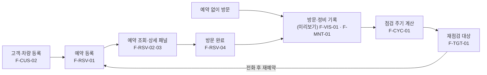
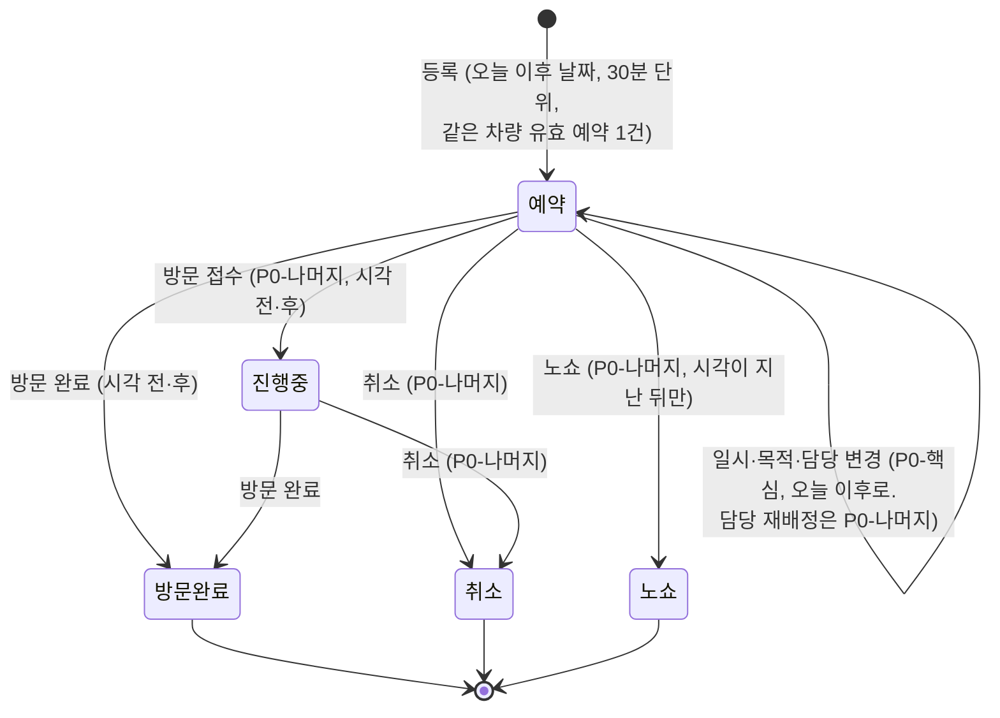
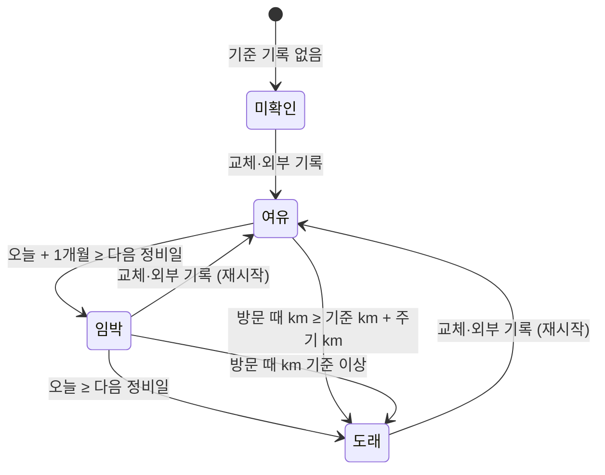

# 02 사용자 흐름·상태 전이

> 예약 → 방문 → 정비 기록 → 재점검 → 재예약 흐름, 상태값과 그 변화

상태: 작성됨 (2026-11-22 · 최은정(eunjung01230)), 2026-11-23 D-51~D-59 반영
근거: 04 기능 규칙, 05 정책, 08 상태 변경 요약, 시나리오 A·B (00 9장), 결정 D-51~D-59
화면 ID는 09, 기능 ID는 04를 따른다.

---

## 1. 전체 순환

**핵심 성공 조건**: 고객 등록 → 예약 → 예약 조회 → 방문·정비 이력 → 재점검 대상 → 재예약이 끊기지 않는다.

## 2. 흐름별 순서

### 2.1 신규 접수 (현장)

1. 차량이 들어오면 고객·차량 목록(S-05)에서 차량번호·연락처로 검색한다.
2. 없으면 신규 등록(M-01): 고객명·연락처·차량번호·차종, 동의는 고객에게 물어보고 체크. 연식·주행거리는 몰라도 되지만, 정비를 시작할 때(방문 접수 또는 첫 기록 저장) 비어 있으면 입력해야 한다(D-58).
3. 기존 고객의 새 차량이면 고객 상세(S-06)에서 차량만 추가한다.
4. 방문·정비 기록(S-08)으로 이동 → 2.4.

### 2.2 전화 예약

1. 홈(S-02)에서 "예약 등록"(M-02) → 차량번호·연락처로 검색.
2. 신규면 M-02 안에서 고객·차량을 먼저 등록(M-01)하고 돌아온다.
3. 날짜·시각(30분 단위)과 예약 목적(선택)을 넣고, **담당 정비사를 고른다**(기본 본인, 사장이면 사장 본인, D-51). P0-핵심에서는 예약을 등록한 사람이 담당으로 자동 지정되고, 담당 선택은 P0-나머지부터 된다. 같은 담당·같은 시작 시각에 유효 예약이 있으면 등록이 막히고 다른 시각·다른 담당을 고르게 안내한다(P0-나머지부터, 409 `MECHANIC_SLOT_CONFLICT`).
4. 같은 차량에 유효 예약이 있으면 등록이 막히고, 화면이 **기존 예약의 상세 패널을 열어** 준다. 고객과 통화하며 그 예약의 일시·목적을 확인하고 필요하면 변경한다(F-RSV-06, P0-핵심). 새 예약을 하나 더 만들지 않는다.
5. 등록되면 홈의 그 날짜 목록·캘린더(P0-나머지)에 나타난다. 그 차량이 재점검 대상이면 "예약 있음"이 붙는다.

### 2.3 예약 확인 (예약 상세 패널)

1. 홈(S-02)의 날짜별 예약 목록(오늘, 앞뒤 날짜 이동) 또는 캘린더(P0-나머지, 월·주)에서 예약을 고른다. 월 보기에서는 날짜를 눌러 그날 목록을 본 뒤 예약을 고른다.
2. 같은 화면 패널에 예약 목적·담당 정비사·고객·차량·최근 방문 2회·점검 주기 요약이 뜬다. 예약 목적 항목은 강조.
3. 이력이 더 필요하면 "상세 이동" → 차량 상세(S-07). 총 방문이 3회 이상일 때만 활성이다.
4. 차가 오면 "방문 접수"(P0-나머지) → 상태가 **진행중**이 된다. 차량에 연식·주행거리가 비어 있으면 이때 입력한다(D-58). 진행중이 아니어도 "방문 완료"로 바로 갈 수 있다.
5. "방문 완료" → 방문·정비 기록(S-08), 차량이 채워져 있다.

### 2.4 방문 중 안내와 기록 (시나리오 B)

1. S-08에서 주행거리를 입력하는 즉시 미리보기로 6개 항목 상태가 바뀌어 보인다(저장 안 됨). 방문 접수를 거치지 않아 차량의 연식·최근 주행거리가 비어 있으면 S-08에서 입력해야 저장된다(D-58).
2. km 기준을 넘은 항목은 "도래"(근거: 주행거리). 정비사가 고객에게 확인을 권한다.
3. 항목마다 구분을 고른다: 교체 / 점검(·결과 양호·주의, P0-나머지) / 거절(P0-나머지) / 외부(고객 진술, P0-나머지).
4. 저장하면 한 방문으로 묶인다. 교체·외부 항목은 주기가 다시 시작되고, 점검·거절 항목은 그대로다.

### 2.5 재점검과 재예약 (시나리오 A)

1. 홈(S-02)에서 "오늘 연락할 고객 N명"을 누르면 재점검 대상(S-04).
2. 도래가 있는 차량부터 보인다. "예약 있음"이 붙은 차량은 이미 예약된 것이니 건너뛴다.
3. 사장이 고객에게 전화한다(P1부터 문자 초안 복사·결과 기록).
4. 고객이 예약하면 그 줄에서 바로 예약 등록(M-02, 차량 채워짐) → "예약 있음".
5. 이미 다른 곳에서 했다고 하면 외부 정비로 기록(P0-나머지) → 주기 재시작, 목록에서 빠짐.
6. 예약일에 방문 → 2.3·2.4 → 교체 기록 → 그 항목이 목록에서 빠진다.

### 2.6 지난 예약 정리

1. 시각이 지났는데 상태가 "예약"이면 목록·캘린더·홈에 "처리 필요".
2. 왔으면 방문 완료(→ 기록), 미리 연락하고 안 왔으면 취소, 연락 없이 안 왔으면 노쇼(P0-나머지).
3. 처리 안 된 지난 예약(날짜 < 오늘, 상태 "예약")은 유효 예약으로 세지 않아 "예약 있음"이 붙지 않고, 그 차량에 새 예약을 잡을 수 있다. 진행중 예약은 날짜와 무관하게 유효 예약이다.
4. 이미 끝난 예약(완료·취소·노쇼)이나 날짜가 지난 예약의 입력 오류는 **정정**한다(F-RSV-10, P0-나머지). 상태 정정(취소↔노쇼, 취소·노쇼→완료)은 사장만, 메모 정정은 사장 또는 담당 정비사(예약 날짜 + 3일 이내). 완료는 취소·노쇼로 되돌리지 않는다. 모든 정정은 이력에 남는다.

### 2.7 정비소 도입 (서비스 관리자, P1)

1. 정비소 사장이 전화·문의로 이용을 신청한다(신청 접수 화면은 P2).
2. 서비스 관리자가 정비소를 만들고 사장 계정을 임시 비밀번호로 발급한다(기본 기준표 6행 함께).
3. 사장이 첫 로그인에서 비밀번호를 바꾸고, 정비사 계정과 기준표를 설정한다.
4. 이후 서비스 관리자는 정비소 목록에서 이용 중/정지만 관리한다. P0 시연은 시드 정비소·시드 계정.

### 2.8 정비 기록 수정 (P0-나머지, D-55)

1. 차량 상세(S-07)의 정비 이력 줄에서 "수정"을 누른다(M-03). 사장은 모든 기록, 정비사는 본인이 담당한 기록만 수정할 수 있고, 정비사는 방문일 기준 3일이 지나면 "수정" 버튼이 비활성이다(외부 기록은 저장일 기준).
2. 방문일·주행거리·구분·항목·점검 결과·메모·담당 정비사를 고친다. 차량은 바꿀 수 없다. 사유는 선택이다. 삭제는 없다.
3. 저장하면 수정 이력이 남고 그 줄에 "수정됨" 꼬리표가 붙는다. 꼬리표를 누르면 수정 날짜·수정자·바뀐 항목(`항목명: 전 → 후`)을 볼 수 있다.
4. 점검 주기 상태는 저장하지 않으므로, 수정한 날짜·구분이 바로 다음 정비일·상태·재점검 대상에 반영된다.

## 3. 상태 전이

### 3.1 예약 상태

| 상태 | 값 | 보이는 표시 | 다음 |
|---|---|---|---|
| 예약 | `RESERVED` | 시각 전: 예약 / 시각 지남: **처리 필요** | 방문 접수·방문 완료·변경(재배정 포함)·취소·노쇼 |
| 진행중 | `IN_PROGRESS` (P0-나머지) | 진행중 (처리 필요로 표시하지 않음) | 방문 완료·취소 (변경·재배정·노쇼 불가) |
| 방문 완료 | `COMPLETED` | 방문 완료 | 없음 (상태 정정 불가: 취소·노쇼로 되돌리지 않음. 메모만 정정) |
| 취소 | `CANCELED` | 취소 | 없음 (정정: 노쇼·완료로) |
| 노쇼 | `NO_SHOW` (P0-나머지) | 노쇼 | 없음 (정정: 취소·완료로) |

- **유효 예약** = 상태 "예약" + 예약 날짜 ≥ 오늘, 또는 "진행중". 같은 차량에는 유효 예약이 1건만 있을 수 있다(D-22). 진행중 예약은 담당 정비사의 그 시작 시각을 계속 점유한다.
- **변경·재배정은 상태 "예약"만** 가능하다. 진행중·끝난 상태·지난 날짜의 예약은 일시·고객·차량·담당을 바꿀 수 없다. 재배정은 전날까지(사장만 당일 예외, 사유 필수)이다(D-53).
- **정정(F-RSV-10, P0-나머지)**: 지난 예약과 끝난 상태의 예약은 상태·메모만 정정한다. 허용: 취소↔노쇼, 취소·노쇼→완료(사장), 메모(사장·담당 정비사). 완료→취소·노쇼는 불가. 허용표 전체는 04 F-RSV-10. 정정은 위 도표의 화살표(일반 흐름)가 아니라 이력을 남기는 별도 절차다.
- "처리 필요"와 "예약 있음"은 저장하지 않는 표시다. 끝난 상태는 일반 흐름에서 되돌리지 않는다. 두 직원이 같은 예약을 동시에 바꾸면 먼저 저장한 쪽만 반영되고, 나중 쪽은 "다른 직원이 먼저 수정했습니다"(409)를 받고 최신 내용을 다시 본다(D-42).

### 3.2 항목의 점검 주기 상태

저장하지 않고 볼 때마다 계산한다. 날짜가 지나면 기록이 없어도 상태가 바뀐다.

- 점검·거절 기록은 상태를 바꾸지 않는다(화살표 없음).
- P1부터 주행거리 기록이 2회 이상이면 다음 정비일에 월평균 추정이 반영되어, 방문 전에도 km 때문에 임박·도래가 될 수 있다.

### 3.3 표시 (P0-나머지)

| 표시 | 생기는 때 | 사라지는 때 | 상태에 영향 |
|---|---|---|---|
| 지난 방문 거절(날짜) | 그 항목의 가장 최근 기록이 기준 기록 이후의 거절 | 같은 항목이 다시 기록됨 | 없음 |
| 지난 점검 주의(날짜·메모) | 그 항목의 가장 최근 기록이 점검·주의 | 같은 항목이 다시 기록됨 | 없음 |
| 예약 있음(일시) | 차량에 유효 예약(예약 + 예약 날짜 ≥ 오늘, 또는 진행중) | 방문 완료·취소·노쇼, 또는 예약 날짜가 지남(진행중 제외) | 없음 (대상 목록에 남음) |

### 3.4 정비소 상태 (P1)

| 상태 | 값 | 로그인 | 데이터 |
|---|---|---|---|
| 이용 중 | `ACTIVE` | 가능 | 유지 |
| 정지 | `SUSPENDED` | 불가 (`SHOP_SUSPENDED`) | 유지 |

### 3.5 연락 (P1)

재점검 대상 → (문자 초안 복사·열기) → 사장이 발송 → 결과 기록 → "연락함(날짜)" 표시. "예약함"이면 예약 등록, "이미 정비함"이면 외부 정비 기록으로 이어진다. 결과 값은 6개(예약함·부재·이미 정비함·연락함·번호 오류·연락 거부, 04 F-CON-02)이고, "연락 거부"는 동의 해제를 확인하는 대화상자를 띄운다(자동 해제 아님). "연락함(날짜)" 꼬리표는 30일 💡 유지한다(D-59).
