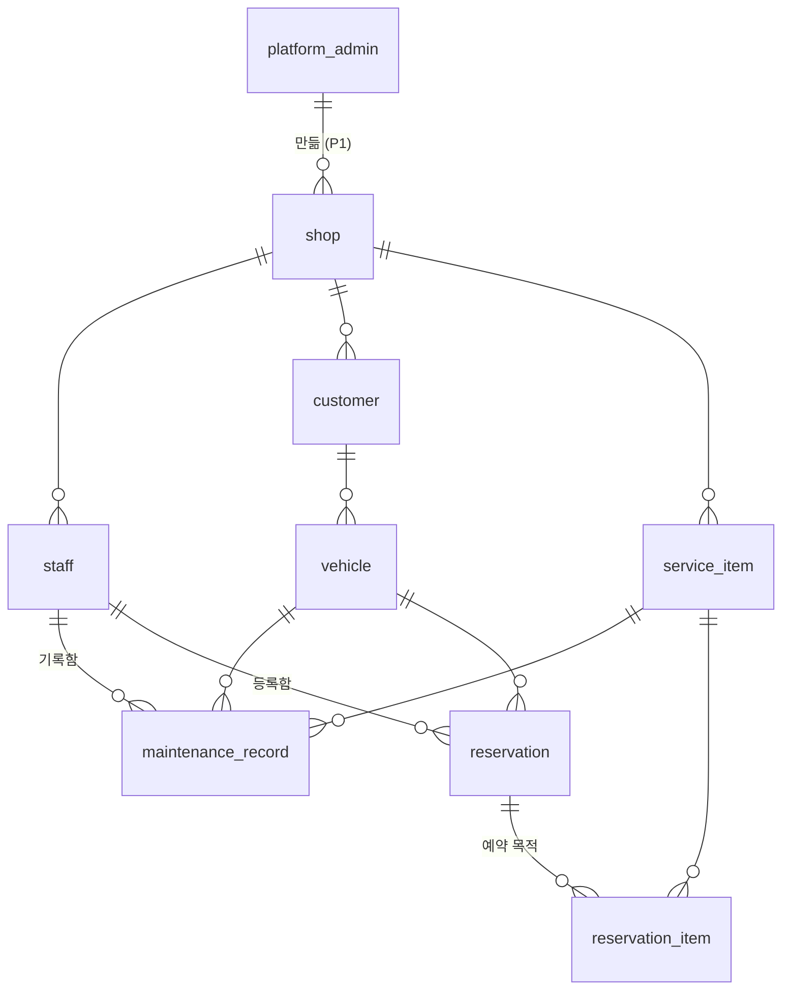

# 07 ERD · DB 설계서

> 테이블·관계·제약조건·격리 규칙·시드 구성 — **테이블·컬럼·제약·격리 I-xx·시드표의 원본**

상태: 작성됨 (2026-11-22 · @하다) — 관문 1에서 확정. 확정 후 바꾸려면 `결정` 이슈 → 이 문서 + 13 changelog → 새 Flyway 버전 파일
근거: 00·04, 상세 기획안 v11 10장, 결정 D-04·D-05·D-07·D-11·D-17·D-21~D-27·D-36·D-38
DB: MySQL 8 (InnoDB, utf8mb4), Flyway. 💡 = 제안값

---

## 1. 원칙

- 원안 8개 테이블 + 예약 목적 연결 표 1개 = **9개**. 차례가 오지 않은 단계의 테이블·컬럼은 미리 만들지 않는다(4장).
- `platform_admin`을 뺀 모든 테이블은 정비소에 속한다. 고객·차량·정비 기록·예약·예약 목적은 `shop_id`를 **직접** 가진다(D-05).
- PK는 `BIGINT AUTO_INCREMENT`. 전화번호·차량번호를 키로 쓰지 않는다.
- 상태(미확인/여유/임박/도래), "예약 있음", "처리 필요", "지난 방문 거절", "지난 점검 주의"는 **저장하지 않는다**. 조회 때 계산한다.
- enum은 `VARCHAR` + `CHECK`로 둔다(값 추가가 쉬움) 💡. 값 이름은 08 API와 글자까지 같다.
- 시각은 `DATETIME`(초 없음, Asia/Seoul 기준) 💡, 날짜는 `DATE`.
- 모든 테이블에 `created_at`. 수정되는 표에만 `updated_at`.

## 2. ERD

## 3. 테이블

### 3.1 `platform_admin` — 서비스 관리자 (D-07)

| 컬럼 | 타입 | 제약 | 설명 |
|---|---|---|---|
| id | BIGINT | PK | |
| login_id | VARCHAR(50) | NOT NULL, UNIQUE | |
| password_hash | VARCHAR(100) | NOT NULL | BCrypt 💡 |
| name | VARCHAR(50) | NOT NULL | |
| created_at | DATETIME | NOT NULL | |

`shop_id`가 없다. 정비소 데이터로 가는 경로가 구조적으로 없다.

### 3.2 `shop` — 정비소

| 컬럼 | 타입 | 제약 | 설명 |
|---|---|---|---|
| id | BIGINT | PK | |
| name | VARCHAR(50) | NOT NULL | 문자 초안(P1)의 정비소명 |
| phone | VARCHAR(20) | NOT NULL | 문자 초안(P1)의 정비소 연락처 |
| status | VARCHAR(20) | NOT NULL, CHECK IN ('ACTIVE','SUSPENDED'), 기본 'ACTIVE' | 정지는 P1(F-ADM-02) |
| created_by_admin_id | BIGINT | NULL, FK → platform_admin.id | 시드 정비소는 NULL |
| created_at | DATETIME | NOT NULL | |

### 3.3 `staff` — 사장·정비사 계정

| 컬럼 | 타입 | 제약 | 설명 |
|---|---|---|---|
| id | BIGINT | PK | |
| shop_id | BIGINT | NOT NULL, FK → shop.id | |
| login_id | VARCHAR(50) | NOT NULL, UNIQUE | 정비소를 넘어 전체에서 유일 💡 |
| password_hash | VARCHAR(100) | NOT NULL | |
| name | VARCHAR(50) | NOT NULL | |
| role | VARCHAR(20) | NOT NULL, CHECK IN ('OWNER','MECHANIC') | |
| password_change_required | BOOLEAN | NOT NULL, 기본 FALSE | 임시 비밀번호 계정 (P1에서 사용) |
| created_at | DATETIME | NOT NULL | |

`login_id`는 `platform_admin`과 겹쳐도 된다(로그인 API가 다르다, 08).

### 3.4 `customer` — 고객

| 컬럼 | 타입 | 제약 | 설명 |
|---|---|---|---|
| id | BIGINT | PK | |
| shop_id | BIGINT | NOT NULL, FK → shop.id | |
| name | VARCHAR(50) | NOT NULL | |
| phone | VARCHAR(20) | NOT NULL | 숫자·하이픈 💡. 중복 허용 |
| consent | BOOLEAN | NOT NULL, 기본 FALSE | 안내 수신 동의 (D-11). "연락 가능 여부" 칸은 두지 않음 (D-25) |
| created_at | DATETIME | NOT NULL | |
| updated_at | DATETIME | NOT NULL | |

인덱스: (shop_id, phone), (shop_id, name) 💡

### 3.5 `vehicle` — 차량 (고객 1:N)

| 컬럼 | 타입 | 제약 | 설명 |
|---|---|---|---|
| id | BIGINT | PK | |
| shop_id | BIGINT | NOT NULL, FK → shop.id | 고객의 `shop_id`와 같아야 함 (I-2) |
| customer_id | BIGINT | NOT NULL, FK → customer.id | |
| plate_number | VARCHAR(20) | NOT NULL | 공백 제거. **중복 허용** (UNIQUE 없음) |
| model | VARCHAR(50) | NULL | 차종 |
| model_year | SMALLINT | NULL | 연식 |
| latest_mileage | INT | NULL, CHECK ≥ 0 | 최근 주행거리. 등록 때 입력 또는 방문 기록으로 갱신 |
| created_at | DATETIME | NOT NULL | |
| updated_at | DATETIME | NOT NULL | |

인덱스: (shop_id, plate_number), (customer_id)

### 3.6 `service_item` — 정비 항목·주기 (정비소별)

| 컬럼 | 타입 | 제약 | 설명 |
|---|---|---|---|
| id | BIGINT | PK | |
| shop_id | BIGINT | NOT NULL, FK → shop.id | |
| code | VARCHAR(30) | NOT NULL | 아래 6개. UNIQUE(shop_id, code) |
| name | VARCHAR(30) | NOT NULL | 화면 표시명 |
| cycle_months | SMALLINT | NOT NULL, CHECK > 0 | |
| cycle_km | INT | NOT NULL, CHECK > 0 | |
| active | BOOLEAN | NOT NULL, 기본 TRUE | 끄기·켜기는 P1(F-ITEM-01) |
| sort_order | SMALLINT | NOT NULL | 표시 순서, 도면 위치와 연결 |

기본 기준표 (D-01) — 정비소마다 이 6행을 가진다:

| code | name | cycle_months | cycle_km | sort_order |
|---|---|---|---|---|
| ENGINE_OIL | 엔진오일 | 6 | 10000 | 1 |
| AIR_CLEANER | 에어클리너 | 12 | 15000 | 2 |
| AC_FILTER | 에어컨필터 | 6 | 10000 | 3 |
| BRAKE_PAD | 브레이크패드 | 12 | 20000 | 4 |
| TIRE | 타이어 상태 점검 | 6 | 10000 | 5 |
| BATTERY | 배터리 | 36 | 60000 | 6 |

### 3.7 `maintenance_record` — 정비 기록 (항목마다 1행, D-04)

| 컬럼 | 타입 | 제약 | 설명 |
|---|---|---|---|
| id | BIGINT | PK | |
| shop_id | BIGINT | NOT NULL, FK → shop.id | |
| vehicle_id | BIGINT | NOT NULL, FK → vehicle.id | |
| service_item_id | BIGINT | NOT NULL, FK → service_item.id | |
| visit_key | CHAR(36) | NOT NULL | 한 번 저장한 방문의 묶음 번호(UUID) 💡 |
| record_date | DATE | NOT NULL | 방문일. 외부는 고객이 말한 정비일 |
| mileage | INT | NULL, CHECK ≥ 0 | 방문 주행거리. 외부는 확인 가능할 때만 |
| record_type | VARCHAR(20) | NOT NULL, CHECK IN ('REPLACE','INSPECT','EXTERNAL','DECLINE') | 교체·점검·외부·거절 (D-06). 4개 모두 P0-핵심부터 |
| source | VARCHAR(20) | NOT NULL, CHECK IN ('SHOP','CUSTOMER_STATEMENT') | EXTERNAL이면 CUSTOMER_STATEMENT, 나머지는 SHOP |
| staff_id | BIGINT | NOT NULL, FK → staff.id | 저장한 계정 💡 |
| memo | VARCHAR(200) | NULL | |
| created_at | DATETIME | NOT NULL | 같은 날 기록끼리의 순서 |

- CHECK: `(record_type = 'EXTERNAL') = (source = 'CUSTOMER_STATEMENT')`
- 인덱스: (vehicle_id, service_item_id, record_date), (shop_id, visit_key)
- 수정·삭제하지 않는다(정정은 P2). `updated_at` 없음.
- **P0-나머지에 추가 (D-36)**: `inspect_result VARCHAR(20) NULL, CHECK IN ('GOOD','CAUTION')` + CHECK `inspect_result IS NULL OR record_type = 'INSPECT'`. 새 버전 파일로 더한다.

### 3.8 `reservation` — 예약

| 컬럼 | 타입 | 제약 | 설명 |
|---|---|---|---|
| id | BIGINT | PK | |
| shop_id | BIGINT | NOT NULL, FK → shop.id | |
| vehicle_id | BIGINT | NOT NULL, FK → vehicle.id | |
| reserved_at | DATETIME | NOT NULL | 30분 단위 (D-21). 서버 검증 + CHECK `MINUTE(reserved_at) IN (0,30)` 💡 |
| status | VARCHAR(20) | NOT NULL, CHECK IN ('RESERVED','COMPLETED','CANCELED') | P0-나머지에 'NO_SHOW' 추가 (D-27) |
| purpose_other | BOOLEAN | NOT NULL, 기본 FALSE | 예약 목적 "기타" (D-38) |
| purpose_memo | VARCHAR(200) | NULL | 예약 목적 메모 |
| created_by_staff_id | BIGINT | NOT NULL, FK → staff.id | |
| version | INT | NOT NULL, 기본 0 | 동시 수정 확인(JPA `@Version`). 바뀔 때마다 1 증가 (D-42) |
| created_at | DATETIME | NOT NULL | |
| updated_at | DATETIME | NOT NULL | |

- 인덱스: (shop_id, reserved_at), (vehicle_id, status, reserved_at)
- "같은 차량 진행 중 1건"(D-22)은 서버에서 확인한다. 날짜 조건이 들어가 DB 유일 제약으로 막지 않는다. 동시 요청까지 막는 것은 P2.
- 정비 기록과 잇는 컬럼은 없다. 방문 완료 → 정비 기록은 화면 이동이다.

### 3.9 `reservation_item` — 예약 목적으로 고른 항목 (D-38)

| 컬럼 | 타입 | 제약 | 설명 |
|---|---|---|---|
| id | BIGINT | PK | |
| shop_id | BIGINT | NOT NULL, FK → shop.id | |
| reservation_id | BIGINT | NOT NULL, FK → reservation.id | |
| service_item_id | BIGINT | NOT NULL, FK → service_item.id | |

UNIQUE(reservation_id, service_item_id). 예약을 변경하면(P0-나머지) 이 행들을 지우고 다시 넣는다 💡.

## 4. 나중에 추가할 것 (지금 만들지 않음)

| 단계 | 추가 | 내용 |
|---|---|---|
| P0-나머지 | `maintenance_record.inspect_result` | 3.7 |
| P0-나머지 | `reservation.status`에 `NO_SHOW` | 3.8 |
| P0-나머지 | `customer.version`, `vehicle.version` | 고객·차량 수정(F-CUS-06)을 만들 때 동시 수정 확인용 (POL-124) |
| P1 | 연락 기록 표 💡 `contact_log` | shop_id, customer_id, result(❓ 값 목록), memo, contacted_at, staff_id. F-CON-02 착수 때 |
| P1 | `staff` 알림 시간 컬럼 | F-NTF-01 저장 위치를 `staff`로 정할 때만 |
| P2 | 방문 테이블 분리, 동의 이력, 노쇼 관리 등 | 상세 기획안 13장 |

## 5. 격리 규칙 (I-xx)

| ID | 규칙 | 지키는 곳 |
|---|---|---|
| I-1 | 정비소 데이터 테이블은 모두 `shop_id NOT NULL` | 이 문서, 마이그레이션 |
| I-2 | 자식의 `shop_id`는 부모의 `shop_id`와 같다 (차량↔고객, 기록·예약↔차량, 예약 목적↔예약) | 저장 전 `getOwned(shopId, id)`로 부모를 먼저 찾아서 그 `shop_id`를 씀 |
| I-3 | 정비소 데이터 조회는 모두 토큰의 `shop_id` 조건을 건다. 요청 값의 `shop_id`는 쓰지 않는다 | Repository `…AndShopId`, X8 |
| I-4 | 없거나 남의 것이면 같은 404 | `getOwned`, X1~X6 |
| I-5 | `platform_admin`에는 `shop_id`가 없고, 관리자 토큰으로는 정비소 테이블을 조회할 경로가 없다 | SecurityConfig, X9 |

## 6. 마이그레이션 계획 (Flyway)

| 버전 💡 | 단계 | 내용 |
|---|---|---|
| `V1__init.sql` | P0-핵심 (`기반` 이슈) | 9개 테이블, 제약, 인덱스 |
| `V2__…` | P0-나머지 | `inspect_result`, `NO_SHOW`, `customer.version`·`vehicle.version` |
| 이후 | P1 | 연락 기록 등 |

마이그레이션은 `chagok-backend/src/main/resources/db/migration/`에만 두고 DB 담당자가 작성한다. 시연 데이터는 마이그레이션이 아니다(7장). 운영용 기본 기준표는 정비소를 만들 때 서버가 넣는다(P1, F-ADM-01).

## 7. 시드 구성 (시연·테스트)

시연 데이터 정책 (D-43·D-44):

| 항목 | 규칙 |
|---|---|
| 위치 | `chagok-backend/db/seed/demo_seed.sql` (classpath 밖. 서버·Flyway가 읽지 않는다) |
| 넣는 곳 | 시연 전용 DB 💡 `chagok_demo`에만. 개발·운영 DB에는 넣지 않는다 |
| 실행 | `db/seed/run-demo-seed.sh`로만. DB 이름(`_demo`), Flyway 적용 여부, 빈 DB인지 확인하고 아니면 거부 |
| 다시 넣기 | 시드는 지우지 않는다(`DELETE`·`TRUNCATE`·`DROP`·`ALTER`·`CREATE`·`UPDATE` 금지). 시연 DB를 새로 만들고 Flyway 적용 → 시드 순서로 다시 한다 |
| 작성 | ERD 확정과 `V1__init.sql` 뒤 DB 담당자 |
| 날짜 | 모두 **오늘(D) 기준 상대값**. 경계에서 1주 이상 떨어뜨리고, 월말·윤년은 시드에 쓰지 않는다(T6·T7은 단위 테스트) |

### 7.1 정비소·계정

| 정비소 | 이름 | 계정 |
|---|---|---|
| A | 차곡카센터 (02-0000-0001) | 사장 1, 정비사 1 |
| B | 바른카센터 (02-0000-0002) | 사장 1 |
| — | — | 서비스 관리자 1 (`platform_admin`) |

| 시연 계정 💡 | 역할 | 비밀번호 |
|---|---|---|
| `owner_a` | A 정비소 사장 | `1234` |
| `mech_a` | A 정비소 정비사 | `1234` |
| `owner_b` | B 정비소 사장 | `1234` |
| `admin` | 서비스 관리자 | `1234` |

시연 DB에만 있다. 비밀번호는 BCrypt 해시로 넣고, `password_change_required = false`(첫 로그인 변경 강제 안 함). 운영 환경에는 만들지 않는다 (D-44, 05 POL-17).

### 7.2 A 정비소 고객·차량과 기대 상태

"교체 D-6M-7d"는 오늘에서 6개월 전보다 7일 더 이전. 항목을 적지 않은 나머지 항목은 미확인.

| 고객 (동의) | 차량 | 기록 | 기대 (개월 기준) | 대상 목록 | 단계별 확인 |
|---|---|---|---|---|---|
| 김민수 010-0000-0001 (Y) | 12가0001 | 엔진오일 교체 D-6M-7d (40,000km), 엔진오일 점검 D-2M | 엔진오일 도래 | ○ | T12 (점검은 기준이 아님) |
| 이영희 010-0000-0002 (Y) | 34나0002 | 엔진오일 교체 D-6M-10d | 엔진오일 도래 | ○ 예약 있음 (D+2일 10:00) | D-13 |
| 박철수 010-0000-0003 (Y) | 56다0003 | 브레이크패드 교체 D-12M+20d | 브레이크패드 임박 (다음 정비일 D+20일) | ○ | |
| 최지은 010-0000-0004 (Y) | 78라0004 | 엔진오일 교체 D-2M (45,000km) | 엔진오일 여유 | × | 시나리오 B: 주행거리 55,000 입력 → 도래 |
| 정우성 010-0000-0005 (Y) | 90마0005 | 없음 | 전부 미확인 | × | T1 |
| 한가람 010-0000-0006 (Y) | 11바0006 | 엔진오일 교체 D-8M, 엔진오일 거절 D-1M | 엔진오일 도래 | ○ | P0-나머지부터 "지난 방문 거절" |
| 서민준 010-0000-0007 (Y) | 22사0007 | 에어컨필터 교체 D-13M, 에어컨필터 외부 D-1M (고객 진술) | 에어컨필터 여유 | × | 외부로 재시작 |
| 윤하늘 010-0000-0008 (Y) | 33아0008 | 타이어 교체 D-6M+20d, 타이어 점검 D-2M | 타이어 임박 | ○ | P0-나머지부터 점검 결과 "주의" + 메모 (V2 이후 시드에 반영) |
| 장미래 010-0000-0009 (**N**) | 44자0009 | 엔진오일 교체 D-7M | 엔진오일 도래 | × (미동의) | |
| 오세훈 010-0000-0010 (Y) | 55차0010 | 배터리 교체 D-36M+20d, 엔진오일 교체 D-1M, 에어클리너 교체 D-3M, 에어컨필터 교체 D-3M | 배터리 임박 | ○ | 이력 많은 차량 (방문 3회 이상) |
| 〃 | 66카0011 | 없음 | 전부 미확인 | × | 한 고객 여러 차량 |

차종·연식·최근 주행거리는 08 JSON 예시와 같게 넣는다: 78라0004 K5·2020·45,000km, 55차0010 쏘나타·2018·97,000km, 90마0005 아반떼·2019. 그 밖은 비워도 된다.

### 7.3 A 정비소 예약

| 차량 | 일시 | 상태 | 예약 목적 | 확인 |
|---|---|---|---|---|
| 78라0004 | 오늘 10:00 | 예약 | 엔진오일 | 오늘 예약, 시나리오 B 시작점 |
| 22사0007 | 오늘 14:30 | 예약 | 기타 + 메모 "에어컨 냄새" | 오늘 예약 |
| 34나0002 | D+2일 10:00 | 예약 | 엔진오일 | "예약 있음" |
| 55차0010 | 어제 15:00 | 예약 | 배터리 | **처리 필요** (D-23), "예약 있음"으로 세지 않음 |

### 7.4 B 정비소

| 고객 | 차량 | 기록 | 확인 |
|---|---|---|---|
| 강동원 010-0000-0101 (Y) | **12가0001** (A의 김민수와 같은 번호) | 엔진오일 교체 D-7M | A에서 검색해도 안 보임 (X7), A 토큰으로 id 조회 시 404 (X1·X2) |

### 7.5 시드 기대값 (매일 마감 전 확인용)

| 항목 | 기대값 |
|---|---|
| 홈 "오늘 예약" | 2건 |
| 홈 "오늘 연락할 고객" | 5명 (김민수·박철수·한가람·윤하늘·오세훈) |
| 재점검 대상 목록 | 6대 (위 5명의 차량 + 이영희 34나0002 "예약 있음") |
| A 정비소 고객 수 | 10명, 차량 11대 |

시드는 `chagok-seed-data` 스킬로 만들고(`demo_seed.sql`), 기대값이 바뀌면 이 절과 08 JSON 예시를 같이 고친다.
