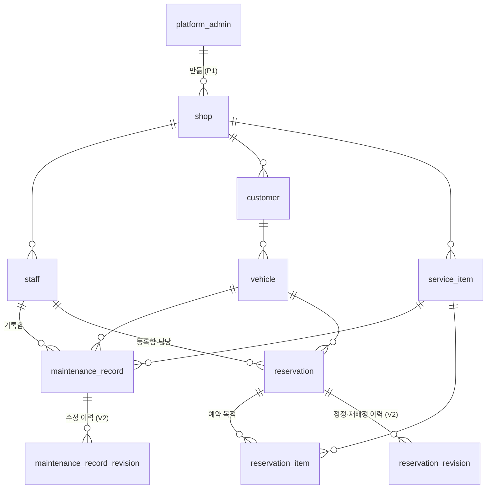

# 07 ERD · DB 설계서

> 테이블·관계·제약조건·격리 규칙·시드 구성 — **테이블·컬럼·제약·격리 I-xx·시드표의 원본**

상태: 작성됨 (2026-11-22 · 최은정(eunjung01230)) — M1 설계 확정(2026-11-23, chagok-docs#46). 확정 후 바꾸려면 `결정` 이슈 → 이 문서 + 13 changelog → 새 Flyway 버전 파일. 2026-11-23 D-60~D-63 반영(chagok-docs#65): 약관 동의 기록 표는 **초안(4.4), DB 담당자 검토 전**이며 마이그레이션을 만들지 않았다
근거: 00·04, 상세 기획안 v11 10장, 결정 D-04·D-05·D-07·D-11·D-17·D-21~D-27·D-36·D-38·D-42, **D-51~D-59(2026-11-23 회의 결정: 담당 정비사·진행중·지난 예약 정정·정비 기록 수정·삭제·보관·역할 개정·필수 입력·P1 미결 확정)**, M1 결정 A~D (13 changelog, chagok-docs#12), D-60~D-63 (계정·약관·세부 정책, chagok-docs#65)
DB: MySQL 8 (InnoDB, utf8mb4), Flyway. 💡 = 제안값(M1 설계 확정 chagok-docs#46에서 P0-핵심 15건 확정, 💡 해제)

---

## 1. 원칙

- 원안 8개 테이블 + 예약 목적 연결 표 1개 = **9개**(V1). P0-나머지(V2)에서 이력 표 2개(`maintenance_record_revision`·`reservation_revision`)가 더해진다. 차례가 오지 않은 단계의 테이블·컬럼은 미리 만들지 않는다(4장. 예외: D-73 `shop.brn`·`shop.shop_address`, 3.2).
- `platform_admin`을 뺀 모든 테이블은 정비소에 속한다. 고객·차량·정비 기록·예약·예약 목적(V2의 이력 표 2개도)은 `shop_id`를 **직접** 가진다(D-05).
- PK는 `BIGINT AUTO_INCREMENT`. 전화번호·차량번호를 키로 쓰지 않는다.
- 상태(미확인/여유/임박/도래), "예약 있음", "처리 필요", "지난 방문 거절", "지난 점검 주의"는 **저장하지 않는다**. 조회 때 계산한다.
- enum은 `VARCHAR` + `CHECK`로 둔다(값 추가가 쉬움). 값 이름은 08 API와 글자까지 같다.
- 시각은 `DATETIME`(소수 초 없음 = 정밀도 0, Asia/Seoul 기준, M1 설계 확정 15번: 오프셋 없는 형식), 날짜는 `DATE`. 예약 시각만 초를 00으로 강제한다(3.8).
- 모든 테이블에 `created_at`. 수정되는 표에만 `updated_at`. 정비 기록(`maintenance_record`)도 F-MNT-04(D-55)로 수정되므로 `updated_at`·`version`을 가진다(P0-나머지, V2).
- **생성·수정 시각은 서버가 넣는다 (M1 설계 확정).** `created_at`은 최초 생성 시각, `updated_at`은 생성 때도 같은 값으로 넣고 실제로 수정될 때 갱신한다. 값은 JPA Auditing이 넣고, Auditing의 시간 공급자(`DateTimeProvider`)는 주입한 `Clock` 빈(Asia/Seoul)을 쓴다. 두 칼럼은 `NOT NULL`이고 **DB `DEFAULT`·`CURRENT_TIMESTAMP`·`ON UPDATE`를 쓰지 않는다**(DB 세션 시간대와 서버 `Clock`이 어긋나지 않게). 시드는 시각을 직접 적는다(7장). 예약 `version`은 시각과 별개로 `@Version`이 관리한다.
- **정비소 일치는 두 겹으로 지킨다 (M1 결정 A).** ① 서버가 저장 전 부모를 `getOwned(shopId, id)`로 찾는다(없거나 남의 것이면 404). ② DB는 핵심 부모·자식 관계를 **복합 FK** `(shop_id, 부모_id) → 부모(shop_id, id)`로 묶어, 서버 검증이 빠져도 다른 정비소 부모를 가리키는 행이 저장되지 않게 한다. 복합 FK의 부모 쪽에는 `UNIQUE(shop_id, id)`를 둔다(MySQL 8.4부터 FK는 UNIQUE·PK 키만 참조할 수 있다). 대상 관계와 이유는 5.1.
- 삭제는 이력(정비 기록·예약)이 없는 고객과 그 고객의 이력 없는 차량에 한해, 서버가 자식부터 지운다(05 POL-39, P1, D-56). 정비 기록은 삭제하지 않는다(수정은 F-MNT-04, POL-58). **FK의 삭제·수정 동작은 모두 기본값(`RESTRICT`)이고** `CASCADE`·`SET NULL`은 쓰지 않는다(`SET NULL`은 `shop_id NOT NULL`과 충돌).
- 고객 개인정보 파기(익명화, P1, D-56)는 고객 행을 지우지 않고 값을 바꾼다. `customer.phone`은 `NOT NULL`이라 익명화 값은 빈 문자열 `''`이고 이름은 "(삭제된 고객)"이다. 고객 행이 남으므로 `vehicle`의 복합 FK `(shop_id, customer_id)`는 그대로이고 차량 영구 보존이 구조적으로 성립한다.

## 2. ERD

`customer → vehicle`, `vehicle → maintenance_record·reservation`, `service_item → maintenance_record·reservation_item`, `reservation → reservation_item` 6개 관계와 정비사를 담당으로 가리키는 `staff → reservation`·`staff → maintenance_record` 2개, 합쳐 **V1의 8개 관계**는 `shop_id`를 함께 묶은 복합 FK다(5.1). V2의 이력 표 2개가 복합 FK 2개를 더한다(10개). 예약과 정비 기록 사이에는 선이 없다(3.8). 이력 표는 `staff`(수정자)도 가리킨다(4.1·4.2, 그림 생략).

## 3. 테이블

### 3.1 `platform_admin` — 서비스 관리자 (D-07)

| 컬럼 | 타입 | 제약 | 설명 |
|---|---|---|---|
| id | BIGINT | PK | |
| login_id | VARCHAR(50) | NOT NULL, UNIQUE | |
| password_hash | VARCHAR(100) | NOT NULL | BCrypt 💡 |
| name | VARCHAR(50) | NOT NULL | |
| created_at | DATETIME | NOT NULL | |

`shop_id`가 없다. 정비소 데이터로 가는 경로가 구조적으로 없다.

- **최초 서비스 관리자 (D-60 A01)**: 셀프 가입은 없다. 시연 DB는 시드의 `admin`(7.1). 시연이 아닌 환경의 첫 서비스 관리자 행은 DB 담당자가 환경별 안전한 초기화 절차로 넣는다(마이그레이션·시드·저장소에 비밀번호나 해시를 두지 않음). 절차 문서는 DB 담당자 후속 과제다.

### 3.2 `shop` — 정비소

| 컬럼 | 타입 | 제약 | 설명 |
|---|---|---|---|
| id | BIGINT | PK | |
| name | VARCHAR(50) | NOT NULL | 문자 초안(P1)의 정비소명 |
| phone | VARCHAR(20) | NOT NULL | 문자 초안(P1)의 정비소 연락처 |
| status | VARCHAR(20) | NOT NULL, CHECK IN ('ACTIVE','SUSPENDED'), 기본 'ACTIVE' | 정지는 P1(F-ADM-02) |
| created_by_admin_id | BIGINT | NULL, FK → platform_admin.id | 시드 정비소는 NULL |
| brn | VARCHAR(20) | NOT NULL, 기본 `''` (V2) | 사업자등록번호. 정비소 개설(F-ADM-01, P1)의 입력값. UNIQUE 없음(같은 사업자가 정비소를 여러 곳 낼 수 있음) |
| shop_address | VARCHAR(200) | NOT NULL, 기본 `''` (V2) | 정비소 주소. 정비소 개설(F-ADM-01, P1)의 입력값 |
| created_at | DATETIME | NOT NULL | |

`brn`·`shop_address`는 P1 입력값이지만 P0-나머지 V2에 미리 넣는다(D-73, 00 2장 예외). 기존 행과 시드 정비소는 `''`로 채워지고, DB는 NULL만 막는다. 값이 실제로 있는지와 형식은 서버가 검증하며, 그 규칙(필수 여부·형식)은 P1 정비소 개설 착수 PR에서 08 32와 함께 정한다(08 10장 ❓8). P0 코드(`Shop` 엔티티 매핑·API)는 두 칼럼을 쓰지 않는다.

### 3.3 `staff` — 사장·정비사 계정

| 컬럼 | 타입 | 제약 | 설명 |
|---|---|---|---|
| id | BIGINT | PK | |
| shop_id | BIGINT | NOT NULL, FK → shop.id | |
| login_id | VARCHAR(50) | NOT NULL, UNIQUE | 정비소를 넘어 전체에서 유일. P1 신규 계정(26·32)은 서버가 6~20자·`a-z0-9_`·소문자 시작으로 검증(D-60, 칼럼은 그대로) |
| password_hash | VARCHAR(100) | NOT NULL | |
| name | VARCHAR(50) | NOT NULL | |
| role | VARCHAR(20) | NOT NULL, CHECK IN ('OWNER','MECHANIC') | |
| password_change_required | BOOLEAN | NOT NULL, 기본 FALSE | 임시 비밀번호로 발급(26·32)·재발급(35·51)하면 TRUE, 첫 비밀번호 변경(24)에 FALSE (P1, D-60). 시드 시연 계정은 FALSE |
| created_at | DATETIME | NOT NULL | |

- UNIQUE(shop_id, id): 복합 FK 부모 키 (`reservation`의 담당·`maintenance_record`의 담당 정비사가 참조, 5.1). **V1**(D-51·D-57)
- **P1(V3)에 추가 (D-57)**: `active BOOLEAN NOT NULL DEFAULT TRUE` — 정비사 비활성화(F-STF-01). 삭제는 없다.
- 아침 알림 설정은 브라우저에 저장하므로(D-59) `staff`에 알림 시간 칼럼을 두지 않는다.

`login_id`는 `platform_admin`과 겹쳐도 된다(로그인 API가 다르다, 08). 신규 아이디 규칙은 `staff`에만 적용하고 `platform_admin`과의 중복 정책은 합치지 않는다(D-60). 시연 아이디(`owner_a`·`mech_a`·`owner_b`·`admin`)는 바꾸지 않는다.

- **계정 상태 확인 (P1, D-62)**: 보호된 정비소 요청마다 서버가 `staff`(V3 이후 `active` 포함)·`password_change_required`와 약관 동의 기록(4.4)을 읽는다(08 0.6). 토큰에는 이 상태를 넣지 않는다.

### 3.4 `customer` — 고객

| 컬럼 | 타입 | 제약 | 설명 |
|---|---|---|---|
| id | BIGINT | PK | |
| shop_id | BIGINT | NOT NULL, FK → shop.id | |
| name | VARCHAR(50) | NOT NULL | |
| phone | VARCHAR(20) | NOT NULL | 숫자·하이픈. 중복 허용 |
| consent | BOOLEAN | NOT NULL, 기본 FALSE | 안내 수신 동의 (D-11). "연락 가능 여부" 칸은 두지 않음 (D-25) |
| created_at | DATETIME | NOT NULL | |
| updated_at | DATETIME | NOT NULL | |

- UNIQUE(shop_id, id): 복합 FK 부모 키 (vehicle이 참조, 5.1). 정비소별 최근 등록순 목록(05 API)에도 쓰인다.
- 인덱스: (shop_id, phone), (shop_id, name) 💡
- **P1(V3)에 추가 (D-56)**: `status VARCHAR(20) NOT NULL DEFAULT 'ACTIVE' CHECK IN ('ACTIVE','INACTIVE','ANONYMIZED')`, `anonymized_at DATETIME NULL`. 익명화하면 이름 "(삭제된 고객)", `phone` 빈 문자열 `''`, `consent` 해제, `anonymized_at` 기록(1장).

### 3.5 `vehicle` — 차량 (고객 1:N)

| 컬럼 | 타입 | 제약 | 설명 |
|---|---|---|---|
| id | BIGINT | PK | |
| shop_id | BIGINT | NOT NULL, FK → shop.id | 고객의 `shop_id`와 같아야 함 (I-2) |
| customer_id | BIGINT | NOT NULL, FK (shop_id, customer_id) → customer(shop_id, id) | 복합 FK (5.1) |
| plate_number | VARCHAR(20) | NOT NULL | 공백 제거. **중복 허용** (UNIQUE 없음) |
| model | VARCHAR(50) | NULL | 차종. **서버 검증으로 필수**(D-58). DB는 NULL을 허용한다 |
| model_year | SMALLINT | NULL | 연식. 선택이지만 비어 있으면 정비 시작(방문 접수)·정비 기록 첫 저장 때 필수(D-58, 서버 검증). 범위(1980~현재 연도+1, D-63 B04)는 서버 검증만 (올해는 CHECK에 쓸 수 없음) |
| latest_mileage | INT | NULL, CHECK ≥ 0 | 최근 주행거리. 선택이지만 비어 있으면 정비 시작·정비 기록 첫 저장 때 필수(D-58). 등록 때 입력 또는 방문 기록으로 갱신. 상한 2,000,000은 서버 검증만(D-63 B03, DB CHECK는 ≥ 0 그대로) |
| created_at | DATETIME | NOT NULL | |
| updated_at | DATETIME | NOT NULL | |

- UNIQUE(shop_id, id): 복합 FK 부모 키 (maintenance_record·reservation이 참조)
- 인덱스: (shop_id, plate_number), (shop_id, customer_id) — 뒤의 것은 복합 FK 인덱스이자 고객의 차량 목록 조회용 (이전 `(customer_id)` 대체)
- **P1(V3)에 추가 (D-56)**: `active BOOLEAN NOT NULL DEFAULT TRUE` — 차량은 영구 보존이라 비활성화만 있다(이력 없는 차량은 이력 없는 고객 삭제 때 함께만 삭제).

### 3.6 `service_item` — 정비 항목·주기 (정비소별)

| 컬럼 | 타입 | 제약 | 설명 |
|---|---|---|---|
| id | BIGINT | PK | |
| shop_id | BIGINT | NOT NULL, FK → shop.id | |
| code | VARCHAR(30) | NOT NULL | 아래 6개. UNIQUE(shop_id, code) |
| name | VARCHAR(30) | NOT NULL | 화면 표시명 |
| cycle_months | SMALLINT | NOT NULL, CHECK > 0 | |
| cycle_km | INT | NOT NULL, CHECK > 0 | |
| active | BOOLEAN | NOT NULL, 기본 TRUE | 끄기·켜기는 P1(F-ITEM-01) |
| sort_order | SMALLINT | NOT NULL | 표시 순서, 도면 위치와 연결 |
| created_at | DATETIME | NOT NULL | 1장 원칙 "모든 테이블에 `created_at`" 반영 (M1 설계 확정). 수정(P1 F-ITEM-01) 때의 `updated_at`은 P1 착수 때 더한다 |

- UNIQUE(shop_id, code), UNIQUE(shop_id, id): 뒤의 것은 복합 FK 부모 키 (maintenance_record·reservation_item이 참조)

기본 기준표 (D-01) — 정비소마다 이 6행을 가진다:

| code | name | cycle_months | cycle_km | sort_order |
|---|---|---|---|---|
| ENGINE_OIL | 엔진오일 | 6 | 10000 | 1 |
| AIR_CLEANER | 에어클리너 | 12 | 15000 | 2 |
| AC_FILTER | 에어컨필터 | 6 | 10000 | 3 |
| BRAKE_PAD | 브레이크패드 | 12 | 20000 | 4 |
| TIRE | 타이어 상태 점검 | 6 | 10000 | 5 |
| BATTERY | 배터리 | 36 | 60000 | 6 |

### 3.7 `maintenance_record` — 정비 기록 (항목마다 1행, D-04)

| 컬럼 | 타입 | 제약 | 설명 |
|---|---|---|---|
| id | BIGINT | PK | |
| shop_id | BIGINT | NOT NULL, FK → shop.id | |
| vehicle_id | BIGINT | NOT NULL, FK (shop_id, vehicle_id) → vehicle(shop_id, id) | 복합 FK (5.1) |
| service_item_id | BIGINT | NOT NULL, FK (shop_id, service_item_id) → service_item(shop_id, id) | 복합 FK (5.1) |
| visit_key | CHAR(36) | NOT NULL | 한 번 저장한 방문의 묶음 번호(UUID). **서버가 저장 요청(API 12) 하나마다 새로 만든다.** 요청으로 받지 않고, 예약 번호와 잇지 않는다. 여러 행이 같은 값을 가지므로 UNIQUE 아님 |
| record_date | DATE | NOT NULL | 방문일. 외부는 고객이 말한 정비일 |
| mileage | INT | NULL, CHECK ≥ 0 | 방문 주행거리. 외부는 확인 가능할 때만 |
| record_type | VARCHAR(20) | NOT NULL, CHECK IN ('REPLACE','INSPECT','EXTERNAL','DECLINE') | 교체·점검·외부·거절 (D-06). CHECK 값 4개는 V1부터 있다. 입력은 P0-핵심 `REPLACE`·`INSPECT`, `EXTERNAL`·`DECLINE`은 P0-나머지부터(08 12, 13 2026-11-22). 시드(7.2)에는 4개가 모두 있어 P0-핵심 조회 응답에도 나온다 |
| source | VARCHAR(20) | NOT NULL, CHECK IN ('SHOP','CUSTOMER_STATEMENT') | EXTERNAL이면 CUSTOMER_STATEMENT, 나머지는 SHOP |
| staff_id | BIGINT | NOT NULL, FK (shop_id, staff_id) → staff(shop_id, id) | **담당 정비사**. P0-핵심은 저장한 계정(토큰), P0-나머지부터 요청의 `mechanicId`(기본: 예약의 담당 또는 로그인 계정, 05 POL-59). 요청 값이 될 수 있으므로 복합 FK (5.1, V1) |
| memo | VARCHAR(200) | NULL | |
| created_at | DATETIME | NOT NULL | 같은 날 기록끼리의 순서 (같으면 `id`가 큰 것이 나중) |

- CHECK: `(record_type = 'EXTERNAL') = (source = 'CUSTOMER_STATEMENT')`
- 인덱스: (shop_id, vehicle_id, service_item_id, record_date) — 주기 계산 조회이자 vehicle 복합 FK 인덱스 (이전 `(vehicle_id, service_item_id, record_date)` 앞에 `shop_id`를 붙임), (shop_id, service_item_id) — service_item 복합 FK 인덱스, (shop_id, staff_id) — staff 복합 FK 인덱스, (shop_id, visit_key)
- 한 저장 요청의 행은 모두 같은 `visit_key`·`vehicle_id`·`staff_id`다. `record_date`는 외부면 고객이 말한 정비일, 나머지는 방문일. `mileage`는 외부면 확인된 주행거리(없으면 NULL), 나머지는 방문 주행거리. 같은 방문에 같은 항목 두 번 불가(05 POL-57)는 서버가 검증한다(요청 안의 중복이고 `visit_key`를 다시 쓰지 않으므로 DB 제약을 두지 않음).
- **수정은 F-MNT-04로 한다. 삭제는 없다**(잘못 넣은 기록의 무효 처리는 후속 P2). V1에는 `updated_at`·`version`이 없고, P0-나머지(V2)부터 `updated_at`·`version`이 있으며 수정 전 값은 `maintenance_record_revision`에 남는다(4.1).
- **P0-나머지에 추가 (D-36)**: `inspect_result VARCHAR(20) NULL, CHECK IN ('GOOD','CAUTION')`(`ck_maintenance_record_inspect_result`) + CHECK `inspect_result IS NULL OR record_type = 'INSPECT'`(`ck_maintenance_record_inspect_result_record_type`). V1에는 만들지 않고 `V2`로 더한다(6장).
- **P0-나머지에 추가 (D-55)**: `updated_at DATETIME NOT NULL`, `version INT NOT NULL DEFAULT 0`, `UNIQUE(shop_id, id)`(이력 표의 복합 FK 부모 키), 이력 표 `maintenance_record_revision`. 모두 `V2`.

### 3.8 `reservation` — 예약

| 컬럼 | 타입 | 제약 | 설명 |
|---|---|---|---|
| id | BIGINT | PK | |
| shop_id | BIGINT | NOT NULL, FK → shop.id | |
| vehicle_id | BIGINT | NOT NULL, FK (shop_id, vehicle_id) → vehicle(shop_id, id) | 복합 FK (5.1) |
| reserved_at | DATETIME | NOT NULL | 30분 단위 (D-21). 서버 검증 + CHECK `MINUTE(reserved_at) IN (0,30) AND SECOND(reserved_at) = 0` (08 16 "분 00·30, 초 00") |
| status | VARCHAR(20) | NOT NULL, CHECK IN ('RESERVED','COMPLETED','CANCELED') | P0-나머지 V2에 **'IN_PROGRESS'**(진행중, D-52)·'NO_SHOW'(D-27) 추가. CHECK는 V2가 지우고 두 값과 함께 다시 만들 수 있게 이름을 붙인다(6장) |
| purpose_other | BOOLEAN | NOT NULL, 기본 FALSE | 예약 목적 "기타" (D-38) |
| purpose_memo | VARCHAR(200) | NULL | 예약 목적 메모 |
| assignee_staff_id | BIGINT | NOT NULL, FK (shop_id, assignee_staff_id) → staff(shop_id, id) | **담당 정비사**(D-51, 사장·정비사 모두 가능). P0-핵심은 서버가 예약 등록자(토큰의 계정)로 채운다(요청에 담당 필드 없음). P0-나머지부터 요청의 `assigneeId`로 고른다. 복합 FK (5.1, V1) |
| created_by_staff_id | BIGINT | NOT NULL, FK → staff.id | 토큰의 계정이라 단일 FK (5.1) |
| version | INT | NOT NULL, 기본 0 | 동시 수정 확인(JPA `@Version`). 바뀔 때마다 1 증가 (D-42). 변경(19)·방문 완료(18)·취소(20)·노쇼(21)·방문 접수(39)·정정(40) 모두 화면이 보낸 `version`을 이 값과 비교하고, 저장 때 `@Version`으로 다시 확인한다(M1 결정 B, 08 6장). 예약 목적 항목(`reservation_item`)만 바뀌어도 1 올린다. 실패한 요청은 이 값을 바꾸지 않는다 |
| created_at | DATETIME | NOT NULL | |
| updated_at | DATETIME | NOT NULL | |

- UNIQUE(shop_id, id): 복합 FK 부모 키 (reservation_item이 참조, V2부터 reservation_revision도 참조)
- 인덱스: (shop_id, reserved_at), (shop_id, vehicle_id, status, reserved_at) — 유효 예약 확인이자 vehicle 복합 FK 인덱스 (이전 `(vehicle_id, status, reserved_at)` 앞에 `shop_id`를 붙임), (shop_id, assignee_staff_id, reserved_at) — 담당 중복 확인이자 staff 복합 FK 인덱스
- "같은 차량 유효 예약 1건"(D-22)은 서버에서 확인한다. **유효 예약** = 상태 `RESERVED` + 예약 **날짜** ≥ 오늘, 또는 `IN_PROGRESS`(V2부터). 날짜 조건이 들어가 DB 유일 제약으로 막지 않는다. 동시 등록까지 막는 것은 P2.
- **담당 중복**(D-51, P0-나머지)은 서버에서 확인한다. 같은 `shop_id`·`assignee_staff_id`·`reserved_at`에 `RESERVED` 또는 `IN_PROGRESS` 예약이 자기 자신을 빼고 있으면 `MECHANIC_SLOT_CONFLICT`. 같은 시각 다른 담당은 허용한다. 상태 조건이 있어 DB 유일 제약은 두지 않는다. 동시 등록까지 막는 것은 P2.
- 정비 기록과 잇는 컬럼은 없다(M1 결정 C). 방문 완료 → 정비 기록은 화면 이동이고, 저장 순서·실패 처리는 05 POL-95.

### 3.9 `reservation_item` — 예약 목적으로 고른 항목 (D-38)

| 컬럼 | 타입 | 제약 | 설명 |
|---|---|---|---|
| id | BIGINT | PK | |
| shop_id | BIGINT | NOT NULL, FK → shop.id | |
| reservation_id | BIGINT | NOT NULL, FK (shop_id, reservation_id) → reservation(shop_id, id) | 복합 FK (5.1) |
| service_item_id | BIGINT | NOT NULL, FK (shop_id, service_item_id) → service_item(shop_id, id) | 복합 FK (5.1) |
| created_at | DATETIME | NOT NULL | 1장 원칙 반영 (M1 설계 확정) |

- UNIQUE(reservation_id, service_item_id)
- 인덱스: (shop_id, reservation_id), (shop_id, service_item_id) — 복합 FK 인덱스
- 예약을 변경하면(**P0-핵심**, F-RSV-06·D-42) 이 행들을 지우고 다시 넣는다 💡. JPA는 한 번의 flush에서 INSERT를 DELETE보다 먼저 보내므로, 같은 항목을 다시 넣으면 위 UNIQUE에 걸린다. 지우기를 먼저 실행(벌크 삭제 쿼리 또는 삭제 후 flush)한 뒤 넣는다.

## 4. 나중에 추가할 것 (지금 만들지 않음)

| 단계 (마이그레이션) | 추가 | 내용 |
|---|---|---|
| P0-나머지 (V2) | `maintenance_record.inspect_result` | 3.7 |
| P0-나머지 (V2) | `reservation.status`에 `IN_PROGRESS`·`NO_SHOW` | 3.8 (D-52·D-27) |
| P0-나머지 (V2) | `customer.version`, `vehicle.version` | 고객·차량 수정(F-CUS-06)을 만들 때 동시 수정 확인용 (POL-124) |
| P0-나머지 (V2) | `maintenance_record.updated_at`·`version`·`UNIQUE(shop_id, id)`, `maintenance_record_revision` | 정비 기록 수정 이력 (D-55), 4.1 |
| P0-나머지 (V2) | `reservation_revision` | 지난 예약 정정·담당 재배정 이력 (D-53), 4.2 |
| P0-나머지 (V2, P1 입력값 선반영) | `shop.brn`, `shop.shop_address` | 정비소 개설(F-ADM-01, P1)의 사업자등록번호·정비소 주소 (D-73), 3.2 |
| P1 (V3) | `customer.status`·`anonymized_at`, `vehicle.active`, `staff.active` | 고객·차량 비활성화·익명화, 정비사 비활성화 (D-56·D-57) |
| P1 (V3) | 연락 기록 표 💡 `contact_log` | 4.3. F-CON-02 착수 때 |
| P1 (V3 또는 별도 버전, **DB 담당자 결정**) | 약관 동의 기록 표 💡 `terms_agreement` | 4.4 초안. F-AUTH-04 착수 전 DB 담당자 검토 (D-61) |
| P2 | 방문 테이블 분리, 동의 이력, 노쇼 관리, **정비 기록 무효 처리** 등 | 상세 기획안 13장 |

### 4.1 `maintenance_record_revision` — 정비 기록 수정 이력 (P0-나머지, V2, D-55)

수정할 때마다 1행. 수정 후 값은 다음 이력의 `prev_*` 또는 현재 기록이다.

| 컬럼 | 타입 | 제약 | 설명 |
|---|---|---|---|
| id | BIGINT | PK | |
| shop_id | BIGINT | NOT NULL, FK → shop.id | |
| record_id | BIGINT | NOT NULL, FK (shop_id, record_id) → maintenance_record(shop_id, id) | 복합 FK (5.1) |
| revision_no | INT | NOT NULL | 기록별 1부터 |
| changed_by_staff_id | BIGINT | NOT NULL, FK → staff.id | 수정자. 토큰의 계정이라 단일 FK |
| reason | VARCHAR(200) | NULL | 수정 사유(선택) |
| prev_record_date | DATE | NOT NULL | 수정 전 값 |
| prev_mileage | INT | NULL | 수정 전 값 |
| prev_record_type | VARCHAR(20) | NOT NULL | 수정 전 값 |
| prev_service_item_id | BIGINT | NOT NULL | 수정 전 값 |
| prev_inspect_result | VARCHAR(20) | NULL | 수정 전 값 |
| prev_memo | VARCHAR(200) | NULL | 수정 전 값 |
| prev_staff_id | BIGINT | NOT NULL | 수정 전 담당 정비사 |
| created_at | DATETIME | NOT NULL | 수정 시각 |

- UNIQUE(record_id, revision_no), 인덱스 (shop_id, record_id) — `record_id` 복합 FK 인덱스, (changed_by_staff_id) — 수정자 FK 인덱스. 이름을 붙여 명시한다(6.1, 6.4).
- 스냅샷 칼럼 `prev_service_item_id`·`prev_staff_id`에는 FK를 걸지 않는다. 이미 복합 FK가 걸린 원본 행(`maintenance_record`)에서 복사한 값이고, `service_item`·`staff`는 삭제하지 않는다(5.1 "불필요한 제약을 늘리지 않음").

### 4.2 `reservation_revision` — 예약 정정·재배정 이력 (P0-나머지, V2, D-53)

| 컬럼 | 타입 | 제약 | 설명 |
|---|---|---|---|
| id | BIGINT | PK | |
| shop_id | BIGINT | NOT NULL, FK → shop.id | |
| reservation_id | BIGINT | NOT NULL, FK (shop_id, reservation_id) → reservation(shop_id, id) | 복합 FK (5.1) |
| kind | VARCHAR(20) | NOT NULL, CHECK IN ('STATUS','MEMO','ASSIGNEE') | 상태 정정·메모 정정·담당 재배정 |
| changed_by_staff_id | BIGINT | NOT NULL, FK → staff.id | 토큰의 계정이라 단일 FK |
| reason | VARCHAR(200) | NULL | 사유. 당일 재배정은 서버가 필수로 요구 |
| prev_status, new_status | VARCHAR(20) | NULL | `kind`가 해당하는 것만 채움 |
| prev_memo, new_memo | VARCHAR(200) | NULL | 〃 |
| prev_assignee_id, new_assignee_id | BIGINT | NULL | 〃 |
| created_at | DATETIME | NOT NULL | |

- 인덱스: (shop_id, reservation_id, created_at) — `reservation_id` 복합 FK 인덱스이자 API 41 이력 목록(시간순) 조회용, (changed_by_staff_id) — 수정자 FK 인덱스. 이름은 6.4.
- 번호 칼럼(`revision_no`)은 두지 않는다. 순서는 `created_at`, 같으면 `id`(API 41 응답에 번호 없음).
- CHECK: `kind` 값(`ck_reservation_revision_kind`), `kind = 'STATUS'`이면 `prev_status`·`new_status` NOT NULL, `kind = 'ASSIGNEE'`이면 `prev_assignee_id`·`new_assignee_id` NOT NULL(예약의 `status`·`assignee_staff_id`가 NOT NULL이라 이전·이후 값이 항상 있음). `kind = 'MEMO'`는 이전 메모가 NULL일 수 있어 CHECK로 막지 않고 서버가 검증한다. 다른 `kind`의 칼럼이 NULL인지도 서버가 검증한다.
- 스냅샷 칼럼 `prev_assignee_id`·`new_assignee_id`에는 FK를 걸지 않는다(4.1과 같은 이유. 새 담당은 예약 변경 때 `reservation`의 복합 FK로 이미 검사됨).

### 4.3 `contact_log` — 연락 기록 (P1, V3, D-59)

| 컬럼 | 타입 | 제약 | 설명 |
|---|---|---|---|
| id | BIGINT | PK | |
| shop_id | BIGINT | NOT NULL, FK → shop.id | |
| customer_id | BIGINT | NOT NULL, FK (shop_id, customer_id) → customer(shop_id, id) | 복합 FK (5.1) |
| result | VARCHAR(20) | NOT NULL, `CHECK IN ('RESERVED','ABSENT','ALREADY_DONE','CONTACTED','WRONG_NUMBER','REFUSED')` | 예약함·부재·이미 정비함·연락함·번호 오류·연락 거부 |
| memo | VARCHAR(200) | NULL | |
| contacted_at | DATETIME | NOT NULL | 연락 결과를 기록한 시각(서버 `Clock`) |
| staff_id | BIGINT | NOT NULL, FK → staff.id | 기록한 계정. 토큰의 계정이라 단일 FK |
| created_at | DATETIME | NOT NULL | |

- 인덱스: (shop_id, customer_id, contacted_at) — 복합 FK 인덱스이자 "연락함(날짜)" 꼬리표 조회용, (staff_id).
- 수정·삭제하지 않는다. `updated_at` 없음. "연락함" 꼬리표는 `contacted_at`이 30일 이내인 가장 최근 기록으로 계산한다(저장하지 않음).

### 4.4 `terms_agreement` — 서비스 이용약관 동의 기록 (P1, **초안 — DB 담당자 검토 전**, D-61)

사장이 정비소를 대표해 서비스 이용약관에 동의한 기록(D-61 A08). 최소 기록만 둔다(전자서명·다중 동의·약관 본문 저장 없음). 이름·타입·버전 번호는 DB 담당자 검토에서 정한다.

| 컬럼 | 타입 | 제약 | 설명 |
|---|---|---|---|
| id | BIGINT | PK | |
| shop_id | BIGINT | NOT NULL, FK → shop.id | 동의한 정비소 (I-1) |
| staff_id | BIGINT | NOT NULL, FK → staff.id | 동의한 사장. 토큰의 계정이라 단일 FK (5.1 원칙, `created_by_staff_id`와 같음) |
| terms_version | VARCHAR(20) 💡 | NOT NULL | 동의한 약관 버전(서버 설정의 현재 버전, 08 52) |
| accepted_at | DATETIME | NOT NULL | 동의 시각 (서버 `Clock`) |
| created_at | DATETIME | NOT NULL | |

- UNIQUE(shop_id, terms_version): 같은 정비소·같은 버전은 1건. 52를 다시 보내면 새로 넣지 않는다. 이 인덱스가 `shop_id` FK 인덱스를 겸한다. `staff_id` FK 인덱스는 따로.
- 수정·삭제하지 않는다(`updated_at` 없음). 정비사 행은 없다(정비사에게는 필수 동의가 없음).
- 판정: 사장 요청 때 "그 정비소에 현재 버전 행이 있는가"(08 0.6 4번).

**DB 담당자 검토 항목** (승인 전에는 마이그레이션·시드를 만들거나 DB에 적용하지 않는다)

| # | 검토할 것 | 메모 |
|---|---|---|
| 1 | 표·칼럼 이름, `terms_version` 길이 | 버전 형식은 약관 전문 확정 때(04 F-AUTH-04) |
| 2 | V3에 넣을지, 별도 버전으로 둘지 | 이미 적용된 V1은 고치지 않음. V2(P0-나머지)에는 넣지 않음 |
| 3 | `staff_id`를 단일 FK로 둘지, 복합 FK `(shop_id, staff_id) → staff(shop_id, id)`로 둘지 | 값이 모두 토큰에서 오므로 단일 FK가 07 5.1 원칙. 복합 FK를 쓰면 I-2 대상이 된다 |
| 4 | 시연 시드에 시연 정비소(A·B)의 동의 행을 넣을지 | 넣지 않으면 P1 이후 시연 사장 계정이 첫 로그인에서 약관 단계를 거친다. 시드 변경은 `chagok-seed-data`로 따로 |
| 5 | 검증 체크리스트 (빈 DB 적용 → 재실행 up to date, UNIQUE·FK·NOT NULL 위반 INSERT 실패, V1·V2 정합성) | 6.3 형식으로 그 버전 PR에서 |

## 5. 격리 규칙 (I-xx)

| ID | 규칙 | 지키는 곳 |
|---|---|---|
| I-1 | 정비소 데이터 테이블은 모두 `shop_id NOT NULL` | 이 문서, 마이그레이션 |
| I-2 | 자식의 `shop_id`는 부모의 `shop_id`와 같다 (차량↔고객, 기록·예약↔차량, 기록·예약 목적↔정비 항목, 예약 목적↔예약, 예약 담당·기록 담당↔정비사, V2부터 이력↔기록·예약) | ① 서버: 저장 전 `getOwned(shopId, id)`로 부모를 먼저 찾아서 그 `shop_id`를 씀 ② DB: 복합 FK (5.1, V1 검증 6.3) |
| I-3 | 정비소 데이터 조회는 모두 토큰의 `shop_id` 조건을 건다. 요청 값의 `shop_id`는 쓰지 않는다 | Repository `…AndShopId`, X7·X8 |
| I-4 | 없거나 남의 것이면 같은 404 | `getOwned`, X1~X6·X12·X14·X15·X17 |
| I-5 | `platform_admin`에는 `shop_id`가 없고, 서비스 관리자 토큰으로는 정비소 테이블을 조회할 경로가 없다. 반대로 정비소 토큰은 서비스 관리자 API를 쓸 수 없다 | SecurityConfig, X9·X16·X18 |

### 5.1 정비소 간 참조 분석 (M1 결정 A)

자식 행이 다른 정비소의 부모를 가리킬 수 있는지 관계마다 본 결과다. "요청 값"이면 화면이 보낸 id라 남의 id가 들어올 수 있고, "토큰"이면 서버가 로그인 정보에서 넣으므로 들어올 수 없다.

| 관계 (자식 → 부모) | 부모 id 출처 | 서버 검증 | DB 제약 | 남의 것을 가리킬 때 |
|---|---|---|---|---|
| staff → shop | 시드 / P1 개설 | — | FK `shop_id` | — |
| customer → shop | 토큰 | — | FK `shop_id` | — |
| service_item → shop | 시드 / P1 개설 | — | FK `shop_id`, UNIQUE(shop_id, code) | — |
| vehicle → customer | 요청 값 (경로 `customerId`, API 08) | `getOwned` | **복합 FK** (shop_id, customer_id) | 404 (I-4. DB 쪽은 V1-3, API 쪽은 08 X17, D-63 B11) |
| maintenance_record → vehicle | 요청 값 (경로, API 12) | `getOwned` | **복합 FK** (shop_id, vehicle_id) | 404 (X5) |
| maintenance_record → service_item | 요청 값 (`records[].itemId`) | 그 정비소의 쓰는 항목인지 | **복합 FK** (shop_id, service_item_id) | 400 `INVALID_INPUT` (X11) |
| reservation → vehicle | 요청 값 (`vehicleId`, API 16) | `getOwned` | **복합 FK** (shop_id, vehicle_id) | 404 (X4) |
| reservation_item → reservation | 서버 (저장한 예약) | 16·19 안에서 같은 트랜잭션 | **복합 FK** (shop_id, reservation_id) | — |
| reservation_item → service_item | 요청 값 (`purpose.itemIds`) | 그 정비소의 쓰는 항목인지 | **복합 FK** (shop_id, service_item_id) | 400 `INVALID_INPUT` (X11) |
| reservation → staff (**담당**, `assignee_staff_id`) | P0-핵심: 토큰(서버가 등록자로 채움) / P0-나머지부터 **요청 값** (`assigneeId`, API 16·19) | P0-나머지부터: 그 정비소의 사장·정비사인지(비활성 제외는 `staff.active`가 생기는 P1부터) | **복합 FK** (shop_id, assignee_staff_id) | P0-핵심 구조상 없음 / P0-나머지부터 400 `INVALID_INPUT` (X13) |
| maintenance_record → staff (**담당**, `staff_id`) | P0-핵심: 토큰(저장한 계정) / P0-나머지부터 **요청 값** (`mechanicId`, API 12·37) | P0-나머지부터: 같음 | **복합 FK** (shop_id, staff_id) | P0-핵심 구조상 없음 / P0-나머지부터 400 `INVALID_INPUT` (X13) |
| reservation → staff (`created_by_staff_id`) | 토큰 | — | 단일 FK | 구조상 없음 |
| maintenance_record_revision → maintenance_record (V2) | 서버 (수정한 기록) | 37 안에서 같은 트랜잭션 | **복합 FK** (shop_id, record_id) | — |
| reservation_revision → reservation (V2) | 서버 | 19·40 안에서 같은 트랜잭션 | **복합 FK** (shop_id, reservation_id) | — |
| 이력 표의 `changed_by_staff_id` → staff (V2) | 토큰 | — | 단일 FK | 구조상 없음 |
| shop → platform_admin | P1 서비스 관리자 토큰 | — | FK (NULL 허용) | 정비소 범위 밖 |

- 복합 FK는 **V1에서 8개**(위 표의 기존 6개 + 담당 2개: reservation→staff, maintenance_record→staff), **V2 이후 10개**(이력 표 2개 추가)다. `created_by_staff_id`·`changed_by_staff_id`는 값이 토큰에서만 오므로 복합 FK를 더하지 않고 단일 FK로 둔다(불필요한 제약을 늘리지 않음).
- 복합 FK의 부모 쪽 UNIQUE(shop_id, id)는 **V1에서 customer·vehicle·service_item·reservation·staff 5개** 테이블에 있고, V2에서 maintenance_record가 더해져 6개가 된다. `id`가 PK라 값이 겹칠 일은 없고, FK가 참조할 키를 만드는 용도다.
- V3(P1)에서 `contact_log`가 복합 FK 1개(customer)를 더해 **11개**가 된다.
- 각 테이블의 `shop_id → shop.id` 단일 FK도 그대로 둔다(I-1). 복합 FK 인덱스가 `shop_id`로 시작하므로 인덱스가 늘지 않는다.
- 서버 검증이 먼저다. 복합 FK 위반(MySQL 1452)이 실제로 나면 서버 검증이 빠진 버그이므로 500 `INTERNAL_ERROR`로 처리하고(트랜잭션 롤백), 404·409로 바꿔 숨기지 않는다(08 0.3).

## 6. 마이그레이션 계획 (Flyway)

| 버전 💡 | 단계 | 내용 |
|---|---|---|
| `V1__init.sql` | P0-핵심 (`기반` 이슈 B-3) | 9개 테이블, 제약, 인덱스 (6.1~6.3). `staff` UNIQUE(shop_id, id), `reservation.assignee_staff_id NOT NULL` + 복합 FK + 인덱스, `maintenance_record.staff_id` 복합 FK 포함(D-51·D-57) |
| `V2__p0_remaining.sql` | P0-나머지 | `inspect_result`(+ CHECK 2개), `reservation.status` CHECK에 `IN_PROGRESS`·`NO_SHOW`(`ck_reservation_status`를 지우고 다시 만듦), `customer.version`·`vehicle.version`(`INT NOT NULL DEFAULT 0`), `maintenance_record.updated_at`·`version`·`UNIQUE(shop_id, id)`, `maintenance_record_revision`, `reservation_revision`, `shop.brn`(`VARCHAR(20)`)·`shop.shop_address`(`VARCHAR(200)`) `NOT NULL DEFAULT ''`(P1 입력값 선반영, D-73). **한 파일로**, DB 담당자가 P0-나머지 착수 때(M2 통합 검증 통과 후) 기능 이슈(12 백로그 19·24)보다 먼저 만든다 |
| `V3__…` | P1 | `customer.status`·`anonymized_at`, `vehicle.active`, `staff.active`, 연락 기록 `contact_log` 등. 약관 동의 기록(4.4)을 여기 넣을지 별도 버전으로 둘지는 DB 담당자 결정 |

V1은 아직 `develop`에 머지되지 않았으므로 D-51·D-57·D-58의 V1 변경은 V1 파일 자체에 반영한다. 그 전에 V1 PR이 머지되면 같은 변경을 V2로 옮긴다(이미 머지된 마이그레이션은 고치지 않는다).

마이그레이션은 `chagok-backend/src/main/resources/db/migration/`에만 두고 DB 담당자가 작성한다. 시연 데이터는 마이그레이션이 아니다(7장). 운영용 기본 기준표는 정비소를 만들 때 서버가 넣는다(P1, F-ADM-01).

### 6.1 V1 생성 순서와 이름 규칙

부모가 먼저 있어야 FK를 만들 수 있다. 복합 FK가 참조하는 UNIQUE(shop_id, id)는 부모의 `CREATE TABLE` 안에 둔다.

| 순서 | 테이블 | 먼저 있어야 하는 것 |
|---|---|---|
| 1 | platform_admin | — |
| 2 | shop | platform_admin |
| 3 | staff | shop (UNIQUE(shop_id, id)) |
| 4 | customer | shop |
| 5 | service_item | shop |
| 6 | vehicle | shop, customer (UNIQUE(shop_id, id)) |
| 7 | maintenance_record | shop, vehicle·service_item·staff (UNIQUE(shop_id, id)) |
| 8 | reservation | shop, vehicle·staff (UNIQUE(shop_id, id)) |
| 9 | reservation_item | shop, reservation·service_item (UNIQUE(shop_id, id)) |

- `ENGINE=InnoDB DEFAULT CHARSET=utf8mb4` (콜레이션은 MySQL 8 기본 `utf8mb4_0900_ai_ci`).
- 제약에 이름을 붙인다: `uk_{테이블}_{칼럼}`, `fk_{자식}_{부모}`, `ck_{테이블}_{칼럼}`, `idx_{테이블}_{칼럼}`. MySQL은 FK·CHECK 이름이 스키마 안에서 유일해야 하고, V2가 `ck_reservation_status`를 `DROP CHECK` 후 다시 만들어야 하므로 이름이 필요하다.
  - 예외 ①: 규칙대로 지은 이름이 MySQL 식별자 최대 길이 64자를 넘으면 마이그레이션이 실패하므로 칼럼 이름을 줄인다(`shop_id` → `shop` 등). 칼럼 구성·순서는 바꾸지 않는다.
  - 예외 ②: 한 테이블이 같은 부모를 FK 두 개로 가리키면 `fk_{자식}_{부모}`가 겹친다(스키마 안에서 유일해야 함). 먼저 있던 FK는 규칙대로 두고(기존 FK 변경 최소화), 나중 FK는 `fk_{자식}_{역할}_{부모}`로 역할을 붙여 구분한다.
  - 예외로 지은 이름은 아래 표에 적는다.

    | 테이블 | 칼럼 (3장 그대로) | 규칙대로의 이름 | 실제 이름 |
    |---|---|---|---|
    | maintenance_record | (shop_id, vehicle_id, service_item_id, record_date) | `idx_maintenance_record_shop_id_vehicle_id_service_item_id_record_date` (69자) | `idx_maintenance_record_shop_vehicle_item_date` (45자) |
    | reservation | (shop_id, assignee_staff_id) → staff(shop_id, id) — 담당 정비사 복합 FK (D-51) | `fk_reservation_staff` (등록자 FK `created_by_staff_id → staff.id`와 겹침) | `fk_reservation_assignee_staff`. 등록자 FK는 `fk_reservation_staff` 그대로 |
- FK 칼럼 순서는 부모 키와 같게 `(shop_id, 부모_id)`. 자식 쪽 인덱스는 같은 순서로 시작해야 한다(3장 표의 인덱스가 그 역할). 인덱스를 따로 적지 않으면 MySQL이 이름 없는 인덱스를 만들므로 3장대로 명시한다.
- `staff.shop_id`, `shop.created_by_admin_id`, `reservation.created_by_staff_id`의 단일 FK 인덱스도 명시한다. `maintenance_record.staff_id`는 복합 FK라 `(shop_id, staff_id)` 인덱스로, `reservation.assignee_staff_id`는 `(shop_id, assignee_staff_id, reserved_at)` 인덱스로 대신한다(3장).
- 시연 시드는 V1에 넣지 않는다(7장). 기본 기준표 6행도 시드가 정비소마다 넣는다.
- 타임스탬프 칼럼(`created_at`·`updated_at`)은 `DATETIME NOT NULL`로만 만들고 `DEFAULT`를 붙이지 않는다(1장, M1 설계 확정). `version`·`consent`·`status` 등 타임스탬프가 아닌 칼럼의 기본값(3장)은 그대로 둔다.

### 6.2 JPA 매핑 확인 (`ddl-auto: validate`)

`validate`는 테이블·칼럼·타입을 비교하고 FK·인덱스·CHECK는 보지 않는다. 그래서 **복합 FK는 Flyway에만 두고 Entity에 옮기지 않는다.**

| 대상 | 매핑 |
|---|---|
| `shop_id`, 다른 도메인 id (`vehicle_id`, `service_item_id`, `staff_id`, `assignee_staff_id` 등) | `Long` 기본 칼럼 (CONVENTIONS: 다른 도메인은 ID로만) |
| vehicle → customer (같은 도메인) | `Long customerId` 기본 칼럼. `@ManyToOne`을 쓰려면 `@JoinColumn(name = "customer_id", insertable = false, updatable = false)` 읽기 전용으로. `shop_id`가 두 매핑에 겹치므로 `@JoinColumns` 복합 매핑은 쓰지 않는다 |
| `SMALLINT` (model_year, cycle_months, sort_order) | `Short` (`Integer`면 validate가 타입 불일치로 실패) |
| `INT` (version, mileage, latest_mileage, cycle_km) | `Integer` |
| `CHAR(36)` visit_key | `String` + `@JdbcTypeCode(SqlTypes.CHAR)` 또는 `columnDefinition = "char(36)"` |
| enum (`VARCHAR` + CHECK) | `@Enumerated(EnumType.STRING)`. validate가 MySQL `enum` 타입을 기대해 실패하면 `@JdbcTypeCode(SqlTypes.VARCHAR)`를 붙인다 (첫 dbTest에서 확인) |
| `BOOLEAN` | `boolean`/`Boolean` (MySQL `TINYINT(1)`) |
| reservation.version | `@Version Integer version` |
| `created_at`·`updated_at` | `LocalDateTime` + `@CreatedDate`·`@LastModifiedDate` (`@EntityListeners(AuditingEntityListener.class)`), `@EnableJpaAuditing(dateTimeProviderRef = …)`로 `Clock` 기반 `DateTimeProvider` 지정. `created_at`은 `updatable = false`. `updated_at`이 없는 표(platform_admin·shop·staff·service_item·maintenance_record(V2부터 `updated_at` 있음)·reservation_item)는 `created_at`만 매핑 |

### 6.3 V1 검증 체크리스트 (DB 담당자, B-3 PR)

빈 MySQL 8에 Flyway를 적용한 뒤(`backend-ci` db-test) 확인한다. SQL 실행 결과를 PR 본문에 적고, 돌리지 못한 항목은 "미검증"으로 남긴다.

| ID | 확인 | 기대 |
|---|---|---|
| V1-1 | 빈 DB에 V1 적용, 앱 기동(`validate`) | 성공. 테이블 9개 |
| V1-2 | `information_schema`의 FK 목록, `staff`의 UNIQUE(shop_id, id) | 복합 FK 8개 + 단일 FK 9개(`shop_id` 7개, `created_by_staff_id` 1개, `platform_admin` 1개). 복합 FK의 부모 UNIQUE(shop_id, id)는 customer·vehicle·service_item·reservation·staff 5개 |
| V1-3 | A 정비소 고객 id로 B 정비소 `vehicle` INSERT (`shop_id` = B) | 실패 (1452) |
| V1-4 | B 정비소 차량·항목으로 A 정비소 `maintenance_record`·`reservation` INSERT. A 정비소 `reservation`의 `assignee_staff_id`·`maintenance_record`의 `staff_id`에 B 정비소 정비사 INSERT | 실패 (1452) |
| V1-5 | B 정비소 예약·항목을 가리키는 A 정비소 `reservation_item` INSERT | 실패 (1452) |
| V1-6 | `reserved_at` 10:15 / 10:30:15 INSERT | 실패 (CHECK) |
| V1-7 | `record_type = 'EXTERNAL'`, `source = 'SHOP'` INSERT | 실패 (CHECK) |
| V1-8 | `reservation.status = 'NO_SHOW'`·`'IN_PROGRESS'` INSERT | 실패 (V1에는 없음, V2에서 허용) |
| V1-9 | 같은 정비소 `service_item.code` 중복, 같은 예약에 같은 항목 두 번 | 실패 (UNIQUE) |
| V1-10 | 같은 정비소 같은 `plate_number` 차량 2대 | 성공 (중복 허용, POL-32) |
| V1-11 | 시연 시드(`run-demo-seed.sh`)를 V1 위에 적용 | 성공, 07 7.5 기대값 |
| V1-12 | V1에 P0-나머지·P1 칼럼·값·표(`inspect_result`, `IN_PROGRESS`, `NO_SHOW`, `customer.version`·`vehicle.version`, `maintenance_record.updated_at`·`version`, `maintenance_record_revision`·`reservation_revision`, `shop.brn`·`shop.shop_address`, `customer.status`·`vehicle.active`·`staff.active`, `contact_log`)이 없고, `reservation.assignee_staff_id`는 있음 | 없음 / 있음 |
| V1-13 | `created_at`(·`updated_at`)을 빼고 INSERT / `SHOW CREATE TABLE`의 타임스탬프 칼럼 | 실패(1364, 기본값 없음) / `DEFAULT`·`ON UPDATE` 없음 |

V1-3~V1-10·V1-13은 SQL로 직접 확인하거나 `@Tag("db")` 테스트로 남긴다(TEST 명세서 6.1).

### 6.4 V2 이름 (2026-11-25 DB 담당 확정, #114)

6.1 규칙을 그대로 따른다. 모두 64자 이하라 예외 이름은 없다. V2 파일은 기존 표 변경(ALTER)을 먼저, 이력 표 생성(CREATE)을 나중에 쓴다(이력 표의 복합 FK가 `maintenance_record`의 UNIQUE(shop_id, id)를 참조하므로).

| 표 | 대상 | 이름 |
|---|---|---|
| maintenance_record | `inspect_result IN ('GOOD','CAUTION')` | `ck_maintenance_record_inspect_result` |
| maintenance_record | `inspect_result IS NULL OR record_type = 'INSPECT'` | `ck_maintenance_record_inspect_result_record_type` |
| maintenance_record_revision | (changed_by_staff_id) — 수정자 FK 인덱스 | `idx_maintenance_record_revision_changed_by_staff_id` |
| reservation_revision | `kind IN ('STATUS','MEMO','ASSIGNEE')` | `ck_reservation_revision_kind` |
| reservation_revision | `kind <> 'STATUS' OR (prev_status IS NOT NULL AND new_status IS NOT NULL)` | `ck_reservation_revision_kind_status` |
| reservation_revision | `kind <> 'ASSIGNEE' OR (prev_assignee_id IS NOT NULL AND new_assignee_id IS NOT NULL)` | `ck_reservation_revision_kind_assignee` |
| reservation_revision | (shop_id, reservation_id, created_at) — 복합 FK·이력 목록 인덱스 | `idx_reservation_revision_shop_id_reservation_id_created_at` |
| reservation_revision | (changed_by_staff_id) — 수정자 FK 인덱스 | `idx_reservation_revision_changed_by_staff_id` |

나머지 UNIQUE·FK·인덱스 이름은 6.1 규칙으로 짓는다(예: `uk_maintenance_record_revision_record_id_revision_no`, `fk_reservation_revision_reservation`).

## 7. 시드 구성 (시연·테스트)

시연 데이터 정책 (D-43·D-44):

| 항목 | 규칙 |
|---|---|
| 위치 | `chagok-backend/db/seed/demo_seed.sql` (classpath 밖. 서버·Flyway가 읽지 않는다) |
| 넣는 곳 | 시연 전용 DB 💡 `chagok_demo`에만. 개발·운영 DB에는 넣지 않는다 |
| 실행 | `db/seed/run-demo-seed.sh`로만. DB 이름(`_demo`), Flyway 적용 여부, 빈 DB인지 확인하고 아니면 거부 |
| 다시 넣기 | 시드는 지우지 않는다(`DELETE`·`TRUNCATE`·`DROP`·`ALTER`·`CREATE`·`UPDATE` 금지). 시연 DB를 새로 만들고 Flyway 적용 → 시드 순서로 다시 한다 |
| 작성 | ERD 확정과 `V1__init.sql` 뒤 DB 담당자 |
| 날짜 | 모두 **오늘(D) 기준 상대값**. 경계에서 1주 이상 떨어뜨리고, 월말·윤년은 시드에 쓰지 않는다(T6·T7은 단위 테스트) |
| 오늘(D) | **서울 날짜**(앱의 오늘과 같음, 1장). MySQL 세션 시간대에 기대지 않도록 `CURDATE()` 대신 `DATE(CONVERT_TZ(UTC_TIMESTAMP(), '+00:00', '+09:00'))`로 구한다(숫자 오프셋이라 시간대 테이블 없이 동작). 데이터 값에 9시간을 더하지 않는다. 시드 테스트도 같은 식을 쓴다(#110) |
| 생성·수정 시각 | 모든 행에 `created_at`(있으면 `updated_at`)을 직접 적는다. DB 기본값이 없으므로 빠뜨리면 INSERT가 실패한다(V1-13). 값은 그 행의 날짜 칼럼과 어긋나지 않게 💡 |

### 7.1 정비소·계정

| 정비소 | 이름 | 계정 |
|---|---|---|
| A | 차곡카센터 (02-0000-0001) | 사장 1, 정비사 1 |
| B | 바른카센터 (02-0000-0002) | 사장 1 |
| — | — | 서비스 관리자 1 (`platform_admin`) |

| 시연 계정 💡 | 이름 💡 | 역할 | 비밀번호 |
|---|---|---|---|
| `owner_a` | 박사장 | A 정비소 사장 | `1234` |
| `mech_a` | 김정비 | A 정비소 정비사 | `1234` |
| `owner_b` | 최사장 | B 정비소 사장 | `1234` |
| `admin` | 운영관리자 | 서비스 관리자 | `1234` |

A 정비소의 담당 정비사 후보는 사장(`owner_a`)과 정비사(`mech_a`) 2명이고, B 정비소는 사장 1명이라 담당이 사장이다(D-51·D-57). 시연 DB에만 있다. 비밀번호는 BCrypt 해시로 넣고, `password_change_required = false`(첫 로그인 변경 강제 안 함). 운영 환경에는 만들지 않는다 (D-44, 05 POL-17). 시연 아이디는 P1 신규 아이디 규칙(D-60)과 관계없이 그대로 쓰고, 비밀번호 `1234`도 그대로 로그인한다(신규 비밀번호 규칙은 새 비밀번호·발급에만). P1 이후 시연 정비소의 약관 동의 기록을 시드에 넣을지는 4.4 검토 항목 4.

### 7.2 A 정비소 고객·차량과 기대 상태

"교체 D-6M-7d"는 오늘에서 6개월 전보다 7일 더 이전. 항목을 적지 않은 나머지 항목은 미확인.

| 고객 (동의) | 차량 | 기록 | 기대 (개월 기준) | 대상 목록 | 단계별 확인 |
|---|---|---|---|---|---|
| 김민수 010-0000-0001 (Y) | 12가0001 | 엔진오일 교체 D-6M-7d (40,000km), 엔진오일 점검 D-2M | 엔진오일 도래 | ○ | T12 (점검은 기준이 아님) |
| 이영희 010-0000-0002 (Y) | 34나0002 | 엔진오일 교체 D-6M-10d | 엔진오일 도래 | ○ 예약 있음 (D+2일 10:00) | D-13 |
| 박철수 010-0000-0003 (Y) | 56다0003 | 브레이크패드 교체 D-12M+20d | 브레이크패드 임박 (다음 정비일 D+20일) | ○ | |
| 최지은 010-0000-0004 (Y) | 78라0004 | 엔진오일 교체 D-2M (45,000km) | 엔진오일 여유 | × | 시나리오 B: 주행거리 55,000 입력 → 도래 |
| 정우성 010-0000-0005 (Y) | 90마0005 | 없음 | 전부 미확인 | × | T1 |
| 한가람 010-0000-0006 (Y) | 11바0006 | 엔진오일 교체 D-8M, 엔진오일 거절 D-1M | 엔진오일 도래 | ○ | P0-나머지부터 "지난 방문 거절" |
| 서민준 010-0000-0007 (Y) | 22사0007 | 에어컨필터 교체 D-13M, 에어컨필터 외부 D-1M (고객 진술) | 에어컨필터 여유 | × | 외부로 재시작 |
| 윤하늘 010-0000-0008 (Y) | 33아0008 | 타이어 교체 D-6M+20d, 타이어 점검 D-2M | 타이어 임박 | ○ | P0-나머지부터 점검 결과 "주의" + 메모 (V2 이후 시드에 반영) |
| 장미래 010-0000-0009 (**N**) | 44자0009 | 엔진오일 교체 D-7M | 엔진오일 도래 | × (미동의) | |
| 오세훈 010-0000-0010 (Y) | 55차0010 | 배터리 교체 D-36M+20d, 엔진오일 교체 D-1M, 에어클리너 교체 D-3M, 에어컨필터 교체 D-3M | 배터리 임박 | ○ | 이력 많은 차량 (방문 3회 이상) |
| 〃 | 66카0011 | 없음 | 전부 미확인 | × | 한 고객 여러 차량 |

**차종은 모든 차량에 값이 필요하다**(D-58). 차종·연식·최근 주행거리는 08 JSON 예시와 같게 아래처럼 넣는다. 임의의 가짜 값이며, 시드 작성 때 기록의 km·날짜와 어긋나면 숫자만 맞추고 이 표에 반영한다.

| 차량 | 차종 | 연식 | 최근 주행거리 | 비고 |
|---|---|---|---|---|
| 12가0001 | 아반떼 | 💡 2019 | 💡 40,000 | 엔진오일 기록의 km와 맞춤 |
| 34나0002 | 쏘나타 | 💡 2018 | 💡 60,000 | |
| 56다0003 | 그랜저 | 💡 2017 | 💡 80,000 | |
| 78라0004 | K5 | 2020 | 45,000 | 08 예시 |
| 90마0005 | 아반떼 | 2019 | **비움** | 주행거리 없음 → "정비 시작 때 입력" 확인용 |
| 11바0006 | 투싼 | 💡 2016 | 💡 70,000 | |
| 22사0007 | 쏘렌토 | 💡 2018 | 💡 55,000 | |
| 33아0008 | 스포티지 | 💡 2021 | 💡 30,000 | |
| 44자0009 | 아반떼 | 💡 2015 | 💡 90,000 | |
| 55차0010 | 쏘나타 | 2018 | 97,000 | 08 예시 |
| 66카0011 | K3 | **비움** | **비움** | 한 고객 여러 차량 + 연식·주행거리 없음 확인용 |

### 7.3 A 정비소 예약

| 차량 | 일시 | 상태 | 예약 목적 | 담당 | 확인 |
|---|---|---|---|---|---|
| 78라0004 | 오늘 10:00 | 예약 | 엔진오일 | `mech_a` | 오늘 예약, 시나리오 B 시작점 |
| 22사0007 | 오늘 14:30 | 예약 | 기타 + 메모 "에어컨 냄새" | `owner_a` | 오늘 예약 |
| 34나0002 | D+2일 10:00 | 예약 | 엔진오일 | `mech_a` | "예약 있음" |
| 55차0010 | 어제 15:00 | 예약 | 배터리 | `owner_a` | **처리 필요** (D-23), "예약 있음"으로 세지 않음 |

`reservation.assignee_staff_id`(NOT NULL)를 위 담당 계정의 id로 채운다. 담당 충돌·진행중·정정은 시드에 넣지 않고 테스트(04 R15~R29)로 확인한다. V2 이후 시드에 진행중 예약을 넣을 때는 7.5 기대값(홈 "오늘 예약"·캘린더 건수)을 다시 계산한다.

### 7.4 B 정비소

| 고객 | 차량 | 기록 | 확인 |
|---|---|---|---|
| 강동원 010-0000-0101 (Y) | **12가0001** (A의 김민수와 같은 번호), 차종 아반떼 💡 | 엔진오일 교체 D-7M | A에서 검색해도 안 보임 (X7), A 토큰으로 id 조회 시 404 (X1·X2), A 토큰으로 이 고객에 차량 추가 시 404 (X17) |

B 정비소에는 **예약을 넣지 않는다**. 08 X3·X12·X14처럼 B 정비소 예약이 필요한 격리 테스트는 그 테스트가 자기 픽스처로 B 예약을 만든다(D-63 B12, 시연 시드 불변). 시연 시드의 7.5 기대값도 그대로다.

### 7.5 시드 기대값 (매일 마감 전 확인용)

| 항목 | 기대값 |
|---|---|
| 홈 "오늘 예약" | 2건 |
| 홈 "오늘 연락할 고객" | 5명 (김민수·박철수·한가람·윤하늘·오세훈) |
| 재점검 대상 목록 | 6대 (위 5명의 차량 + 이영희 34나0002 "예약 있음") |
| A 정비소 고객 수 | 10명, 차량 11대 |

D-51~D-59 반영(담당 열·차종 값)으로 이 기대값은 **바뀌지 않는다**.

시드는 `chagok-seed-data` 스킬로 만들고(`demo_seed.sql`), 기대값이 바뀌면 이 절과 08 JSON 예시를 같이 고친다.
