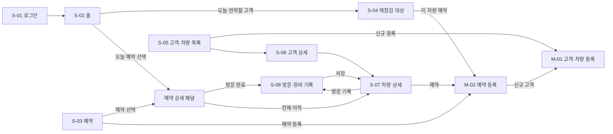

# 09 화면 명세서

> 화면 목록·구성·이동 경로 (S-01~S-10, M-01~M-02)

상태: 작성됨 (2026-11-22 · @하다) — **텍스트 명세 1차**. 와이어프레임(D-19)이 나오면 그에 맞춰 고친다
근거: 04 기능, 08 API, 05 정책, 결정 D-26·D-33·D-35·D-39
화면 ID와 프론트 `src/pages` 파일은 1:1이다(모달 M-xx는 `features` 컴포넌트). 💡 = 제안값

---

## 0. 공통

| 항목 | 규칙 |
|---|---|
| 크기 | PC와 태블릿. 화면 폭 💡 1024px을 기준으로 넓은 화면·좁은 화면 배치를 나눈다 |
| 메뉴 💡 | 넓은 화면: 왼쪽 메뉴. 좁은 화면: 위쪽 탭. 홈 · 예약 · 재점검 대상 · 고객·차량 (· 설정, P1 사장만) |
| 머리 | 정비소명, 로그인한 이름·역할, 로그아웃 |
| 상태 표시 | `shared/ui/StatusBadge` 한 곳에서만. 미확인 / 여유 / 임박 / 도래 글자를 항상 함께 쓰고(색만으로 구분하지 않음), 색은 💡 회색 / 파랑 / 주황 / 빨강. 정상·불량 같은 말은 쓰지 않는다 (05 POL-01) |
| 보조 표시 | "예약 있음", "처리 필요", "지난 방문 거절"(P0-나머지), "지난 점검 주의"(P0-나머지)는 작은 꼬리표 |
| 저장 버튼 | 요청 중 비활성 + 진행 표시, 끝나면 결과 문구 (05 POL-120) |
| 오류 | 05 10장(POL-120~129)과 08 0.2 표대로 `shared/api/client.ts` 한 곳에서 처리. 실패해도 **입력값을 지우지 않는다**. 400은 필드 옆 메시지, 401은 로그인 안내 후 로그인 화면, 403은 권한 안내, 404는 "찾을 수 없습니다", 409 동시 수정은 최신 내용을 다시 불러와 보여줌, 500·네트워크 오류는 공통 안내. 저장 결과가 불확실하면 자동으로 다시 보내지 않고, 목록·이력에서 저장 여부를 확인하게 한다 |
| 연락처 | 목록 화면(S-02 오늘 예약, S-03, S-04, S-05)은 P0-나머지부터 마스킹. 상세 화면(S-06, S-07, 예약 상세 패널)은 전체 번호 (D-40, 05 POL-38) |
| 빈 화면 금지 | 차례가 오지 않은 기능의 메뉴·버튼·빈 화면을 미리 두지 않는다 |

## 1. 화면 목록

| ID | 화면 | 단계 | 주요 기능 | API |
|---|---|---|---|---|
| S-01 | 로그인 | P0-핵심 (비밀번호 변경 P1) | F-AUTH-01·03 | 01, 03, 24 |
| S-02 | 홈 | P0-핵심 | F-HOME-01, F-RSV-03 | 04, 17 |
| S-03 | 예약 (날짜별 목록 → 월·주·일 캘린더) + 예약 상세 패널 | P0-핵심 (변경 포함) / 캘린더·취소·노쇼 P0-나머지 | F-RSV-02~08 | 15, 17~21 |
| S-04 | 재점검 대상 | P0-핵심 (문자 초안·연락 결과 P1) | F-TGT-01, F-CON-01·02 | 14, 28, 29 |
| S-05 | 고객·차량 목록 | P0-핵심 | F-CUS-01 | 05 |
| S-06 | 고객 상세 | P0-핵심 (수정 P0-나머지) | F-CUS-03·04·06 | 07, 08, 22 |
| S-07 | 차량 상세 | P0-핵심 (수정 P0-나머지, 도면 P1) | F-CUS-05·06·08 | 09, 10, 11, 23 |
| S-08 | 방문·정비 기록 (미리보기 포함) | P0-핵심 (외부·거절·점검 결과 P0-나머지) | F-VIS-01, F-MNT-01~03 | 09, 10, 12, 13 |
| S-09 | 설정 (사장) | P1 | F-STF-01, F-ITEM-01, F-NTF-01, F-STAT-01 ❓ | 13, 25~27, 30 |
| S-10 | 관리자: 정비소 관리 | P1 | F-ADM-01·02 | 02, 31~35 |
| M-01 | 고객·차량 등록 (모달) | P0-핵심 | F-CUS-01·02 | 05, 06 |
| M-02 | 예약 등록·변경 (모달) | P0-핵심 | F-RSV-01·06 | 05, 13, 16, 19 |

주요 화면은 S-01~S-08 8개다. S-09·S-10은 P1에 생긴다.

## 2. 이동 경로

## 3. 화면별 명세

### S-01 로그인

- 아이디·비밀번호·로그인 버튼. 실패하면 "아이디 또는 비밀번호를 확인해 주세요."(실패 이유를 나누지 않음).
- 성공하면 S-02. 이미 토큰이 있으면 S-02로 바로.
- P1: 임시 비밀번호 계정이면 같은 화면에서 새 비밀번호 입력 단계(F-AUTH-03). "관리자 로그인" 전환(S-10용) 💡.

### S-02 홈 (D-39)

| 영역 | 내용 |
|---|---|
| 요약 숫자 | **오늘 예약 N건** · **오늘 연락할 고객 N명**(누르면 S-04) |
| 오늘 예약 목록 | 시각 순. 시각 · 차량번호 · 고객명 · 연락처 · 예약 목적 요약 · 상태(·처리 필요). 줄을 누르면 예약 상세 패널 |
| 빈 상태 | "오늘 예약이 없습니다." |

### S-03 예약

| 영역 | P0-핵심 | P0-나머지 |
|---|---|---|
| 보기 전환 | 날짜별 목록만 (날짜 앞뒤 이동, 오늘로) | 월 · 주 · 일 탭 (일 = 날짜별 목록) |
| 목록 줄 | 시각 · 차량번호 · 고객명 · 연락처 · 예약 목적 요약 · 상태 꼬리표(처리 필요/방문 완료/취소/노쇼) | 같음 |
| 월 보기 | — | 날짜 칸에 예약 건수(취소 제외 💡). 날짜를 누르면 일 보기 |
| 주 보기 | — | 7일 × 30분 칸, 표시 💡 08:00~20:00. 칸 안에 차량번호·고객명 카드. 범위 밖 예약은 맨 위·아래 줄 💡 |
| 예약 등록 | "예약 등록" 버튼 → M-02 | 같음 |
| 예약 상세 패널 | 아래 (변경 버튼 포함) | 취소·노쇼 버튼 추가 |

**예약 상세 패널 (F-RSV-03, D-26·D-35)** — S-02와 S-03이 같은 컴포넌트를 쓴다.

| 순서 | 영역 | 내용 |
|---|---|---|
| 1 | 예약 | 일시 · 상태(·처리 필요) · 예약 목적(고른 항목, 기타, 메모) |
| 2 | 고객·차량 | 고객명 · 연락처(전체) · 차량번호 · 차종·연식 · 최근 주행거리 |
| 3 | 점검 주기 요약 | 6개 항목 `StatusBadge`. 예약 목적 항목은 굵게·맨 위 💡. P0-나머지부터 "지난 방문 거절", "지난 점검 주의(메모)" |
| 4 | 최근 정비 이력 | 최근 방문 3회: 날짜 · 주행거리 · 항목·구분(·결과)·메모. 더 있으면 "전체 이력" → S-07 |
| 5 | 버튼 | **방문 완료**(→ S-08) · **변경**(M-02, P0-핵심) · 취소·노쇼(P0-나머지, 노쇼는 시각이 지난 예약만) |

- 넓은 화면(1024px 이상): 목록·캘린더 오른쪽에 패널. 좁은 화면: 화면 전체를 덮는 패널, 닫기·뒤로 가기로 복귀.
- 취소·노쇼는 확인 대화상자를 거친다 💡.

### S-04 재점검 대상

| 영역 | 내용 |
|---|---|
| 머리 | 기준일(오늘), 대상 차량 수 |
| 줄 (차량 하나) | 고객명 · 연락처 · 차량번호 · 대상 항목들(`StatusBadge` + 다음 정비일, 기준 기록일) · "예약 있음(일시)" 꼬리표 |
| 줄 버튼 | **예약 등록**(M-02, 차량 채워짐). "예약 있음"이면 버튼 대신 예약 일시(누르면 예약 상세 패널 💡) |
| P0-나머지 | 항목 옆 "지난 방문 거절", "지난 점검 주의" 꼬리표 |
| P1 | 줄마다 "문자 초안"(복사 / 문자 앱 열기) · "결과 기록"(값 ❓) · "연락함(날짜)" 꼬리표 |
| 빈 상태 | "지금 연락할 고객이 없습니다." |

정렬: 도래가 있는 차량 먼저, 그다음 다음 정비일이 이른 순. 미동의 고객은 나오지 않는다.

### S-05 고객·차량 목록

- 검색창 하나(차량번호·연락처·이름). 결과 줄: 고객명 · 연락처 · 동의 · 차량번호들. 줄을 누르면 S-06.
- "신규 등록" → M-01. 검색 결과가 없을 때 그 검색어를 M-01에 채워 준다 💡.

### S-06 고객 상세

| 영역 | 내용 |
|---|---|
| 고객 정보 | 고객명 · 연락처(전체) · 안내 수신 동의 |
| 차량 목록 | 차량번호 · 차종·연식 · 최근 주행거리 · 도래 n · 임박 n. 누르면 S-07 |
| 버튼 | 차량 추가(인라인 입력 💡) · 수정(P0-나머지, 동의 포함) |

### S-07 차량 상세

| 영역 | 내용 |
|---|---|
| 차량·고객 | 차량번호 · 차종·연식 · 최근 주행거리 · 고객명(→ S-06) · 연락처(전체) |
| 점검 주기 | 6개 항목 표: 항목 · 상태 · 기준 기록(날짜·km·구분) · 다음 정비일 · 다음 정비 km. P0-나머지부터 꼬리표 |
| 약식 도면 (P1) | 일반 약식 차량 그림 위 6개 항목 위치에 `StatusBadge` 색. 읽기 전용(누르거나 입력하지 않음) |
| 정비 이력 | 방문 단위 최신순, 더 보기(쪽 나누기). 외부는 "고객 진술" 표시 |
| 버튼 | **방문 기록**(→ S-08) · 예약(M-02) · 수정(P0-나머지) |

### S-08 방문·정비 기록 (F-VIS-01 · F-MNT-01~03)

| 순서 | 영역 | 내용 |
|---|---|---|
| 1 | 차량 | 차량번호 · 고객명 (예약 상세 패널·차량 상세에서 오면 채워짐, 아니면 검색) |
| 2 | 방문 정보 | 방문일(기본 오늘) · 주행거리(입력) |
| 3 | 미리보기 | 주행거리를 넣는 즉시(입력 멈춘 뒤 💡 0.5초) API-10으로 6개 항목 상태를 다시 보여줌. 상단에 "저장 전 미리보기 — 기록되지 않음" 표시. 도래 항목은 근거(날짜/주행거리) 함께 |
| 4 | 항목 기록 | 6개 항목 줄마다 구분 선택: 기록 안 함(기본) / 교체 / 점검. P0-나머지: 거절 / 외부(정비일·주행거리 입력) / 점검이면 결과 양호·주의. 줄마다 메모 |
| 5 | 저장 | 1개 이상 고른 경우만 활성. 저장 후 S-07로 이동하고 바뀐 상태를 보여줌 |

- 미리보기 문구는 "확인이 필요한 항목"으로 쓰고 진단 표현을 쓰지 않는다.

### S-09 설정 (P1, 사장)

탭 💡: 정비사 계정(목록·추가) · 항목 기준표(켜기·끄기, 개월·km) · 아침 알림(시간, 브라우저 알림 허용) · 집계(위치 ❓). 정비사에게는 메뉴가 보이지 않는다.

### S-10 관리자: 정비소 관리 (P1)

정비소 목록(이름 · 연락처 · 상태 · 생성일) · 정비소 개설(정비소 정보 + 사장 아이디·임시 비밀번호) · 정지·재개 · 사장 비밀번호 재발급. 정비소 안의 숫자는 보여주지 않는다.

### M-01 고객·차량 등록

- 위에 검색 결과(같은 차량번호·연락처가 있으면 먼저 보여줌 — "이미 있는 고객이면 고르세요").
- 입력: 고객명* · 연락처* · 안내 수신 동의(체크 안 됨이 기본, "고객에게 물어보고 체크하세요" 안내) · 차량번호* · 차종 · 연식 · 주행거리.
- M-02에서 열렸으면 저장 후 M-02로 돌아가 차량을 채운다.

### M-02 예약 등록·변경

- 차량: 검색해서 고르기 또는 신규(M-01). S-04·S-07에서 열면 채워짐. 변경 때는 바꿀 수 없음.
- 날짜(오늘 이후) · 시각(30분 단위 선택지).
- 예약 목적: 6개 항목 체크(여러 개) · 기타 체크 · 메모. 모두 선택 입력.
- 같은 차량에 진행 중 예약이 있다는 오류(409)면 "이 차량에는 진행 중인 예약이 있습니다"와 함께 **기존 예약의 상세 패널을 열고**, 고객과 확인한 뒤 변경하게 한다(D-42). 입력하던 일시·목적은 변경 화면에 채워 준다 💡.
- 변경 모드: 차량은 바꿀 수 없다. 저장할 때 읽어 온 `version`을 함께 보낸다. 다른 직원이 먼저 바꿨다는 오류(409)면 최신 예약을 다시 불러와 보여주고 다시 수정하게 한다.

## 4. 결정 필요

| 번호 | 내용 |
|---|---|
| D-19 | 와이어프레임: 이 문서를 바탕으로 만들고, 다르면 이 문서를 고친다 |
| P1 착수 때 | 연락 결과 값, 집계 화면 위치 |
