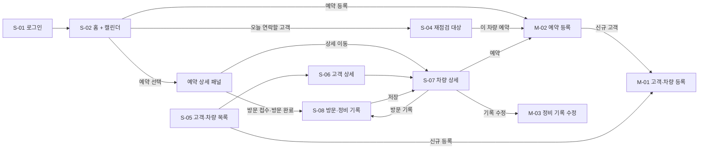

# 09 화면 명세서

> 화면 목록·구성·이동 경로 (S-01~S-10, M-01~M-03. S-03은 폐지, 번호 재사용 안 함)

상태: 작성됨 (2026-11-22 · @하다) — **텍스트 명세 1차**. 와이어프레임(D-19)이 나오면 그에 맞춰 고친다
근거: 04 기능, 08 API, 05 정책, 결정 D-33·D-35·D-39, D-51~D-59 (D-26은 D-54로 대체)
화면 ID와 프론트 `src/pages` 파일은 1:1이다(모달 M-xx는 `features` 컴포넌트). S-03은 폐지(D-54)했고 번호는 비워 둔다(재사용 안 함). 💡 = 제안값

---

## 0. 공통

| 항목 | 규칙 |
|---|---|
| 크기 | PC와 태블릿. 화면 폭 💡 1024px을 기준으로 넓은 화면·좁은 화면 배치를 나눈다 |
| 메뉴 💡 | 넓은 화면: 왼쪽 메뉴. 좁은 화면: 위쪽 탭. 홈 · 재점검 대상 · 고객·차량 (· 설정, P1 사장만). 예약 메뉴는 없다(캘린더는 홈, D-54) |
| 머리 | 정비소명, 로그인한 이름·역할, 로그아웃 |
| 상태 표시 | `shared/ui/StatusBadge` 한 곳에서만. 미확인 / 여유 / 임박 / 도래 글자를 항상 함께 쓰고(색만으로 구분하지 않음), 색은 💡 회색 / 파랑 / 주황 / 빨강. 정상·불량 같은 말은 쓰지 않는다 (05 POL-01). **담당 색**(P0-나머지)은 상태 색과 다른 계열(💡 보라·청록·분홍·갈색·연두·남색·올리브·자주)을 쓰고, 항상 담당 이름 라벨을 함께 보인다(색만으로 구분하지 않음) |
| 보조 표시 | "예약 있음", "처리 필요", "진행중"(P0-나머지, 상태 꼬리표), "지난 방문 거절"(P0-나머지), "지난 점검 주의"(P0-나머지), "수정됨"(P0-나머지, 기록 수정 이력이 있을 때), "비활성"(P1)은 작은 꼬리표 |
| 저장 버튼 | 요청 중 비활성 + 진행 표시, 끝나면 결과 문구 (05 POL-120) |
| 오류 | 05 10장(POL-120~129)과 08 0.2 표대로 `shared/api/client.ts` 한 곳에서 처리. 실패해도 **입력값을 지우지 않는다**. 400은 필드 옆 메시지, 401은 로그인 안내 후 로그인 화면, 403은 권한 안내, 404는 "찾을 수 없습니다", 409 동시 수정은 최신 내용을 다시 불러와 보여줌, 500·네트워크 오류는 공통 안내. 저장 결과가 불확실하면 자동으로 다시 보내지 않고, 목록·이력에서 저장 여부를 확인하게 한다 |
| 연락처 | 목록 화면(S-02 홈의 오늘 예약·캘린더, S-04, S-05)은 P0-나머지부터 마스킹. 상세 화면(S-06, S-07, 예약 상세 패널)은 전체 번호 (D-40, 05 POL-38) |
| 빈 화면 금지 | 차례가 오지 않은 기능의 메뉴·버튼·빈 화면을 미리 두지 않는다 (빈 상태 문구와 이어지는 버튼은 5장 표) |

## 1. 화면 목록

| ID | 화면 | 단계 | 주요 기능 | API |
|---|---|---|---|---|
| S-01 | 로그인 | P0-핵심 (비밀번호 변경 P1) | F-AUTH-01·03 | 01, 03, 24 |
| S-02 | 홈 + 캘린더 + 예약 상세 패널 | P0-핵심 (요약·오늘 예약 목록·변경) / P0-나머지 (월·주 캘린더, 담당 선택·색, 취소·노쇼·방문 접수·정정) / P1 (고객 집계) | F-HOME-01, F-RSV-02~10, F-STAT-01 | 04, 15, 17~21, 30, 39~42 |
| S-04 | 재점검 대상 | P0-핵심 (문자 초안·연락 결과 P1) | F-TGT-01, F-CON-01·02 | 14, 28, 29 |
| S-05 | 고객·차량 목록 | P0-핵심 (비활성 포함·지표 P1) | F-CUS-01·09·10 | 05 |
| S-06 | 고객 상세 | P0-핵심 (수정 P0-나머지, 비활성화·삭제·지표 P1) | F-CUS-03·04·06·09·10 | 07, 08, 22, 43~47 |
| S-07 | 차량 상세 | P0-핵심 (수정 P0-나머지, 정비 기록 수정 P0-나머지, 도면 P1, 비활성화 P1) | F-CUS-05·06·08·10, F-MNT-04 | 09, 10, 11, 23, 37, 38, 46, 47 |
| S-08 | 방문·정비 기록 (미리보기 포함) | P0-핵심 (외부·거절·점검 결과·담당 선택 P0-나머지) | F-VIS-01, F-MNT-01~03 | 09, 10, 12, 13, 36 |
| S-09 | 설정 (사장) | P1 | F-STF-01, F-ITEM-01, F-NTF-01, F-CUS-11 | 13, 25~27, 48~50 |
| S-10 | 서비스 관리자: 정비소 관리 | P1 | F-ADM-01·02 | 02, 31~35 |
| M-01 | 고객·차량 등록 (모달) | P0-핵심 | F-CUS-01·02 | 05, 06 |
| M-02 | 예약 등록·변경 (모달) | P0-핵심 (담당 선택·재배정 P0-나머지) | F-RSV-01·06 | 05, 13, 16, 19, 36 |
| M-03 | 정비 기록 수정 (모달) | P0-나머지 | F-MNT-04 | 37, 38 |

S-03은 폐지했다(예약 화면은 S-02 홈으로 통합, D-54). 번호는 재사용하지 않는다. 주요 화면은 S-01·S-02·S-04~S-08 7개다. S-09·S-10은 P1에 생긴다.

## 2. 이동 경로

## 3. 화면별 명세

### S-01 로그인

- 아이디·비밀번호·로그인 버튼. 실패하면 "아이디 또는 비밀번호를 확인해 주세요."(실패 이유를 나누지 않음).
- 성공하면 S-02. 이미 토큰이 있으면 S-02로 바로.
- P1: 임시 비밀번호 계정이면 같은 화면에서 새 비밀번호 입력 단계(F-AUTH-03). "서비스 관리자 로그인" 전환(S-10용) 💡.

### S-02 홈 (D-39, D-54)

캘린더는 정비소당 공용 하나다. 사장·정비사 모두 전체 일정을 본다(D-57).

| 영역 | P0-핵심 | P0-나머지 |
|---|---|---|
| 요약 숫자 | **오늘 예약 N건** · **오늘 연락할 고객 N명**(누르면 S-04) | 같음 |
| 주 영역 | 오늘 예약 목록: 시각 · 차량번호 · 고객명 · 연락처 · 예약 목적 요약 · 상태(·처리 필요). 날짜 앞뒤 이동·"오늘로". 줄을 누르면 예약 상세 패널 | **캘린더**(기본 주 보기)로 교체. 우측 상단 버튼으로 월/주 전환. 일 보기는 없다. 목록 줄·카드에 **담당(이름+색)** 표시 |
| 월 보기 | — | 날짜 칸에 총 건수(취소만 제외, 진행중·노쇼는 포함) + 상태별 작은 숫자(예약·진행중·완료·취소·노쇼). 날짜를 누르면 그날 목록 패널(P0-핵심 목록 컴포넌트 재사용), 목록에서 예약을 누르면 상세 패널 |
| 주 보기 | — | 7일 × 30분 칸, 💡 08:00~20:00, 범위 밖은 맨 위·아래 줄. 칸 안에 시각·차량번호·고객명 **상세 카드**(담당 색 띠 + 이름). 카드를 누르면 상세 패널 |
| 보기 옵션 | — | "내 담당만" 토글 💡 기본 전체 |
| 예약 등록 | "예약 등록" 버튼 → M-02 | 같음 |
| 빈 상태 | "오늘 예약이 없습니다." + [예약 등록] 버튼 | 주·월에서 빈 날: 칸만 비워 둠(문구 없음). 목록 패널의 빈 날은 같은 문구 |

| 영역 | P1 |
|---|---|
| 고객 집계 | 홈 하단 "고객 집계" 카드(사장·정비사 공통). 기간(이번 달·지난달·직접 선택)의 신규 고객·재방문 고객 수 (F-STAT-01, API 30). 재방문의 정의는 04 한 곳 |

**예약 상세 패널 (F-RSV-03, D-35·D-54)** — S-02의 오늘 예약 목록·월 목록 패널·주 카드가 같은 컴포넌트를 쓴다.

| 순서 | 영역 | 내용 |
|---|---|---|
| 1 | 예약 | 일시 · 상태(·처리 필요) · 예약 목적(고른 항목, 기타, 메모). P0-나머지부터 **담당 정비사(이름+색)** 추가 |
| 2 | 고객·차량 | 고객명 · 연락처(전체) · 차량번호 · 차종·연식 · 최근 주행거리 |
| 3 | 점검 주기 요약 | 6개 항목 `StatusBadge`. 예약 목적 항목은 굵게·맨 위 💡. P0-나머지부터 "지난 방문 거절", "지난 점검 주의(메모)" |
| 4 | 최근 정비 이력 | **최근 방문 2회**: 날짜 · 주행거리 · 항목·구분(·결과)·메모. **상세 이동 버튼은 항상 보이고 총 방문 3회 이상이면 활성, 그 미만은 비활성**(→ S-07). 이력이 없으면 5장 문구 |
| 5 | 버튼 | **방문 접수**(P0-나머지, 상태 "예약"만) · **방문 완료**(→ S-08, 상태 "예약"·"진행중") · **변경**(M-02, 상태 "예약"만. P0-핵심) · 취소(상태 "예약"·"진행중")·노쇼(상태 "예약"이고 시각이 지난 예약만) (P0-나머지) · **정정**(P0-나머지, 끝난 예약·지난 예약, 확인 대화상자) · **이력 보기**(P0-나머지, 재배정·정정 이력) |

- 넓은 화면(1024px 이상): 목록·캘린더 오른쪽에 패널. 좁은 화면: 화면 전체를 덮는 패널, 닫기·뒤로 가기로 복귀.
- 취소·노쇼·정정·재배정(사장 당일 예외 사유 입력 포함)은 확인 대화상자를 거친다 💡. 정정 대화상자에는 사유(선택) 입력.
- 방문 접수·방문 완료·취소·노쇼·정정은 패널이 읽은 예약의 `version`을 함께 보낸다(08 18·20·21·39·40). 409(`INVALID_STATUS_TRANSITION`·`CONCURRENT_MODIFICATION`)면 패널을 다시 조회(08 17)해 최신 상태를 보여 주고, S-08로 이동하지 않으며 자동으로 다시 보내지 않는다(M1 결정 B).
- 방문 접수에서 차량의 연식·최근 주행거리가 비어 있으면 입력 칸이 열린다(D-58).

### S-04 재점검 대상

| 영역 | 내용 |
|---|---|
| 머리 | 기준일(오늘), 대상 차량 수 |
| 줄 (차량 하나) | 고객명 · 연락처 · 차량번호 · 대상 항목들(`StatusBadge` + 다음 정비일, 기준 기록일) · "예약 있음(일시)" 꼬리표 |
| 줄 버튼 | **예약 등록**(M-02, 차량 채워짐). "예약 있음"이면 버튼 대신 예약 일시(누르면 예약 상세 패널 💡) |
| P0-나머지 | 항목 옆 "지난 방문 거절", "지난 점검 주의" 꼬리표 |
| P1 | 줄마다 "문자 초안"(복사 / 문자 앱 열기) · "결과 기록"(6개 값: 예약함·부재·이미 정비함·연락함·번호 오류·연락 거부) · "연락함(날짜)" 꼬리표. "연락 거부"를 고르면 "안내 수신 동의를 해제할까요?" 확인 대화상자(자동 해제 아님). 연락함 꼬리표는 💡 30일 보여준 뒤 사라진다(대상 목록에는 계속 있음) |
| 빈 상태 | "지금 연락할 고객이 없습니다." |

정렬: 도래가 있는 차량 먼저, 그다음 다음 정비일이 이른 순. 미동의 고객은 나오지 않는다. 비활성 고객·차량은 나오지 않는다(P1).

### S-05 고객·차량 목록

- 검색창 하나(차량번호·연락처·이름). 결과 줄: 고객명 · 연락처 · 동의 · 차량번호들. 줄을 누르면 S-06.
- "신규 등록" → M-01. 검색 결과가 없을 때 그 검색어를 M-01에 채워 준다 💡.
- P1: 고객 줄에 "비활성" 꼬리표, "비활성 포함" 토글(기본 제외). 지표 3종(최근 방문·방문 횟수·점검 예정 꼬리표)을 목록 줄 칸으로 보여준다(F-CUS-09, D-59).

### S-06 고객 상세

| 영역 | 내용 |
|---|---|
| 고객 정보 | 고객명 · 연락처(전체) · 안내 수신 동의. P1: 상단에 지표 요약(최근 방문·방문 횟수·점검 예정) |
| 차량 목록 | 차량번호 · 차종·연식 · 최근 주행거리 · 도래 n · 임박 n. 누르면 S-07 |
| 버튼 | 차량 추가(인라인 입력 💡, 차종 필수) · 수정(P0-나머지, 동의 포함) · **비활성화/삭제**(P1, 사장만, 확인 대화상자) |

### S-07 차량 상세

| 영역 | 내용 |
|---|---|
| 차량·고객 | 차량번호 · 차종·연식 · 최근 주행거리 · 고객명(→ S-06) · 연락처(전체) |
| 점검 주기 | 6개 항목 표: 항목 · 상태 · 기준 기록(날짜·km·구분) · 다음 정비일 · 다음 정비 km. P0-나머지부터 꼬리표 |
| 약식 도면 (P1) | 일반 약식 차량 그림 위 6개 항목 위치에 `StatusBadge` 색. 읽기 전용(누르거나 입력하지 않음) |
| 정비 이력 | 방문 단위 최신순, 더 보기(쪽 나누기). 외부는 "고객 진술" 표시. P0-나머지: 줄 오른쪽 **"수정"** 버튼(사장은 전체, 정비사는 본인 담당·기간 내만 활성, 아니면 비활성 + 이유 툴팁) → M-03. "수정됨" 꼬리표를 누르면 수정 이력 패널(수정 날짜 · 수정자 · 바뀐 항목 `항목명: 전 → 후` · 사유) |
| 버튼 | **방문 기록**(→ S-08) · 예약(M-02) · 수정(P0-나머지) · **비활성화**(P1, 사장만) |

### S-08 방문·정비 기록 (F-VIS-01 · F-MNT-01~03)

| 순서 | 영역 | 내용 |
|---|---|---|
| 1 | 차량 | 차량번호 · 고객명 (예약 상세 패널·차량 상세에서 오면 채워짐, 아니면 검색) |
| 2 | 방문 정보 | 방문일(기본 오늘) · 주행거리(입력). 차량에 연식·최근 주행거리가 비어 있으면 상단에 "연식·주행거리를 입력해 주세요" 안내와 입력 칸(교체·점검 저장에 필수, D-58) |
| 3 | 미리보기 | 주행거리를 넣는 즉시(입력 멈춘 뒤 💡 0.5초) API-10으로 6개 항목 상태를 다시 보여줌. 상단에 "저장 전 미리보기 — 기록되지 않음" 표시. 도래 항목은 근거(날짜/주행거리) 함께 |
| 4 | 항목 기록 | 6개 항목 줄마다 구분 선택: 기록 안 함(기본) / 교체 / 점검. P0-나머지: 거절 / 외부(정비일·주행거리 입력) / 점검이면 결과 양호·주의. 줄마다 메모 |
| 5 | 담당 정비사 | P0-핵심: 저장한 계정이 담당(선택 칸 없음). P0-나머지: 담당 정비사 선택(기본 예약의 담당 또는 로그인 계정, API 36) |
| 6 | 저장 | 1개 이상 고른 경우만 활성. 저장 후 S-07로 이동하고 바뀐 상태를 보여줌 |

- 미리보기 문구는 "확인이 필요한 항목"으로 쓰고 진단 표현을 쓰지 않는다.

### S-09 설정 (P1, 사장)

탭 💡: 정비사 계정(목록·추가·비활성화) · 항목 기준표(6개 항목의 켜기·끄기, 개월·km 수정. 새 항목 추가는 P2) · 아침 알림(시간, 브라우저 알림 허용. 설정은 브라우저에 저장, 서버·API 없음) · **보관 기간 경과 고객**(F-CUS-11: 이름 · 마지막 방문일 · 기준일 · [익명화] 버튼. 5년이 지난 고객만, 확인 대화상자). 정비사에게는 메뉴가 보이지 않는다.

### S-10 서비스 관리자: 정비소 관리 (P1)

정비소 목록(이름 · 연락처 · 상태 · 생성일) · 정비소 개설(정비소 정보 + 사장 아이디·임시 비밀번호) · 정지·재개 · 사장 비밀번호 재발급. 정비소 안의 숫자는 보여주지 않는다. 서비스 관리자 전용이다.

### M-01 고객·차량 등록

- 위에 검색 결과(같은 차량번호·연락처가 있으면 먼저 보여줌 — "이미 있는 고객이면 고르세요"). 같은 연락처의 기존 고객이 있어도 ① 기존 고객 선택(차량만 추가) ② 그래도 새로 등록(가족 공동 번호는 막지 않음)을 고를 수 있다. F-CUS-06이 만들어지면(P0-나머지) ③ "기존 고객 수정" 링크를 안내창에 더한다.
- 입력: 고객명* · 연락처* · 안내 수신 동의(체크 안 됨이 기본, "고객에게 물어보고 체크하세요" 안내) · 차량번호* · **차종*** · 연식 · 주행거리 (`*` 필수). 안내문: "연식과 주행거리는 정비 시작 때 입력해도 됩니다."
- M-02에서 열렸으면 저장 후 M-02로 돌아가 차량을 채운다.

### M-02 예약 등록·변경

- 차량: 검색해서 고르기 또는 신규(M-01). S-04·S-07에서 열면 채워짐. 변경 때는 바꿀 수 없음.
- 날짜(오늘 이후) · 시각(30분 단위 선택지).
- 예약 목적: 6개 항목 체크(여러 개) · 기타 체크 · 메모. 모두 선택 입력.
- **담당 정비사**: P0-핵심에는 입력 칸이 없다. 서버가 예약을 등록한 계정을 담당으로 정한다. P0-나머지부터 **담당 정비사 드롭다운**(API 36, 필수, 기본: 정비사 로그인이면 본인, 사장이면 사장 본인)을 둔다.
- 같은 차량에 유효 예약이 있다는 오류(409 `RESERVATION_ACTIVE_EXISTS`)면 "이 차량에는 유효한 예약이 있습니다"와 함께 **기존 예약의 상세 패널을 열고**, 고객과 확인한 뒤 변경하게 한다(D-42). 입력하던 일시·목적은 변경 화면에 채워 준다 💡.
- P0-나머지: 409 `MECHANIC_SLOT_CONFLICT`면 "이 정비사는 해당 시각에 이미 예약이 있습니다"와 겹친 예약 열기 링크를 보이고, 다른 시각·다른 담당을 고르게 한다.
- 변경 모드: 차량은 바꿀 수 없다. 저장할 때 읽어 온 `version`을 함께 보낸다. 다른 직원이 먼저 바꿨다는 오류(409)면 최신 예약을 다시 불러와 보여주고 다시 수정하게 한다.
- 변경 모드의 담당 재배정(P0-나머지): 재배정 가능 구간(예약 날짜 전날까지, 사장은 당일도)에서만 담당 칸을 활성화한다. 당일 사장은 사유 입력 칸이 열리고 필수다. 진행중이거나 지난 날짜의 예약은 담당 칸을 비활성으로 두고 안내한다.

### M-03 정비 기록 수정 (P0-나머지, D-55)

- 입력: 방문일 · 주행거리 · 구분 · 항목 · 점검 결과 · 메모 · 담당 정비사, 사유(선택). 차량은 표시만 하고 바꿀 수 없다. 삭제는 없다.
- 저장할 때 읽어 온 `version`을 함께 보낸다(API 37). 이력은 API 38로 조회해 S-07의 수정 이력 패널에 보여준다.

## 4. 결정 필요

| 번호 | 내용 |
|---|---|
| D-19 | 와이어프레임: 이 문서를 바탕으로 만들고, 다르면 이 문서를 고친다 |

## 5. 빈 상태·실패 안내

| 화면 | 빈 상태 문구 | 버튼 |
|---|---|---|
| S-02 오늘 예약 | "오늘 예약이 없습니다." | 예약 등록 |
| S-04 | "지금 연락할 고객이 없습니다." | — |
| S-05 | "등록된 고객이 없습니다." / 검색 결과 없음: "검색 결과가 없습니다." | 신규 등록(검색어 채움) |
| S-06 차량 없음 | "등록된 차량이 없습니다." | 차량 추가 |
| S-07 이력 없음 | "정비 이력이 없습니다." | 방문 기록 |
| 예약 패널 이력 없음 | "최근 정비 이력이 없습니다." | — |
| S-09 보관 기간 경과 고객 없음 (P1) | "보관 기간이 지난 고객이 없습니다." | — |

- **저장 실패**: 입력값 유지, 화면 상단 오류 안내(원인 코드별 문구) + 수동 "다시 시도" 버튼(자동 재전송 없음, 05 POL-125).
- **조회 실패**: "불러오지 못했습니다." + "다시 불러오기".
- **404**: "찾을 수 없습니다." + "홈으로".
- 자동 재시도·임시 저장은 범위 밖.
