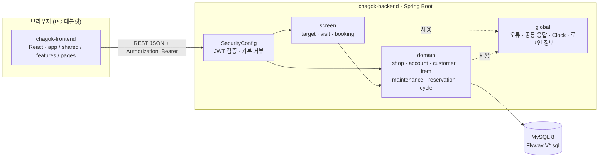

# 11 기술 스택 · 아키텍처

> 기술 선택·이유·구조. **규칙 자체는 `CONVENTIONS.md`**에 있고, 이 문서는 "왜 그렇게 정했나"와 "언제 다시 정하나"를 적는다.

상태: 작성됨 (2026-11-22 · 최은정(eunjung01230)) — 💡는 M1 설계 확정(결정 20)에서 확정
근거: 기획안 v12 「기술과 개발 방식」, 결정 2·3·16·17, D-60~D-62(계정 상태 확인, chagok-docs#65), `CONVENTIONS.md`, `CONTRIBUTING.md`

---

## 1. 기술 스택

| 구분 | 선택 | 결정 | 비고 |
|---|---|---|---|
| 프론트 | React + Vite, JavaScript 위주 + TypeScript 병행 | 결정 2 | API 타입(`features/*/types.ts`)은 08 JSON 예시와 같게 |
| 백엔드 | Java 21 + Spring Boot 4.1.2, Gradle, REST API | 결정 2, D-41 | 공통 응답·전역 예외 처리 |
| DB | MySQL 8 + JPA | 결정 2 | `ddl-auto: validate` |
| DB 구조 관리 | Flyway (변경마다 버전 파일) | 결정 17 | Boot 4는 `spring-boot-starter-flyway` + `flyway-mysql`. `schema.sql` 자동 실행 끔 |
| 인증 | JWT | 결정 3, D-68 | 서비스 관리자 토큰에는 `shop_id`가 없음. 라이브러리는 인증 `기반` 이슈에서 (Jackson 3 호환 확인). 프론트 토큰은 `localStorage`, 배포는 같은 출처 기본·CORS 허용 목록 없음(개발은 Vite 프록시) |
| 예약 캘린더 | 라이브러리 없이 직접 구현 (월·주) | 결정 16 | P0-나머지 |
| 사장 알림 (P1) | 브라우저 Notification API, 프론트에서만 | 기획안 | 탭이 열려 있을 때만. 웹 푸시는 P2 |
| 구조 검사 | ArchUnit(백엔드), ESLint 경계 규칙(프론트) | CONVENTIONS 8장 | 빌드에서 자동 |
| CI | GitHub Actions: `pr-check`, `backend-ci`(MySQL 8 + Flyway), `frontend-ci` | CONTRIBUTING 5장 | 모든 PR |
| 리뷰 보조 | CodeRabbit (`review-me`·`release` 라벨 PR만) | CONTRIBUTING 6장 | 코드 레포만 |
| 개발 환경 | JDK 21, Node 22 LTS, MySQL 8 | GUIDE | 시간대 Asia/Seoul 💡. DB 접속 정보는 환경변수(`DB_URL`·`DB_USERNAME`·`DB_PASSWORD`) |
| 3.5가 아닌 4.1인 이유 | 3.5.x는 2026-06 OSS 지원 종료 | D-41 | 모듈화된 스타터(`webmvc`·`flyway`)와 Jackson 3에 맞춰 둠 |

## 2. 전체 구조

- 프론트와 백엔드는 다른 레포(`chagok-frontend`, `chagok-backend`)이고, 계약은 `chagok-docs`의 08 API 명세 하나다.
- 백엔드 패키지는 세 층이다: `global`(기반) / `domain`(업무, 표를 가짐) / `screen`(여러 도메인을 읽어 화면 하나를 조립, 표 없음). 상세는 CONVENTIONS 2·3장.

## 3. 구조를 이렇게 정한 이유

### 3.1 도메인 + `api` 계약 + `screen` 조립

놀이방 프로젝트에서 도메인끼리 Service를 직접 주입해 하나를 고치면 여러 곳이 무너졌다(13개 도메인 중 9개가 얽힘). 그래서:

- 다른 도메인은 그 도메인의 `api`(interface·record·enum)로만 부른다. 안쪽을 바꿔도 밖이 무너지지 않는다.
- 의존 방향 = 외래키 방향. 아래쪽 도메인(customer, item, shop, cycle)은 위쪽을 모른다.
- 여러 도메인을 읽는 화면은 `screen`에서만 조립하고, 아무도 `screen`을 import하지 않는다. 재점검 대상(target), 방문 중 안내(visit), 예약 상세 패널(booking 💡)이 여기 있다.
- "방문 완료 → 정비 기록 등록"은 코드 호출이 아니라 프론트의 화면 이동이다. reservation이 maintenance를 부르지 않는다.

### 3.2 상태를 저장하지 않고 계산한다

미확인/여유/임박/도래, "지난 방문 거절", "지난 점검 주의"는 DB 칼럼이 아니다. 볼 때마다 `domain/cycle` 한 곳에서 계산한다.

- 주기 규칙(임박 기준, 도래 경계)을 바꿔도 데이터 이관이 필요 없다.
- 차량 상세·방문 접수 미리보기·재점검 대상 목록·홈 요약·예약 상세 패널·문자 초안(P1)·차량 도면(P1)이 같은 결과를 쓴다. 화면마다 판정이 어긋날 수 없다.
- `cycle`은 다른 도메인·Spring·JPA를 모른다. 입력도 값, 출력도 값이라 DB 없이 단위 테스트(04의 T-xx)가 돈다.
- 현재 날짜는 `Clock` 빈 하나에서만 얻는다. 테스트에서 날짜를 고정할 수 있다.

### 3.3 정비소 격리는 토큰의 `shop_id` 하나로

- 사장·정비사 JWT에는 소속 정비소 `shop_id`가 들어 있다. 정비소 데이터 API는 요청 값이 아니라 토큰의 `shop_id`로만 조회한다.
- 고객·차량·정비 기록·예약(그리고 예약 목적 연결 표)이 `shop_id`를 직접 가진다(결정 5). 모든 조회에 조건 하나만 걸면 되고, 격리 테스트(08의 X-xx)도 단순해진다.
- 다른 정비소 데이터는 404로 답한다. 403이면 그 데이터가 있다는 사실이 드러난다.
- 서비스 관리자는 별도 테이블 `platform_admin`에 두고, 관리자 토큰에는 `shop_id`가 없다. 관리자 역할은 `/admin/**`만 허용한다. 정비소 데이터를 조회할 기준 자체가 없으므로 구조로 막힌다.
- `SecurityConfig`는 `anyRequest().denyAll()`로 끝난다. 새 API를 등록하지 않으면 닫혀 있고, `EndpointGuardTest`가 확인한다. 반대 방향(사장·정비사 토큰 → `/api/admin/**`)도 403이다(E4, 08 X18).

### 3.3.1 토큰을 받은 뒤 바뀐 계정 상태 (P1, D-60~D-62)

- 토큰은 그대로 **서명·만료(12시간)·클레임**만 담는다. 비활성·첫 비밀번호 변경·약관 동의 여부는 토큰에 넣지 않고, 보호된 정비소 요청마다 서버가 DB에서 확인한다(08 0.6). 그래서 비밀번호를 바꾸거나 약관에 동의하면 같은 토큰으로 바로 다음 단계가 되고, 정비사를 비활성화하면 그 전에 받은 토큰도 다음 요청부터 막힌다(D-62). 리프레시 토큰·무효화 목록·서버 세션은 두지 않는다.
- **위치**: 인증이 끝난 뒤, 역할 권한(`SecurityConfig` URL 규칙) **전에** 도는 `global/auth`의 요청 확인 한 곳(08 0.6·06 2.1과 같은 순서 — 비활성·임시 비밀번호 상태의 정비사가 사장 전용 API를 불러도 `FORBIDDEN`이 아니라 상태 코드가 나간다). 어떤 API를 제한 상태에서 허용하는지(08 0.6 표)도 그곳 한 곳에 둔다.
- **의존 방향**: `global`은 `domain`을 import할 수 없다(CONVENTIONS 3·5장, ArchitectureTest). 그래서 `global/auth`에 "계정 상태를 돌려주는" 작은 인터페이스(값은 enum·record)를 두고 `account` 도메인 service가 구현하는 방식을 쓴다(`account` → `global`은 허용 방향). 판정에 쓰는 값(`staff.active`·`password_change_required`·약관 동의 기록)은 `account` 도메인이 읽는다. `account → global` 방향 자체는 이미 허용되어 있다(CONVENTIONS 3장 "모두 ──▶ global"). P1 착수(백로그 30·32·34-3) 전에 형상관리·도메인관리가 확인할 것은 두 가지다: ① global에 인터페이스를 두고 domain이 구현하는 방식(의존 역전)을 CONVENTIONS에 적을지 ② 제한 상태에서 허용할 API 표와 약관 판정을 global에 두는 것이 CONVENTIONS 5장 global 행("업무 규칙 없음")에 걸리는지(걸리면 판정은 account에, global은 결과만) ③ 구현이 하나뿐인 인터페이스라 CONVENTIONS 11장 3번(한 번만 쓰는 인터페이스를 새로 만들지 않음)과 2장의 "계약은 주는 쪽 `api`에" 선택에 대한 예외로 둘지, 다른 방식(예: account의 필터를 `SecurityConfig`가 아닌 다른 등록 방식으로 연결)을 쓸지. 이 문단의 방식은 **제안**이며 아직 정하지 않았다. 규칙과 부딪히면 `결정` 이슈로 올린다(CONVENTIONS 5장 끝).
- **비용**: 요청마다 `staff` 한 행(+ 사장이면 약관 동의 기록)을 읽는다. 1~5인 정비소 규모에서는 캐시 없이 시작하고, 느려지면 5장 표대로 다시 정한다.
- 정비소 정지(`shop.status`)는 이 확인에 넣지 않는다(정지 즉시 차단은 P2, 05 POL-15).

### 3.4 Flyway

로컬 DB 스키마 차이로 테스트가 계속 실패한 경험(놀이방: 420개 중 172개)이 있어, 팀원 누구의 DB든 같은 순서로 같은 구조가 되게 한다.

- 구조: `src/main/resources/db/migration/V{번호}__{설명}.sql`. 공유된 버전 파일은 고치지 않고 새 번호를 더한다(pr-check가 막음).
- 시연 시드: `chagok-backend/db/seed/demo_seed.sql`(classpath 밖). 시연 전용 DB에만, 안전 검사 실행기(`run-demo-seed.sh`)로만 넣는다. 서버 실행 때 자동으로 들어가지 않는다(D-43). 시연 전날 시연 DB를 새로 만들어 다시 넣는다.
- 테스트는 둘로 나눈다: DB 없이 도는 `test`(ArchitectureTest·단위 테스트, `./gradlew build`)와 MySQL이 필요한 `dbTest`(`@Tag("db")`). CI는 두 작업으로 따로 돌리고 결과를 요약·보관한다.
- CI는 빈 MySQL에 마이그레이션을 처음부터 적용하며 빌드한다.

### 3.5 레포 3개

- 백엔드·프론트를 나눴기 때문에(결정 3 메모), 둘이 함께 기준으로 삼는 기획 문서·협업 규칙·공용 AI 설정은 `chagok-docs` 한 곳에 둔다.
- 명세가 바뀌면 문서 PR(`chagok-docs`)이 먼저, 코드 PR에는 문서 PR 링크(pr-check 검사).
- 세 레포에 같은 릴리스 태그를 달아 한 시점의 문서·백엔드·프론트를 함께 받는다.

### 3.6 동시 수정은 덮어쓰지 않는다

예약은 JPA `@Version`(`reservation.version`)으로 낙관적 잠금을 건다. 화면은 읽은 `version`을 변경 요청에 보내고, 다른 직원이 먼저 바꿨으면 409 `CONCURRENT_MODIFICATION`을 받는다(D-42). 고객·차량 수정(P0-나머지)도 같은 방식으로 `version`을 더한다. 같은 차량에 예약 두 건이 동시에 **등록**되는 경우까지 막는 잠금은 P2다.

### 3.7 캘린더 직접 구현

월·주 보기(홈 캘린더)와 날짜별 목록이 같은 기간 조회 API를 쓴다. 보기는 화면 모양만 다르다. 드래그·반복 예약이 없으므로 라이브러리 없이 충분하다고 판단했다(결정 16). 날짜별 목록으로 순환을 먼저 완성하고 캘린더는 P0-나머지에 붙인다.

## 4. 요청 흐름 예시 — 예약 상세 패널

1. 프론트가 예약을 고르면 `features/reservation/api.ts`(💡)가 패널 API를 부른다(`shared/api/client.ts`를 거침).
2. JWT 필터가 토큰을 검증하고 `LoginStaff(staffId, shopId, role)`를 만든다.
3. `screen/booking`이 `reservation.api`로 예약을, `customer.api`로 고객·차량을, `maintenance.api`로 최근 기록을, `item.api`로 항목·주기를 읽고, `cycle`로 점검 주기 요약을 계산해 한 응답으로 조립한다. 모든 조회는 `shopId` 조건.
4. 남의 정비소 예약이면 `getOwned`에서 `NOT_FOUND`(404). 응답은 공통 응답으로 감싼다.
5. 프론트는 상태를 다시 계산하지 않고 `StatusBadge`로 표시만 한다.

## 5. 이 선택이 깨지는 상황 (다시 정할 때)

| 선택 | 깨지는 상황 | 그때 할 일 |
|---|---|---|
| 상태를 조회 때 계산 | 정비소당 고객·기록이 많아 대상 목록 응답이 느려짐 (예: 고객 1,000명 이상) | 대상 목록 페이징, 계산 결과 캐시 또는 일 단위 저장 검토. 코드에 `// LIMIT:` 주석 |
| `visit_key`로 방문 묶음 | 방문 단위 정보(방문 메모·사진·예약 연결)가 늘거나 정비 기록 무효 처리가 필요 | 방문 테이블 분리 + Flyway 이관 (P2) |
| JWT만 사용 (서버 세션 없음), 계정 상태는 요청마다 DB 확인(3.3.1) | 강제 로그아웃·정지 즉시 차단이 필요, 요청마다 하는 계정 확인이 느려짐 | 리프레시 토큰·토큰 무효화 목록 (P2), 계정 상태 캐시 |
| 동시성 처리 없음 | 같은 차량 또는 같은 담당·같은 시작 시각에 동시 예약 요청이 실제로 생김 | 유일 제약 또는 잠금 (P2, `결정` 이슈) |
| 캘린더 직접 구현 | 드래그 이동·반복 예약이 필요 | 라이브러리 도입 재검토 (P2) |
| 브라우저 알림 (P1) | 탭을 닫아도 알림이 필요 | 서비스 워커·푸시 구독·서버 스케줄러 (P2) |
| 토큰 `localStorage`·같은 출처 배포 (D-68) | 한 PC를 여러 사람이 공유하는 정비소가 확인됨 / 프론트·백엔드를 다른 도메인에 배포 | `sessionStorage`·메모리 저장 재검토 / 환경변수 기반 CORS 허용 목록(L3, `결정` 이슈) |

## 6. 확정 전 항목 (💡)

| 항목 | 제안값 | 정하는 곳 |
|---|---|---|
| 패키지 구조·의존 방향 | CONVENTIONS 2·3장 | 결정 20 (M1 설계 확정) |
| 예약 상세 패널 조립 패키지 | `screen/booking` | 결정 20 |
| 서버·DB 시간대 | Asia/Seoul | `기반` 이슈 |
