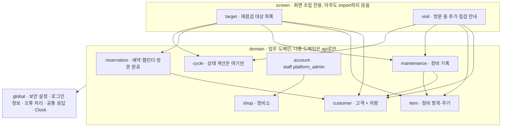

# 차곡 레포 구조 · 협업 규칙 · AI 스킬 안내

> 레포 구조, 협업 규칙, 개발 절차, Claude 환경 설정, 스킬·에이전트 사용법을 한 곳에 모은 **총정리본**

상태: 2026-11-24 기준 (chagok-docs develop `c81e120`, 공용 `.claude/` 원본 `cf9ef3f` · chagok-docs#81 · 최은정(eunjung01230))
빠르게 시작하려면: [STARTER 04 Claude 스킬·에이전트 사용안내](STARTER/04_Claude_스킬_에이전트_사용안내.md)

## 0. 이 문서는

차곡을 어떤 레포 구조로 만들었고, 각 파일이 무슨 일을 하며, 우리가 어떤 규칙과 AI 스킬·에이전트로 일하는지를 정리한 안내서입니다. 규칙을 지키는 수고는 사람 대신 자동 검사와 스킬이 최대한 맡도록 설계했습니다.

| 문서 | 역할 |
|---|---|
| **이 GUIDE** | 전체 총정리본. 팀원에게 전달하는 모든 명령어가 여기에 있습니다 |
| [STARTER 04](STARTER/04_Claude_스킬_에이전트_사용안내.md) | 개발 착수용 빠른 사용 설명서 (이 문서의 요약, 의미가 같아야 함) |
| `CONTRIBUTING.md` · `CONVENTIONS.md` · `.claude/rules/ai-rules.md` · `SKILL.md` · 에이전트 파일 | **실제 규칙과 절차의 원본** |

- **이 문서와 원본이 다르면 원본이 기준입니다.** 문서끼리 다르면 `.claude/rules/source-of-truth.md` 순서(3장)를 따릅니다.
- 이 문서에서 쓰는 상태 표기:

| 표기 | 뜻 |
|---|---|
| **확정** | 기준 문서·CONTRIBUTING·결정 기록(13 changelog, 닫힌 `결정` 이슈)에 있음 |
| **결정 대기** | `결정` 이슈가 열려 있음. 이 문서의 추천안은 정책이 아님 |
| **미구현** | 설계·제안만 있고 파일이 없음. 사용할 수 없음 |
| **미검증** | 실행 근거가 없음. 통과로 세지 않음 |
| 💡 | 원본 문서에 남아 있는 제안값 (CONVENTIONS 6·7장, 시연 DB 이름 등) |
| ❓ | 원본끼리 다르거나 정의가 없음. 임의로 정하지 않고 보고함 |

## 1. 프로젝트와 개발 환경

차곡은 소규모 정비소용 예약 CRM입니다. 예약 관리가 기본, 정비 이력 기반 재방문 관리가 차별화 기능입니다. **MVP = P0 + P1**, 우선순위는 **기능 수보다 완성도**입니다.

| 영역 | 기술 (근거: 각 레포 README·build.gradle·package.json·CI) |
|---|---|
| 백엔드 | Java 21 · Spring Boot · Gradle Wrapper · MySQL 8 · Flyway |
| 프론트 | React 19 · Vite · TypeScript(공통 API·타입·로직은 `.ts`, 현재 화면 컴포넌트는 `.jsx`) · Vitest · ESLint |
| 협업 | GitHub Organization `OneMonthproJect`, 공개 레포 3개, GitHub Free 운영 |
| AI | Claude Code(로컬, 스킬 + 에이전트), claude.ai(스킬만) |

**지금 단계 (2026-11-27)**

| 마일스톤 | 상태 |
|---|---|
| M1 설계 확정 | **통과** (2026-11-23, 태그 `v0.1-m1-design`, chagok-docs#46) |
| 공통 기반 B-0~B-3 | develop에 있음 (backend#11·#4·#9·#12, frontend#10) — 조건부 통과, 남은 조건은 [STARTER 00](STARTER/00_현재_개발현황.md) |
| M2 통합 검증 | **통과** (2026-11-26, 세 레포 태그 `v0.5-m2-integration`) |
| P0-나머지 | 구현 이슈 모두 닫힘(2026-11-27) |
| M3 · M4 · M5 | 대기. M2 이후 순서는 결정 이슈 chagok-docs#192, 결정 전 통과 조건은 00 8장 그대로 |

**한눈에 보는 작업 흐름**: 팀원은 모두 각 레포의 `develop`에 PR로 올리고, `main`에는 형상관리자만 정해진 네 번(M2 · M3 · M4 · M5) 세 레포를 함께 올립니다.

```text
이슈(해당 레포) → 최신 develop에서 브랜치 → (Claude면 계획 → 승인) → 구현 + 테스트 → 로컬 검증
→ develop으로 PR (Closes #n, 일부 완료면 Refs #n, 명세가 바뀌면 문서 PR 링크) → 자동 검사(❌면 머지하지 않음) + 팀원 확인
→ done-verified → Squash merge → issue-close가 이슈를 닫음
                 ↓ (M2 · M3 · M4 · M5)
형상관리자: 세 레포 develop → main 릴리스 PR(Refs #n) → (코드 레포) CodeRabbit 점검 → Merge commit + 같은 태그
```

**누가 무엇을 부르나 (요약)** — 자세한 것은 18·19·23·24장

| 언제 | 누가 | 어느 레포에서 | 스킬 | 에이전트 (Claude Code) |
|---|---|---|---|---|
| 새 아이디어 · 범위 추가 (P2 착수 의견은 거절, D-70) | PM | docs | `chagok-scope-guard` | `chagok-scope-keeper` |
| 이슈 만들기 | 형상관리 · PM (도메인관리는 분할 추천) | docs | `chagok-issue-writer` | — |
| 이슈 구현 (PR 본문 초안까지) | 구현 담당 | backend · frontend | `chagok-issue-coder` | — (메인 대화) |
| 버그 | 구현 담당 | backend · frontend | `chagok-bug-fix` | — (메인 대화) |
| PR 올리기 직전 자가 점검 · PR 리뷰 | 작성자 · 확인하는 팀원 | 해당 레포 | `chagok-pr-review` | `chagok-pr-reviewer` |
| 명세 바꾸기 전 · 문서 대조 | 도메인관리 · 누구나 | 어디서나 | `chagok-spec-sync` 모드 A · B | — |
| API 계약 점검 | 구현 담당 · 도메인관리 | backend · frontend | `chagok-spec-sync` 모드 C | `chagok-contract-checker` |
| 시연 준비 | DB관리 | backend | `chagok-seed-data` | `chagok-seed-builder` |
| 릴리스 전 | 형상관리자 | 작업 폴더 (세 레포) | `chagok-release-check` | — |

## 2. 레포 3개와 각 파일의 역할

### 2.1 왜 문서를 따로 뺐나

백엔드와 프론트를 나누면, 둘이 함께 기준으로 삼는 것(API 명세, ERD, 화면 명세, 협업 규칙, AI 규칙)을 어디에 둘지가 문제가 됩니다. 한쪽 레포에 두면 다른 쪽 담당은 남의 레포에서 계약서를 고쳐야 하고, 양쪽에 복사하면 한쪽만 고치는 순간부터 둘이 갈라집니다. 그래서 공용인 것은 어느 코드 레포에도 속하지 않는 세 번째 레포에 둡니다. 원칙은 하나입니다: **원본은 한 곳에만 두고, 나머지는 가리키기만 한다.**

| 무엇 | 원본 위치 | 코드 레포에서는 |
|---|---|---|
| 기획 문서 00~13 | `chagok-docs/docs/` | 읽기만 (`../chagok-docs/docs/`) |
| 협업 규칙 · 코드 구조 규칙 | `chagok-docs/CONTRIBUTING.md` · `CONVENTIONS.md` | 읽기만 |
| AI 공용 규칙 · 스킬 · 에이전트 | `chagok-docs/.claude/rules·skills·agents` | `sync-claude.sh`로 **복사, 커밋 안 함** |
| AI 권한 설정 | 레포마다 `.claude/settings.json` | 레포마다 다름 (커밋된 파일, 동기화 대상 아님) |
| AI 안내 | 레포마다 `CLAUDE.md` | 레포마다 다름 (그 레포에만 해당하는 것만) |
| CI · pr-check · CODEOWNERS · CodeRabbit | 레포마다 `.github/` | 레포마다 다름 (경로가 다르므로) |

레포마다 다른 것은 달라야 정상입니다. 문제는 같아야 할 것이 달라지는 경우라서, 같아야 할 것은 원본을 하나만 둡니다.

### 2.2 작업 폴더

세 레포는 한 폴더 안에 나란히 clone합니다. 코드 레포의 설정과 스크립트가 `../chagok-docs`를 기준으로 동작하므로 **세 레포가 반드시 같은 폴더에 나란히** 있어야 합니다. 작업 폴더 이름(`chagok`, `ChaGok` 등)은 자유입니다.

```text
chagok/                      ← 내 PC의 작업 폴더 (레포 아님)
├── chagok-docs/             기준 문서 · 협업 규칙 · 공용 Claude 설정 원본
├── chagok-backend/          백엔드 코드 + 복사된 Claude 설정
└── chagok-frontend/         프론트 코드 + 복사된 Claude 설정
```

### 2.3 chagok-docs

```text
chagok-docs/
├── docs/                 기획·설계 문서 00~13 + etc/ (이 안내서, STARTER/)
├── .github/              문서·결정 이슈 템플릿, PR 템플릿, pr-check, 라벨, CODEOWNERS
├── .claude/
│   ├── settings.json     이 레포용 AI 권한 설정
│   ├── rules/            ai-rules.md · source-of-truth.md   ← 세 레포 공용 원본
│   ├── skills/           스킬 8개                            ← 세 레포 공용 원본
│   └── agents/           에이전트 4개                         ← 세 레포 공용 원본
├── scripts/              setup-workspace.sh · sync-claude.sh · setup-labels.sh
├── README.md             프로젝트 소개, 레포 3개, 마일스톤 표, 팀 역할
├── CONTRIBUTING.md       협업 규칙 (세 레포 공통)
├── CONVENTIONS.md        코드 구조 규칙 (백엔드·프론트)
└── CLAUDE.md             이 레포에서 AI로 작업할 때
```

### 2.4 chagok-backend · chagok-frontend

```text
chagok-backend/                          chagok-frontend/
├── src/main/java/…/                     ├── src/
│   global/ domain/ screen/              │   ├── app/ shared/
├── src/main/resources/db/migration/     │   └── features/ pages/
│   V*.sql (Flyway)                      │
├── db/seed/  demo_seed.sql, 실행기       │
├── .github/  기능·버그 템플릿, PR 템플릿, backend-ci / frontend-ci, pr-check, issue-close, 라벨, CODEOWNERS
├── .claude/settings.json   (rules·skills·agents·.synced-from은 복사본, .gitignore)
├── .coderabbit.yaml
├── CLAUDE.md · README.md
└── .gitignore · .gitattributes · .editorconfig
```

### 2.5 주요 파일별 역할

| 위치 | 역할 | 누가 주로 보나 |
|---|---|---|
| `chagok-docs/CONVENTIONS.md` | 코드 구조 규칙의 유일한 원본: 7개 규칙, 패키지 구조, 의존 방향, 한 곳에만 둘 규칙, DB(Flyway), 변경 검증표, 프론트 Mock | 구현 담당 전원 |
| `chagok-docs/CONTRIBUTING.md` | 협업 규칙: 레포 3개, 브랜치 · 이슈 · 커밋 · PR · AI 사용 기록 · 릴리스 · 문서 동기화 · 패키지 주인 · 단계별 규칙 | 전원 |
| `docs/00·04·07·08` | 기준 문서: 범위, 기능 ID·테스트 T·R·H·K·L, ERD·시드표, API·에러 코드·X 테스트. 모든 ID의 출처 | 전원 |
| `docs/11_architecture` | 구조를 "왜" 그렇게 정했는지 (규칙 자체는 CONVENTIONS) | 전원 |
| `docs/12_backlog` | 기능 ID ↔ 백엔드·프론트 이슈 ↔ 담당 ↔ 선행 표. 진행 상태 원본은 Projects 보드 | PM, 형상관리 |
| `docs/13_changelog` | 기획이 왜 바뀌었는지 + 그 결정이 깨지는 상황. 문서끼리 어긋날 때 가장 먼저 보는 결정 기록 | 전원 |
| `docs/etc/` | AI 활용 기록, CodeRabbit 기록, 트러블슈팅, 테스트 명세, 이 안내서, STARTER(개발 착수 자료) | 전원 |
| `scripts/setup-workspace.sh` | 작업 폴더 준비: 빠진 레포 clone, 세 레포 develop 전환, AI 설정 복사 (처음 한 번) | 전원 |
| `scripts/sync-claude.sh` | `chagok-docs`의 공용 AI 설정을 코드 레포 `.claude/`로 복사 | Claude Code 쓰는 팀원 |
| `scripts/setup-labels.sh` | 세 레포 라벨 한 번에 생성 | 형상관리 |
| 레포마다 `.github/CODEOWNERS` | 패키지 주인. PR이 그 경로를 건드리면 주인에게 자동 리뷰 요청. docs는 D-14로 기입됨, **코드 레포 두 곳은 아직 전부 주석(미기입)** — 영역별 담당이 정해지면 채움 | 형상관리 |
| 레포마다 `.github/ISSUE_TEMPLATE/` | docs: 문서 · 결정 / 코드 레포: 기능(짝 이슈 칸 포함) · 버그 | 전원 |
| 레포마다 `.github/PULL_REQUEST_TEMPLATE.md` | `Closes #`, 「문서 PR」 칸, 테스트 결과, 완료 정의, 구조 체크, AI 사용 | 전원 |
| `.gitattributes` | 줄바꿈을 LF로 통일. Windows에서 생기는 가짜 변경 방지 | 자동 |

## 3. 기준 문서와 원본 관리 원칙

기획 문서가 기준이고, 기획 문서는 `chagok-docs`에만 있습니다. 코드와 문서가 다르면 코드에 맞춰 문서를 슬쩍 고치지 않고, 어느 쪽이 맞는지 팀이 정합니다.

문서끼리 어긋날 때의 판단 순서 (원본: `.claude/rules/source-of-truth.md`, Claude Code가 세션마다 자동으로 읽음 — 코드 레포에서는 복사본):

1. **결정 기록**: `13_changelog`와 닫힌 `결정` 이슈의 「결정 결과」. 날짜가 늦은 것이 우선입니다.
2. **기준 문서** 00 · 04 · 07 · 08: 문서마다 자기 영역의 원본입니다. 00은 범위 · 단계(MVP = P0 + P1), 04는 기능 ID · 규칙 · 테스트, 07은 테이블 · 제약 · 시드표, 08은 API · 응답 · 에러 코드 · X 테스트 · JSON 예시.
3. **나머지 문서**(01 · 02 · 03 · 05 · 06 · 09 · 10 · 11 · 12 · `etc/`): 위에 맞춰 고치는 대상입니다. 이 GUIDE와 STARTER도 여기에 속합니다.

기준 문서끼리 다르면 어느 쪽도 고르지 않고 `결정` 이슈로 올립니다. 단, 00에서 P2 · Non-goal인 기능이 다른 문서에 구현 대상으로 들어와 있으면 00이 맞습니다.

## 4. 코드 구조와 설계 원칙

코드 규칙의 원본은 `CONVENTIONS.md`입니다(백엔드는 1~6·8·9장, 프론트는 7장). 패키지 구조·의존 방향(2·3장)은 M1 설계 확정에서 **확정**됐습니다(D-20, chagok-docs#46). 6장 DB·7장 프론트 구조에는 💡 제안값이 남아 있습니다. 사람이 기억할 것은 아래 7개뿐이고, 나머지는 ArchUnit 테스트 · ESLint · CodeRabbit · pr-check가 지킵니다.

백엔드(`chagok-backend`)는 세 층으로 나눕니다.

| 층 | 하는 일 | 패키지 |
|---|---|---|
| `global/` | 모든 도메인이 쓰는 기반 | 보안 설정, 로그인 정보, 오류, 공통 응답, Clock |
| `domain/` | 업무 도메인. 표를 가짐 | shop · account · customer(+vehicle) · item · maintenance · reservation · cycle(계산만) |
| `screen/` | 화면 조립 전용. 표 없음 | target(재점검 대상 목록) · visit(방문 중 안내) · booking(예약 상세 패널) |

도메인 하나의 안쪽은 `api` · `controller` · `dto` · `service` · `entity` · `repository`입니다. 다른 패키지가 import할 수 있는 건 `api`(interface · record · enum)뿐이라, 도메인 안쪽을 바꿔도 밖은 무너지지 않습니다.

프론트(`chagok-frontend`)도 같은 생각입니다. `shared`(공통) ← `features`(도메인별) ← `pages`(화면 조립)이고, feature끼리는 import하지 않으며 ESLint가 막습니다. 모든 요청은 `shared/api/client.ts` 한 곳을 거치고, 상태는 서버가 준 값을 그대로 보여 주며 프론트에서 다시 계산하지 않습니다. 백엔드가 없을 때는 08 JSON 예시로 만든 `features/<도메인>/mocks/`를 `api.ts`에서만 고릅니다(CONVENTIONS 7장 「Mock」).

| # | 규칙 | 놀이방에서 일어난 일 |
|---|---|---|
| 1 | 다른 도메인은 그 도메인의 `api` 패키지로만 부른다 | 13개 도메인 중 9개가 Service 직접 주입으로 얽힘 |
| 2 | 의존 방향은 한쪽으로만 (외래키 방향 = 코드 방향) | 서로 import하는 순환 → 어느 쪽도 혼자 못 고침 |
| 3 | 같은 규칙은 한 곳에 (상태는 cycle, 소속 확인은 getOwned, 상태 전이는 Entity) | 같은 규칙 사본 5~6곳, 이미 어긋나 있었음 |
| 4 | 여러 도메인을 읽는 화면은 `screen`에서 조립, 아무도 screen을 import 안 함 | 마이페이지 · 관리자 화면이 순환을 만듦 |
| 5 | 오류는 ErrorCode로 던지고 전역 처리기 한 곳에서 | Controller 38개 중 13개가 각자 처리 |
| 6 | 상태(미확인/여유/임박/도래)는 저장하지 않고 조회 때 계산 | 규칙을 바꿀 때 데이터 수정이 필요 없게 |
| 7 | DB 구조는 Flyway 버전 파일이 기준, 이미 공유된 버전 파일은 고치지 않고 새 번호로 | 테스트 172개가 스키마 차이로 실패 |

### 4.1 의존 방향

화살표 = import해도 되는 방향(외래키 방향과 같음). 그 밖의 방향은 ArchUnit이 빌드에서 막습니다.



화살표가 없는 방향(예: customer가 maintenance를 부르기, reservation이 maintenance를 부르기)은 금지입니다. "방문 완료 → 정비 기록 등록"은 코드 호출이 아니라 프론트의 화면 이동입니다. `screen/booking`의 의존은 CONVENTIONS 3장 표를 봅니다.

### 4.2 바꾸거나 더할 때 건드리는 곳

이 구조가 맞는지는 "자주 생길 변경이 몇 곳을 건드리나"로 확인합니다. 표보다 많이 건드리게 되면 구조가 새고 있다는 신호이고, pr-check가 도메인 3개 이상을 건드린 PR에 경고를 띄웁니다. 전체 표는 CONVENTIONS 9장입니다.

| 변경 | 건드리는 곳 | 기존 코드 수정 |
|---|---|---|
| 정비 항목 주기값 변경 | 시드(`db/seed/`), 07 시드표 | 없음 |
| 임박 기준 변경 (1개월 → 2주) | cycle 상수 1개 + 테스트 기대값 | cycle만 |
| 상태 표시 문구 · 색 | 프론트 `StatusBadge` | 1파일 |
| API 응답에 필드 추가 | 그 도메인 dto + 08 + 프론트 types | 그 도메인만 |
| 예약 상세 패널에 항목 추가 | `screen/booking` + 필요한 `api` 메서드 + 08 + 프론트 패널 | booking만, 추가 위주 |
| P0-나머지 외부 정비 · 거절 입력 | maintenance 입력 화면 · 검증 (enum과 cycle 처리는 이미 있음) | maintenance만 |
| P1 월평균 주행거리 추정 | cycle + maintenance.api 메서드 추가 + screen/target | 3곳, 추가 위주 |
| P1 연락 결과 기록 | 새 domain/contact(새 마이그레이션) + screen/target 표시 한 줄 | 새 패키지 + 1줄 |
| P1 신규 · 재방문 집계 | 새 screen/stats | 새 패키지 |
| P1 정비소 개설 · 정지 | shop 내부 + shop.api + 보안 설정 1줄 | shop + 1줄 |
| P1 정비소별 항목 설정 화면 | item 내부 + 화면 1개 | item만 |

P1(MVP)을 더할 때도 대부분 "새 패키지를 만들고 기존 코드에는 한 줄"로 끝나도록 설계했습니다. P2는 이번 프로젝트에서 착수하지 않습니다(D-70).

## 5. 팀 역할 — 개발 역할과 운영 역할

운영 역할은 개발 역할과 **겸임**합니다. 역할·소속은 **확정**(D-14, README 팀 표)이고, 기능별 개발 담당은 아직 **추천안**입니다([STARTER 01](STARTER/01_P0_핵심기능_담당배정.md), 12 7장 빈칸). 팀원 전원 확인 + PM·형상관리 확인 전에는 GitHub Assignee를 지정하지 않습니다.

| 팀원 | GitHub | 개발 | 운영 역할 (확정) | 보조 역할 |
|---|---|---|---|---|
| 김예린 | `paaaraaaeaaa` | 백엔드 | **PM** — 범위·마일스톤 진행, M2·M3 검증 진행, M5 시연 흐름, D-15 일정 | 서브 도메인관리 |
| 최은정 | `eunjung01230` | 프론트 | **도메인관리** — 정비 항목·주기표, 주기 계산 규칙 검증, 명세 정합성 | 서브 형상관리 · 서브 DB관리, AI 사용 기록 통합 담당(#60) |
| 이재성 | `godgeul-glitch` | 프론트 | **DB관리** — ERD, Flyway 마이그레이션, 시드 | — |
| 이영주 | `softy20` | 백엔드 | **DB관리** — ERD, Flyway 마이그레이션, 시드 | — |
| 김동윤 | `dyk816` | 백엔드 | **형상관리** — Organization·레포, 브랜치 전략, 커밋 규칙, PR 리뷰·머지, 릴리스, CI, `.github/`·`.claude/`·`scripts/` 주인 | — |

- 개발 인원: 백엔드 3명(김예린·이영주·김동윤), 프론트 2명(최은정·이재성).
- **보조 역할의 대행 범위는 문서에 정의돼 있지 않습니다(❓).** 보조 역할이 주담당보다 넓은 권한을 갖지 않습니다. 과거의 일회성 예외(#46 초기 대행 머지, #77 STARTER 정리, D-65 Git 사전 준비)는 다시 쓰지 않습니다. 자세한 내용은 24.8.

## 6. Git 협업 — 브랜치 · 이슈 · 커밋 · PR

원본: `CONTRIBUTING.md` 2~5장 (**확정**, D-46·D-49). 다섯 줄 요약: **이슈 먼저, 해당 레포의 `develop`에서 브랜치, `develop`으로 PR, 본문에 `Closes #`(일부 완료면 `Refs #`, D-71), 명세가 바뀌면 문서 PR 링크.**

### 6.1 브랜치

| 브랜치 | 용도 | 머지 |
|---|---|---|
| `main` | GitHub 기본 브랜치. M2 · M3 · M4 · M5 시점의 안정 버전 | 형상관리자만, Merge commit |
| `develop` | 통합 브랜치 (팀원 PR의 대상) | PR을 확인한 팀원, Squash (승인 인원 강제 없음, 커밋 메시지 = PR 제목) |
| `feature/#번호-이름` | 기능 | → develop |
| `fix/#번호-이름` | 버그 수정 | → develop |
| `docs/#번호-이름` | 문서만 | → develop |
| `chore/#번호-이름` | 설정 · 빌드 · CI · AI 설정 | → develop |

- 세 레포 모두 같은 규칙. 번호는 **그 레포의** 이슈 번호. 이름은 영문 소문자 · 숫자 · 하이픈 (예: `feature/#12-cycle-calc`).
- clone 직후에는 기본 브랜치 `main`에 있으므로 `git switch develop`부터 합니다. 작업 브랜치는 항상 **최신 develop**에서 만듭니다.
- 이슈 하나 = 브랜치 하나 = PR 하나가 기본입니다. 하루 안에 머지할 크기로 쪼갭니다. 필요하면 같은 이슈로 `Refs` 부분 PR을 여러 개 올립니다(D-71, CONTRIBUTING 2·5장). `main` ↔ `develop` 차이는 정상입니다.
- `main` · `develop`에 직접 push하지 않습니다. GitHub Free 기준이라 GitHub이 막아 주지 않으므로 팀원이 지키는 규칙입니다. AI(Claude Code)에게는 settings.json이 `git push origin main…`·`git push origin develop…`·`git push --force…`·`git push -f…` 형태를 deny로 막고, 그 밖의 push는 확인(ask)만 묻습니다 — 예: upstream이 develop인 상태의 `git push`, `git push origin HEAD:develop`은 deny에 걸리지 않으므로 확인 창에서 사람이 거절해야 합니다(26장).
- Squash merge 뒤 같은 브랜치에서 이어 작업하면 충돌이 나므로 항상 새 브랜치에서 시작합니다.

**머지 후 브랜치 정리 — D-66 (확정, chagok-docs#72)**

| 구분 | 내용 |
|---|---|
| 머지 후 | 브랜치 자동 삭제는 끔(D-49). **팀원 PR이 머지돼도 작업 브랜치는 바로 지우지 않습니다**(CONTRIBUTING 2장, D-66 ①) |
| 정리 시점 | 마일스톤 점검(M2~M5) 또는 형상관리자 요청 때 점검해, 연결 이슈가 닫히고 검증 근거·사후 리뷰·후속 작업이 확인된 「정리 검토 가능」 브랜치 중 **형상관리자가 승인한 원격 브랜치만 사람이 지웁니다.** 내 PC의 로컬 브랜치는 각자 정리(PR에 반영되지 않은 커밋이 없는지 먼저 확인) |
| 릴리스 PR | Delete branch를 누르지 않음 (develop 유지) |
| 점검 도구 | `chagok-branch-audit` 스킬은 **아직 미구현**(후속 L2). 그 전에는 24.6의 읽기 전용 조회 |
| 사후 리뷰·검증 근거 | 작성자 외 확인 없이 머지된 `review-me`·L3 경로 PR, 또는 PR 댓글·AI 사용 기록에 "사후 리뷰 필요"로 표시된 PR은 사후 리뷰 대상. 완료 = 작성자가 아닌 CODEOWNER의 GitHub 리뷰 또는 작성자가 아닌 사람의 「사후 리뷰: 결과 …」 댓글. `done-verified`는 작성자 외 부착·리뷰를 근거로 인정하고, 자기 검증이면 PR 댓글에 실행 명령·결과를 남겨 근거로 인정(단 자기 검증인 L2·L3 PR은 사후 리뷰까지 끝나야 브랜치 정리 검토 가능) (CONTRIBUTING 5장, D-66 ②·③) |

```bash
# 내 PC의 로컬 브랜치 정리 (원격 브랜치는 건드리지 않음. D-66: 로컬은 각자 정리, 원격은 형상관리자 승인)
git switch develop
git pull --prune
git branch -D feature/#12-cycle-calc
```

### 6.2 이슈

- 작업은 이슈부터. 기능·버그는 코드 레포, 문서·결정은 `chagok-docs`. 템플릿: docs는 문서 / 결정, 코드 레포는 기능 / 버그.
- 기능 이슈 제목은 `[F-기능ID] 무엇을`(04 그대로), 단계 라벨(`P0-핵심` / `P0-나머지` / `P1` / `P2` / `기반`) 하나 필수, 마일스톤 5개 중 하나, 담당자(Assignee) 지정(CONTRIBUTING 3장. 지금은 5장대로 담당 확정 후 지정).
- 기능 하나가 API와 화면을 모두 가지면 **백엔드 이슈와 프론트 이슈로 나누고** 「짝 이슈」 칸으로 서로 링크합니다. 백엔드 이슈는 도메인 패키지 하나(또는 screen 하나), 프론트 이슈는 화면 하나가 본체입니다. 도메인 3개 이상이면 쪼갭니다.
- 다른 레포의 이슈 · PR은 `OneMonthproJect/chagok-docs#12`처럼 레포 이름을 붙여 적습니다.
- **단계 순서**: P1 이슈는 M2 통합 검증 통과 전에 열지 않습니다. P2·Non-goal 기능은 이번 프로젝트에서 이슈도 만들지 않습니다(D-70, M3 MVP 검증 통과 뒤에도 같음).
- 개발 시작 후 범위 추가는 `결정` 이슈 + 전원 합의가 먼저입니다. 합의 전에 브랜치를 열지 않습니다. 추가 의견은 PM이 `chagok-scope-guard`로 먼저 판정합니다.
- 범위를 줄이면 기능을 통째로 빼고, 같은 날 `chagok-docs`에서 00 · 04 · 08에 "보류"로 표시합니다.
- P0-핵심 이슈 생성 계획(순서·선행·짝 이슈)은 [STARTER 02](STARTER/02_P0_개발이슈_생성계획.md), 12 4장이 기준입니다.

### 6.3 커밋과 PR

- 커밋: `타입: 무엇을 했는지 (#번호)` — 타입 `feat` `fix` `docs` `test` `refactor` `chore`, 한국어 50자 이내, 마침표 없음. 커밋 메시지에 `Closes #`·`Fixes #`·`Resolves #`를 쓰지 않습니다(릴리스 때 이슈가 닫힐 수 있음).
- **AI를 공동 작성자로 올리지 않습니다.** 커밋·PR 본문에 `Co-authored-by: Claude`, `noreply@anthropic.com`, "Generated with Claude Code"를 넣지 않습니다(pr-check가 막음). 도구가 기본으로 붙이라고 안내해도 이 규칙이 우선입니다.
- PR 대상은 **`develop`**(`gh pr create --base develop`). 기본 브랜치가 `main`이라 화면에서 base를 꼭 고릅니다.
- PR 제목 `[#번호] 이슈 제목`(제목에 닫는 키워드 금지), 본문 첫 줄 `Closes #번호`(이슈 전체 완료) 또는 `Refs #번호`(일부 완료), PR 템플릿 전부 채우기. PR Assignee는 비워 둡니다(D-71).
- 코드 레포 PR은 「문서 PR」 칸: 명세(07·08·09)가 바뀌면 `OneMonthproJect/chagok-docs#번호`, 아니면 「문서 변경 없음」.
- push 전 `git pull origin develop`, 충돌은 올린 사람이 해결.
- 확인하는 사람은 브랜치를 받아 **다른 코드 레포의 develop과 함께 띄워** 실제로 실행합니다. 남의 패키지를 건드렸다면 그 주인의 확인을 받습니다.
- `Closes` 최종 PR은 확인한 팀원이 완료 정의를 확인하고 `done-verified` 라벨을 붙인 뒤 Squash merge → `issue-close`가 이슈를 닫습니다(develop 머지 + `done-verified` + 검사 ✅, 같은 레포 이슈만).
- 승인 인원은 강제하지 않지만 머지 전 팀원 1명 확인이 기본입니다(작은 문서·오타는 생략 가능). 작성자 자가 점검은 L2·L3에서 `chagok-pr-reviewer` 필수(20장).

## 7. CI와 자동 검사

PR을 열면 형식·비밀값·DB 규칙·빌드를 GitHub Actions가 자동으로 검사하고 PR에 ✅/❌를 표시합니다. GitHub Free 운영이라 ❌가 머지 버튼을 막지는 않습니다. **❌인 PR은 머지하지 않고**, 형상관리자가 매일 develop 커밋과 Actions 결과를 확인합니다.

| 무엇 | 레포 | 결과 |
|---|---|---|
| 브랜치 이름 · PR 제목 · 본문 `Closes #`/`Refs #` 검사 (다른 레포 이슈도 인정) | 세 레포 | ❌ |
| 커밋 · PR 본문의 AI 공동 작성자 표기 | 세 레포 | ❌ |
| M4 기능 동결 이후 `feature/` 브랜치 PR (`FEATURE_FREEZE=true`) | 세 레포 | ❌ |
| 비밀값·민감 파일 | 세 레포 | ❌ |
| 이미 develop에 있는 Flyway 버전 파일 수정·삭제, 이름 규칙, `schema.sql`·`data.sql`, classpath 안 시드, `ddl-auto`가 validate 아님 | backend | ❌ |
| 마이그레이션이 바뀌었는데 「문서 PR」에 `chagok-docs` 링크 없음 | backend | ❌ |
| Controller · DTO · ErrorCode 변경인데 문서 PR 링크 없음 / cycle 변경인데 테스트 변경 없음 / 도메인 3개 이상 | backend | 경고 |
| `features/*/api · types` 변경인데 문서 PR 링크 없음, 새 페이지, feature 3개 이상 | frontend | 경고 |
| 기준 문서(00 · 04 · 07 · 08) 변경인데 13 changelog 없음, 공용 AI 설정·공통 규칙 변경 | docs | 경고 (머지 후 팀 공지 안내) |
| Wrapper 검증 → `./gradlew build`(DB 없는 테스트, ArchitectureTest) → DB 테스트(빈 MySQL, Flyway, 앱 기동). 통과·실패·**건너뜀(검증 안 됨)** 요약 | backend `backend-ci` | 모든 PR, develop·main push. ❌ |
| `npm ci` → `npm run lint` → `npm test` → `npm run build` | frontend `frontend-ci` | 모든 PR, develop·main push. ❌ |
| 릴리스 PR 제목·본문의 닫는 키워드, 포함 커밋이 열린 이슈를 닫는 키워드 | 세 레포 | ❌ (D-49) |
| 패키지 주인에게 리뷰 요청 | 세 레포 | CODEOWNERS 기준 자동 (코드 레포는 아직 미기입) |
| 영역 라벨 `backend` `frontend` `db` `docs` `ci`, 유형 라벨 `feature` `fix` | 세 레포 | 자동 |
| `review-me` 라벨 (backend: cycle · global · 마이그레이션 / frontend: `src/app` · `src/shared/api`) | 코드 레포 | 자동(표시용). 필요하면 `@coderabbitai review` |
| 이슈 자동 클로즈(`issue-close`) → 보드 Done | 세 레포 | develop 머지 + `done-verified` + 검사 ✅ (머지 후 라벨을 붙여도 동작) |

자동 검사로 찾을 수 있는 것만 막습니다. 검사가 통과해도 "보안 문제 없음", "명세와 일치"가 보장되지는 않습니다(리뷰와 `chagok-contract-checker`로 확인). GitHub의 `Closes #` 자동 클로즈는 기본 브랜치(`main`) 머지에서만 동작하므로, develop 머지에서는 `issue-close`가 대신 닫습니다. 다른 레포 이슈는 그 레포에서 직접 닫습니다.

## 8. CodeRabbit 운영

원본: CONTRIBUTING 6장 (**확정**, D-47). CodeRabbit은 코드 레포에만 설치하고, 모든 PR이 아니라 릴리스 PR과 위험한 PR에만 돌립니다. **머지 차단 조건이 아닙니다.**

| 언제 | CodeRabbit |
|---|---|
| 일반 PR → develop | 돌지 않음 |
| 중요·복잡한 PR → develop (`review-me` 등) | 필요할 때 PR 댓글 `@coderabbitai review` (수동) |
| 코드 레포 릴리스 PR develop → main | `release` 라벨로 자동 1회. 안 돌면 `@coderabbitai full review`. 추가 push에는 자동 리뷰 없음 |
| `chagok-docs` PR | 대상 아님 |

| 분류 | 기준 | 처리 |
|---|---|---|
| 수정 | 정비소 격리(shop_id) 누락, cycle 규칙 위반, 실행 오류, 보안, 08 명세와 불일치 | `fix/#번호-…`로 develop에 고친 뒤 릴리스 PR에 반영 |
| 미룸 | 이름 짓기, 리팩터링, 작은 성능 개선 등 시연에 영향 없는 것 | "M4 기능 동결 이후 검토" 답글 후 해결 처리 |
| 반영 안 함 | 기획 결정과 충돌 (예: 차량번호 중복 차단, 쓰지 않는 기능 추가) | 근거 문서를 답글로 남기고 해결 처리 |

- 판단: 형상관리자 1차 분류, 주기 계산은 도메인관리, 마이그레이션 · 시드는 DB관리. 수정은 그 코드를 쓴 담당자.
- 기록: `docs/etc/DEV_REVIEW_CodeRabbit.md`에 `| 레포 | 릴리스 | 파일 | 지적 요약 | 분류 | 사유 | 수정 PR |` 한 줄씩.
- **필요 판정 (D-66 ④, 확정)**: 코드 레포의 `review-me` 또는 L3 경로 PR은 CodeRabbit 「필요」. 완료 = 그 PR의 CodeRabbit 리뷰, 또는 그 머지 커밋이 포함된 릴리스 PR의 CodeRabbit 리뷰 + 미해결 지적마다 분류 답글. 머지 차단 조건은 아닙니다.
- **현재 상태 (미검증)**: 지금까지 CodeRabbit 리뷰 기록이 없습니다(backend#16·frontend#13·과거 릴리스 PR). 실제 동작은 다음 코드 릴리스 PR에서 확인합니다. 리뷰가 없으면 "미실시"로 적습니다.

## 9. 마일스톤과 릴리스

| 시점 | 태그 | 통과 조건·범위 (README·CONTRIBUTING 6·9장) |
|---|---|---|
| M1 설계 확정 | `v0.1-m1-design` | 주기표·ERD·API 확정. **통과**(2026-11-23) |
| M2 통합 검증 | `v0.5-m2-integration` | P0-핵심 순환이 BE·FE develop에서 끝까지 시연됨. 미달이면 P0-나머지·P1 이슈 열지 않음 |
| M3 MVP 검증 | `v0.8-m3-mvp` | P0·P1 완료 정의 + T·X 테스트 + 빈 DB 시나리오 A·B·격리 시연. 통과 뒤에도 P2 착수 없음(D-70) |
| M4 기능 동결 | `v0.9-m4-freeze` | 완료 정의를 충족한 기능만. 이후 `FEATURE_FREEZE=true`, `fix/`·`docs/`만 |
| M5 최종 시연 | `v1.0-m5-demo` | 동결 이후 수정분만. 다른 팀원 PC에서 시연 |

날짜·담당은 D-15에서 PM이 정합니다(**결정 대기**, 임의 일정 없음). 릴리스는 **세 레포에 같은 날 같은 태그**를 답니다.

| | 팀원 PR (`feature/…` → develop) | 릴리스 PR (develop → main) |
|---|---|---|
| 누가 머지 | 확인한 팀원 | 형상관리자만 |
| CodeRabbit | 필요할 때 수동 요청 | 코드 레포는 자동 1회 (`release` 라벨) |
| 머지 방식 | Squash | Merge commit |
| 이슈 표기 | 본문 `Closes #번호`(최종) 또는 `Refs #번호`(부분, 이슈 열림 유지) | 본문 `Refs #번호` 또는 링크 (`Closes`·`Fixes`·`Resolves` 금지) |
| 브랜치 삭제 | 6.1 참고 | 누르지 않음 (develop 유지) |
| 이슈 close | `issue-close`가 닫음 | 없음 (열려 있으면 릴리스 점검에서 확인) |

**릴리스 날 순서** (형상관리자)

1. `chagok-release-check` 스킬로 세 레포를 함께 점검 (완료 정의, 짝 이슈가 둘 다 머지됐는지, 열린 P0 · P1 이슈, 범위 위반, 문서 · 코드, 구조 테스트, 포함 PR의 `Closes` 이슈가 닫혔는지)
2. `chagok-docs` 릴리스 PR → 형상관리자 확인 후 머지
3. `chagok-backend` · `chagok-frontend` 릴리스 PR → `release` 라벨 자동 → CodeRabbit 리뷰
4. 지적 분류 → 수정할 것은 `fix/` PR로 develop에 머지 → 모든 지적 해결 처리
5. 세 레포 main을 함께 받아 빈 DB에서 시나리오 A · B와 격리 시연 확인 → Merge commit
6. 세 레포에 같은 태그를 달고 GitHub Release "Generate release notes"

## 10. 문서와 코드 맞추기

M1 설계 확정 이후 명세를 바꾸는 순서 (CONTRIBUTING 7장, **확정**):

1. `chagok-docs`에 `결정` 이슈: 무엇을 왜 바꾸는지
2. `chagok-docs`에 문서 PR: 문서 수정 + `13_changelog`에 한 줄
3. 코드 레포에 코드 PR: 「문서 PR」 칸에 2의 링크
4. **문서 PR을 먼저(또는 같은 날) 머지**합니다. 코드가 문서보다 앞서 develop에 들어가지 않게.

| 문서 (chagok-docs) | 맞춰야 할 코드 | 지키는 방법 |
|---|---|---|
| 07 ERD | backend `db/migration/V*.sql`, `db/seed/demo_seed.sql`, Entity | 마이그레이션이 바뀌면 문서 PR 링크 필수(pr-check ❌). 이미 있는 버전 파일은 고치지 않고 새 번호로 |
| 08 API | backend Controller · DTO · ErrorCode, frontend `features/*/api.ts` · `types.ts` · `mocks/` | 08 표와 JSON 예시를 함께 수정하는 문서 PR, 반대쪽 담당에게 링크 공유. 자동 검사가 경고 |
| 04 주기 규칙 | backend `domain/cycle`, 04의 T 테스트 | 규칙을 바꾸면 테스트 기대값부터. 도메인관리 리뷰 필수 |
| 격리·인증 규칙 | backend 모든 정비소 데이터 조회, 인증·권한·계정 상태 | **08 9장의 X 테스트 전체.** 실패하면 머지 금지 |
| 09 화면 | frontend `src/pages` | 화면 ID와 페이지 파일 1:1 |
| 00 범위 | 존재하는 기능 전체 | 차례가 오지 않은 단계 · Non-goal 기능은 빈 화면 · 버튼 · API · 테이블로도 만들지 않음 |

**테스트 ID는 번호를 외우지 않고 원본에서 확인합니다.** 04의 T(주기)·R(예약)·H(정비 기록 수정)·K·L, 08 9장의 X(격리·역할·인증·계정 상태)가 원본이고, 결정에 따라 번호가 늘어납니다. 이슈 본문에 적힌 테스트 ID는 반드시 구현·실행합니다. (CONTRIBUTING 7장·CONVENTIONS 8장에는 지금 "T1~T17", "현재 X1~X21"처럼 번호가 함께 적혀 있습니다. 내용은 맞지만 번호가 바뀌면 원본을 따릅니다.)

08은 API마다 JSON 예시 블록을 둡니다. 값은 시드에서 가져오고, 필드 이름 · enum · 날짜 형식은 표와 글자까지 같게 씁니다. 프론트 `types.ts`·`mocks/`는 이 JSON을 기준으로 만듭니다. 예시는 08 안에만 두고 코드 레포에 복사하지 않습니다.

---

## 11. Claude Code 사전 준비와 설치

**설정 스크립트는 Claude Code 프로그램을 설치하지 않습니다.** 아래는 각자 준비합니다.

| 준비물 | 확인 방법 | 비고 |
|---|---|---|
| GitHub 계정 + Organization `OneMonthproJect` 초대 수락 | GitHub에서 세 레포가 보이는지 | 레포가 공개라 clone은 되지만, push·PR·라벨에는 팀원 권한이 필요. 권한 문제는 형상관리자에게 |
| Git + Git Bash | `git --version` | 스크립트는 Git Bash(bash) 기준. `git config --global user.name`·`user.email`을 본인 GitHub 계정과 같게 |
| GitHub CLI `gh` + 인증 | `gh --version`, `gh auth status` | 일반 개발은 선택. 스킬이 이슈·PR을 조회할 때(`gh issue view`, `gh pr diff`) 필요. PM·형상관리·리뷰어는 사실상 필요 |
| JDK 21 · MySQL 8 | `java -version` | 백엔드 |
| Node.js 22 LTS · npm | `node -v`, `npm -v` | 프론트 |
| **Claude Code** | `claude --version` | Anthropic 공식 설치 안내(Claude Code 문서)를 따라 각자 설치. Claude Code를 쓸 수 있는 **Claude 계정**과 로그인이 필요(요금제·조직 권한은 각자 확인) |
| claude.ai (선택) | 웹 로그인 | 스킬만 사용. 16장 |

개인 Claude 설정은 레포의 `.claude/settings.local.json`에 둡니다(커밋되지 않음). 공용 `settings.json`은 고치지 않습니다(L3).

**인증은 두 가지가 따로입니다.** GitHub 인증(`gh auth login`, Git 자격 증명)은 레포 접근용이고, Claude 인증(Claude Code 첫 실행 때 로그인)은 AI 사용용입니다. 하나가 된다고 다른 하나가 되지 않습니다.

## 12. 최초 클론과 환경 설정 (처음 한 번)

**Git Bash에서, 작업 폴더를 만들 위치(예: 문서 폴더)에서** 실행합니다.

```bash
mkdir -p chagok && cd chagok
git clone https://github.com/OneMonthproJect/chagok-docs.git
bash chagok-docs/scripts/setup-workspace.sh OneMonthproJect
```

| 스크립트가 하는 일 (`setup-workspace.sh`) | 내가 직접 하는 일 |
|---|---|
| 작업 폴더에 없는 레포만 clone (`chagok-backend`, `chagok-frontend`) | Claude Code 설치·로그인, `gh auth login` |
| 세 레포를 `develop`으로 전환 | `.env`(백엔드)·`.env.local`(프론트) 만들기, 로컬 MySQL DB 만들기 ([STARTER 03](STARTER/03_공통_클론_개발환경.md)) |
| `sync-claude.sh`를 불러 두 코드 레포에 `.claude/rules·skills·agents` 복사, `.claude/.synced-from` 기록 | 동기화 결과 확인(15장), Claude Code에서 스킬 목록 확인 |

PowerShell에서는 `& "C:\Program Files\Git\bin\bash.exe" chagok-docs/scripts/setup-workspace.sh OneMonthproJect`처럼 Git Bash로 부릅니다. 백엔드·프론트 실행·테스트 명령은 [STARTER 03](STARTER/03_공통_클론_개발환경.md)(원본: 각 레포 README)에 있습니다.

## 13. 이미 클론한 팀원의 최신화 (다시 clone하지 않음)

이미 세 레포가 있으면 **다시 clone하지 않습니다.** 진행 중인 작업을 덮어쓰지 않도록 상태부터 봅니다. Git Bash, 작업 폴더(`chagok/`)에서:

```bash
# 1) 지금 브랜치와 커밋하지 않은 변경 확인
for r in chagok-docs chagok-backend chagok-frontend; do
  echo "== $r ($(git -C "$r" branch --show-current))"; git -C "$r" status --short
done
```

- 변경이 보이면 먼저 **내 작업 브랜치에 커밋**합니다(또는 그 레포는 최신화를 미룹니다). `git stash`·`git reset --hard`·`git clean`으로 지우지 않습니다.

```bash
# 2) 커밋하지 않은 변경이 없는 레포만 develop 최신화 (변경이 있으면 건너뜀)
for r in chagok-docs chagok-backend chagok-frontend; do
  if [ -n "$(git -C "$r" status --porcelain --untracked-files=no)" ]; then
    echo "건너뜀: $r 에 커밋하지 않은 변경이 있습니다"; continue
  fi
  git -C "$r" fetch origin && git -C "$r" switch develop && git -C "$r" pull --ff-only origin develop
done
```

- `pull --ff-only`가 실패하면(내 로컬 develop에 원격에 없는 커밋이 있음) 강제로 맞추지 말고 형상관리자에게 문의합니다.
- 작업 중이던 브랜치는 그대로 남아 있습니다. 돌아가려면 `git -C chagok-backend switch feature/#번호-이름`.
- 그다음 14장 동기화를 실행합니다.

## 14. Claude 설정 동기화

| 원칙 | 내용 |
|---|---|
| 원본 | `chagok-docs/.claude/rules·skills·agents` 한 곳 |
| 복사본 | `chagok-backend`·`chagok-frontend`의 `.claude/rules·skills·agents`(+ `.synced-from`). `.gitignore`로 커밋되지 않음 |
| 복사본 수정 | **하지 않습니다.** 코드 레포 settings.json이 AI의 복사본 Edit을 막고, 다음 동기화 때 덮어써집니다 |
| `settings.json` | 레포마다 커밋된 파일. **동기화 대상이 아닙니다**(스크립트는 rules·skills·agents만 복사) |
| 스크립트 동작 | 대상 레포의 `.claude/rules`·`skills`·`agents` 폴더를 **지우고 원본으로 다시 복사**. `chagok-backend`·`chagok-frontend`가 아닌 폴더는 건너뜀. docs가 develop이 아니면 경고하고 **그 브랜치의 설정을 복사** |

**왜 복사인가**: Claude Code는 다른 폴더의 에이전트를 불러오지 않고, 스킬도 Claude Code를 실행한 레포의 `.claude/`에서 불러옵니다. 복사본은 커밋되지 않으므로 원본은 여전히 하나입니다.

**먼저 docs를 최신 develop으로** (13장 2단계와 같음, docs만):

```bash
git -C chagok-docs status --short      # 비어 있어야 함
git -C chagok-docs switch develop && git -C chagok-docs pull --ff-only origin develop
```

**방법 A — 코드 레포별 개별 동기화** (그 코드 레포 루트에서)

```bash
cd chagok-backend      # 또는 chagok-frontend
bash ../chagok-docs/scripts/sync-claude.sh
```

**방법 B — 두 레포 일괄 동기화** (작업 폴더 `chagok/`에서)

```bash
bash chagok-docs/scripts/sync-claude.sh chagok-backend chagok-frontend
```

주의:
- 복사본 폴더를 통째로 바꾸므로, 복사본에 손으로 넣은 파일이 있으면 사라집니다(넣지 않는 것이 규칙).
- docs가 내 작업 브랜치(`docs/…`, `chore/…`)에 있는 채로 실행하면 **아직 머지되지 않은 설정**이 복사됩니다. 경고 문구가 나오면 docs를 develop으로 돌린 뒤 다시 실행합니다.
- `chagok-docs`에서는 동기화하지 않습니다(원본이 그 레포에 있음).

**처음 온 팀원이 함께 읽을 것**: `CONTRIBUTING.md`(협업, 0장부터), `CONVENTIONS.md`(백엔드 1~6장, 프론트 7장 — 내가 주인이 될 패키지 위치 확인), 내 코드 레포의 `CLAUDE.md`와 `.claude/rules/ai-rules.md`. 이전 판의 "첫 docs PR 연습" 대신, 지금은 배정된 이슈로 21장 절차를 바로 따릅니다.

## 15. 최신 버전 확인 방법

`.claude/.synced-from`에는 **복사할 때의 docs 커밋과 브랜치**가 적힙니다(예: `cf9ef3f (develop)`). docs에 다른 문서만 머지되면 docs develop SHA는 바뀌어도 `.claude` 내용은 같을 수 있으므로, **원본과의 diff로 최신 여부를 판단**합니다.

```bash
# 작업 폴더(chagok/)에서. 먼저 docs를 develop 최신으로 받아 둔다
git -C chagok-docs log -1 --format='docs: %h (%D)'
for r in chagok-backend chagok-frontend; do
  echo "== $r: $(cat "$r/.claude/.synced-from" 2>/dev/null || echo '동기화 기록 없음')"
  echo "   스킬 $(ls -d "$r"/.claude/skills/*/ 2>/dev/null | wc -l)개 · 에이전트 $(ls "$r"/.claude/agents/*.md 2>/dev/null | wc -l)개"
  if diff -rq chagok-docs/.claude/rules "$r/.claude/rules" >/dev/null && diff -rq chagok-docs/.claude/skills "$r/.claude/skills" >/dev/null && diff -rq chagok-docs/.claude/agents "$r/.claude/agents" >/dev/null; then echo "   원본과 같음"; else echo "   원본과 다름 → 동기화 다시 실행"; fi
done
grep -l "번호 범위는 외워 쓰지 말고" chagok-backend/.claude/skills/chagok-issue-coder/SKILL.md chagok-backend/.claude/skills/chagok-bug-fix/SKILL.md
ls ~/.claude/skills 2>/dev/null | grep chagok || echo "개인 스킬 폴더에 chagok-* 없음 (정상)"
```

기대 결과 (2026-11-24 기준):

| 항목 | 기대값 |
|---|---|
| `.synced-from` | `cf9ef3f (develop)` 이후의 develop 커밋 (`.claude`가 마지막으로 바뀐 커밋이 `cf9ef3f`) |
| 개수 | 스킬 8개 · 에이전트 4개 |
| 원본 diff | "원본과 같음" (두 레포 모두) |
| 최근 수정 스킬 반영 | `grep -l`이 issue-coder·bug-fix 두 파일을 모두 출력 (PR #76 문장) |
| 개인 폴더 | `chagok-*` 없음. 있으면 지웁니다 — 같은 이름이면 개인 폴더(`~/.claude/skills/`)가 레포보다 우선해 옛 버전이 쓰입니다 |

**Claude Code 안에서 확인** (코드 레포 루트에서 `claude` 실행 → 처음 뜨는 작업 공간 신뢰 확인 수락):
- 입력창에 `/chagok`을 치면 스킬 8개가 보여야 합니다.
- `/agents`를 열면 프로젝트 에이전트 4개(`chagok-contract-checker`·`chagok-pr-reviewer`·`chagok-scope-keeper`·`chagok-seed-builder`)가 보여야 합니다.
- 안 보이면 29장 FAQ "스킬이 목록에 보이지 않으면".

## 16. Claude Code와 claude.ai의 차이

| | Claude Code | claude.ai |
|---|---|---|
| 설정 방법 | Git clone + `setup-workspace.sh`/`sync-claude.sh`. **별도 스킬 ZIP 없음** | 형상관리자가 배포하는 `chagok-*.skill` 파일 8개를 각자 스킬로 등록. 바뀌면 다시 받아 같은 이름으로 덮어씀 |
| 스킬 | 레포의 `.claude/skills` 8개. 요청 내용으로 자동 적용되거나, 이름을 말해 명시적으로 부름 | 등록한 스킬만 |
| 에이전트 | `.claude/agents` 4개 사용 가능 | **없음.** 대신 스킬로 같은 절차: contract-checker → `chagok-spec-sync` 모드 C, pr-reviewer → `chagok-pr-review`(작성자 자가 점검), scope-keeper → `chagok-scope-guard`, seed-builder → `chagok-seed-data` (issue-coder·bug-fix 원문 기준) |
| 레포 파일 읽기 | 작업 폴더의 세 레포를 직접 읽음(`additionalDirectories`) | 못 읽음. 필요한 문서(08 해당 절, `source-of-truth.md`, `ai-rules.md` 등)를 대화에 붙여 넣음 |
| 실행·검증 | 빌드·테스트·git·gh 명령 실행 가능 (settings.json의 deny·ask 적용) | 실행 불가. 검증은 사람이 로컬에서 |
| 권한 장치 | settings.json deny: Read 도구로 `.env`류·`secrets/`·`*.pem` 읽기, `git push origin main/develop…`·`git push --force/-f…` 형태, `gh issue delete`·`gh api` DELETE. ask: 커밋·push·PR 생성·머지·리뷰·코멘트·이슈 생성·태그·Release, 브랜치·worktree·stash 삭제, 원격 ref prune, PR·이슈·라벨 상태 변경, `gh api` 쓰기 (정확한 패턴은 19.1) | 없음. 사람이 판단 |

**claude.ai용 `.skill` 배포 현황 (2026-11-24)**: `.claude/`를 고친 PR이 머지되면 공지와 `.skill` 재배포가 필요합니다(docs `CLAUDE.md`, docs PR 템플릿·pr-check 경고). `.claude/`의 주인은 형상관리(CONTRIBUTING 8장)이므로 배포 확인도 형상관리자에게 합니다. PR #76 이후 `chagok-issue-coder`·`chagok-bug-fix` 재배포가 필요하다고 기록됐으나 **재배포 완료 근거는 확인되지 않았습니다(미확인).** claude.ai를 쓰는 팀원은 형상관리자에게 최신 `.skill`을 받았는지 확인합니다. Claude Code만 쓰면 `.skill`은 필요 없습니다.

## 17. 스킬과 에이전트의 차이

| | 스킬 (`.claude/skills/<이름>/SKILL.md`) | 에이전트 (`.claude/agents/<이름>.md`) |
|---|---|---|
| 무엇 | 특정 업무의 수행 순서·확인할 문서·보고 형식이 적힌 **절차서(원본)** | 스킬을 미리 싣고 **별도 맥락·최소 도구**로 일을 맡아 결과만 돌려주는 **보조 작업자** (Claude Code 전용) |
| 어디서 돌아가나 | 메인 대화에서 사람과 주고받으며 | 메인 대화와 떨어진 새 맥락. 사람에게 질문할 수 없어 범위가 모호하면 좁게 잡고 가정을 적음 |
| 파일 수정 | 메인 대화가 승인 후 고칠 수 있음 | `chagok-seed-builder`(시드 파일만) 외에는 **읽기 전용** |
| 부르는 법 | "chagok-issue-coder로 #17 구현 계획 보여줘" | "chagok-pr-reviewer 에이전트로 이 브랜치 점검해줘" |

- **자동 호출과 명시적 호출**: 스킬·에이전트의 설명(description)에 맞는 요청이면 Claude가 스스로 적용하거나 맡길 수 있습니다(자동). 확실하게 쓰려면 요청에 **이름을 적습니다**(명시적). 어느 것을 썼는지 결과에서 확인하고 PR 「AI 사용」에 적습니다.
- **함께 써야 하나**: 아닙니다. 구현·버그 수정은 스킬만(메인 대화), 리뷰·계약 점검·범위 판정·시드는 에이전트가 같은 스킬을 싣고 따로 합니다. 에이전트는 작업 등급(20장) 조건에 맞을 때만 맡깁니다.
- **에이전트로 뺀 기준**: 읽을 파일이 많아 메인 맥락을 아껴야 하는 일(API 계약 점검, PR 리뷰), 작성자와 떨어진 눈이 필요한 일(PR 리뷰, 범위 판정), 권한을 좁게 묶을 수 있는 일(넷 중 셋은 읽기 전용). 구현·버그 수정은 사람과 주고받으며 계획·구현·테스트가 한 맥락을 공유해야 해서 에이전트로 만들지 않았습니다. 에이전트를 더 늘리지는 않습니다.
- 스킬·에이전트는 **GitHub 이슈·PR을 승인하거나 머지하지 않습니다.** 결과는 모두 제안이고, 커밋·승인·머지는 사람이 합니다.

흐름: `scope-guard` → `issue-writer` → `issue-coder` / `bug-fix` → `pr-review` → (`spec-sync` C · `seed-data`) → `release-check`

## 18. 스킬 8개 상세와 호출 명령어

실제 원본: `chagok-docs/.claude/skills/<이름>/SKILL.md` (2026-11-24 확인, 8개, 추가·삭제 없음). 쓰기 전에 해당 `SKILL.md`를 읽는 것이 원칙이고, 아래는 요약입니다. **모든 스킬 공통**: 경로는 `ai-rules.md` 「작업 폴더와 경로」를 따르고, 필요한 레포가 없으면 지어내지 않고 "읽지 못함"으로 보고합니다. 문서는 `chagok-docs`에서만 고칩니다. 커밋·push·PR·이슈 생성은 사람이 확인한 뒤(settings.json이 확인을 묻습니다). 결과 끝에 AI 사용 기록 한 줄 초안을 줍니다.

### 18.1 `chagok-scope-guard` — 범위 지킴이

| 항목 | 내용 |
|---|---|
| 목적 | 새 기능·범위 추가·축소 요청이 들어온 순간 00 범위와 지금 단계에 비춰 판정 근거를 모음 |
| 언제 | "이거 해도 돼?", "이것도 넣자", "시간 남는데", "P1 시작해도", "P2 해도 돼?", "이 기능 빼자" |
| 누가 · 어디서 | PM 주로(도메인관리 함께) · 주로 `chagok-docs` (어느 레포에서나 가능) |
| 기준 문서 | 00(단계·Non-goal·D-xx), 04(기존 기능 ID), 13·닫힌 결정 이슈, 12·열린 이슈, README 마일스톤·태그, CONTRIBUTING 3·9장, CONVENTIONS 9장 |
| 입력 | 제안 내용 (기능 설명 또는 기능 ID) |
| 결과 | 판정 하나(진행 / 쪼개기 / 결정 이슈 / 보류 / 거절) + 근거 + 대신 할 수 있는 것. 결정 이슈면 `decision.md` 양식 초안. 축소 요청은 통째로 빼기 / 유지 |
| 선행 · 연계 | 진행 → `chagok-issue-writer`, 빼기 → `chagok-spec-sync` 모드 A. 에이전트판: `chagok-scope-keeper`(같은 스킬을 별도 맥락에서 실행) |
| 읽기 · 쓰기 | 읽기만. 코드·문서·이슈를 만들지 않음 |
| 승인 · 검증 | 결정은 사람(전원 합의). 열린 P0-핵심이 있으면 새 기능을 "진행"으로 판정하지 않음. P2 착수 의견은 M3 통과 후에도 "거절"(D-70) |
| 금지 · 주의 | 애매하면 보류. 지금 단계는 추정이면 "추정"으로 표시. 이슈 생성은 사람이 `gh issue create --repo OneMonthproJect/chagok-docs` |

```text
chagok-scope-guard로 "고객에게 문자 자동 발송" 기능을 지금 단계에 넣어도 되는지 판정해줘. 판정·근거·대신 할 수 있는 것을 보여 주고, 결정 이슈가 필요하면 초안만 써줘. 이슈는 만들지 마.
```

### 18.2 `chagok-issue-writer` — 이슈 작성

| 항목 | 내용 |
|---|---|
| 목적 | 기능 ID를 하루 안에 머지할 이슈로 쪼개고, 구현에 필요한 ID·규칙을 이슈 본문에 모음 (issue-coder의 입력) |
| 언제 | "이슈 만들어줘", "F-CUS 이슈", "백로그를 이슈로 쪼개줘", "12 백로그 채워줘" |
| 누가 · 어디서 | 형상관리·PM (이슈 생성 담당), 도메인관리(분할 추천) · `chagok-docs` |
| 기준 문서 | 00·04·07·08·09·12·13, CONTRIBUTING 3·9장, 코드 레포 `ISSUE_TEMPLATE/feature.md`, CONVENTIONS 2·3·9장, 코드 레포 CODEOWNERS |
| 입력 | 기능 ID(F-xx) 또는 12 백로그 행 |
| 결과 | 레포별 이슈 초안(제목·라벨·마일스톤·담당·본문: 범위·건드리는 패키지·연결·할 일·완료 정의·선행·주의), BE·FE 짝 이슈, 요약 표, `gh issue create` 명령 |
| 선행 · 연계 | (범위 밖이면) scope-guard 먼저 → 결과를 issue-coder가 사용 |
| 읽기 · 쓰기 | 초안만. 이슈 생성은 사람이 확인 후 (`gh issue create`는 ask) |
| 승인 · 검증 | 담당이 정해지지 않았으면 `❓ 담당`으로 두고 Assignee 없이. ID는 문서 그대로, 없으면 ❓ |
| 금지 · 주의 | P1은 M2 통과 확인 전 만들지 않음. P2·Non-goal 이슈는 만들지 않음(D-70). 기준 문서끼리 다르면 이슈를 만들지 않고 결정 이슈 제안 |

```text
chagok-issue-writer로 12 백로그 4장 4번(F-CUS-01~05 백엔드)과 5번(프론트) 이슈 초안을 써줘. 짝 이슈로 연결하고, 담당은 확정 전이니 ❓로 둬. 실제 생성은 하지 마.
```

### 18.3 `chagok-issue-coder` — 이슈 구현

| 항목 | 내용 |
|---|---|
| 목적 | 이슈 하나를 그 범위만큼, CONVENTIONS와 완료 정의에 맞춰 구현하고 브랜치·커밋·PR 본문까지 준비 |
| 언제 | "#12 구현해줘", "이 이슈 코딩", "PR 본문 써줘" |
| 누가 · 어디서 | 각 구현 담당 · 이슈가 있는 코드 레포 루트 (그 레포 코드만 씀) |
| 기준 문서 | 이슈 「연결」에 적힌 04·05·06·07·08·09 절, 13·결정 이슈, CONVENTIONS(BE 1~6·11장, FE 1·7장), 기존 `api`·`getOwned`·`ErrorCode`·`cycle`·`client.ts` |
| 입력 | 이슈 번호 또는 본문 |
| 결과 | ① 등급(L0~L3) + 계획 보고(범위·파일·책임 배치·의존·재사용·DB·API 영향·테스트·위험·결정 필요) ② 승인 후 코드·테스트 ③ 결과 보고(상태·빌드·테스트 결과·문서 동기화·PR 전 점검·브랜치·커밋·PR 본문·AI 기록) |
| 선행 · 연계 | 선행 이슈가 열려 있으면 알림. P2·Non-goal 이슈면 멈추고 scope-guard(D-70). 에이전트: diff에 Controller·DTO·ErrorCode·`api.ts`·`types.ts`·`mocks/` → contract-checker, L2·L3 → pr-reviewer |
| 읽기 · 쓰기 | 승인된 범위의 코드·테스트만. 문서는 고치지 않고 문서 PR 초안만 |
| 승인 · 검증 | **사람이 "진행"이라고 할 때까지 코드를 쓰지 않음**(L0만 한 줄 알리고 진행). 검증: BE `./gradlew build`, FE `npm run lint && npm run build`, L2·L3에서 DB에 닿으면 `./gradlew dbTest`, L3 대상별 검증 |
| 금지 · 주의 | 관련 없는 리팩터링·임시방편 금지. 계획과 달라지면 멈추고 다시 보고. 도메인 3개 이상 내부 수정·표 밖 의존이면 멈춤. 테스트 ID는 04·08 표기 그대로(**번호 범위는 원본에서 확인** — PR #76 반영). 결과 없이 "통과" 금지 → "구현 완료(미검증)" |

```text
chagok-backend#<번호> 이슈를 chagok-issue-coder로 구현해줘. 먼저 작업 등급과 계획(범위·파일·책임 배치·테스트·위험)을 보여 주고, 내가 승인하면 구현해. 커밋·push는 내가 확인한 뒤에.
```

### 18.4 `chagok-bug-fix` — 버그 수정

| 항목 | 내용 |
|---|---|
| 목적 | 명세(04·05·08)와 다른 동작을 재현하고, 원인 한 곳을 최소 수정 + 재발 방지 테스트 |
| 언제 | "버그", "에러 나", "500", "대상 목록이 이상해", "다른 정비소 데이터가 보여", "#n 버그 고쳐줘". 동결 후에도 |
| 누가 · 어디서 | 각 구현 담당 · 버그가 있는 코드 레포 루트 |
| 기준 문서 | 04(규칙·T 등), 05(정책), 08(응답·에러·X), 13·결정 이슈, source-of-truth |
| 입력 | 버그 이슈 번호 또는 현상(어디서·재현 순서·실제 결과) |
| 결과 | 버그(실제/기대 + 근거) · 원인(파일:줄) · 수정 · 재발 방지 테스트 · **같은 패턴이 남은 곳(고치지 않음)** · PR 전 점검 · `fix/` 브랜치·커밋·PR 본문 · 트러블슈팅 기록 후보 · AI 기록 |
| 선행 · 연계 | 명세에 없거나 기준 문서끼리 다르면 버그가 아니라 결정 문제 → spec-sync 모드 A + 결정 이슈. 시드 원인 → seed-data. 동결 후 사실상 기능 추가 → scope-guard |
| 읽기 · 쓰기 | 원인 한 곳만. 여러 파일·도메인·API·DB에 걸치면 **고치기 전에 계획 보고 → 승인** |
| 승인 · 검증 | 재현 테스트 통과 + 바뀐 레포 build(또는 lint·build), dbTest·L3 검증은 등급대로(격리·인증·DB 버그는 L3). 못 돌렸으면 "미검증(이유)" |
| 금지 · 주의 | 테스트를 통과시키려고 검증을 지우거나 예외를 삼키지 않음. 테스트 ID 번호 범위는 원본에서 확인(PR #76 반영) |

```text
chagok-bug-fix로 chagok-backend#<번호> 버그를 봐줘. 먼저 04·05·08 근거로 기대 동작을 정리하고, 재현 방법과 원인만 보고해. 고치는 범위가 원인 한 곳을 넘으면 계획을 먼저 보여 줘.
```

### 18.5 `chagok-pr-review` — PR 리뷰 / 작성자 자가 점검

| 항목 | 내용 |
|---|---|
| 목적 | develop 대상 PR에서 놓치기 쉬운 것을 순서대로 확인 (취향보다 결함 위험) |
| 언제 | "#n 봐줘", "PR 리뷰", "승인해도 돼?", "PR 올리기 전에 봐줘", "이 브랜치 점검". 릴리스 PR은 release-check |
| 누가 · 어디서 | 확인하는 팀원, PR 작성자 · 그 PR의 레포 |
| 기준 문서 | 이슈 완료 정의, 00 범위, CONVENTIONS 1·5·11·12장, 08, 05 POL-120~129, `gh pr checks` |
| 입력 | PR 번호(`gh pr view·diff·checks`) 또는 현재 브랜치(`git diff origin/develop...HEAD`) |
| 결과 | 결론(승인 가능 / 수정 후 승인 / 승인 비권장 — 자가 점검이면 올려도 됨 / 고친 뒤 올림) · 심각도별 지적 표(근거 포함) · 직접 실행 확인 순서 · 리뷰 코멘트 초안(자가 점검이면 PR 본문 빠진 칸) |
| 검토 항목 | 0 형식(base `develop`, 브랜치·제목·`Closes`, `done-verified` 안내, CI ❌면 머지하지 않음) · 1 완료 정의 · 2 범위 · 3 격리 · 4 cycle · 5 08 일치 · 6 구조·책임 · 7 문서 동기화 · 8 테스트·검증 증거 · 9 오류·입력 · 10 AI 표기 · 11 유지보수 |
| 연계 | 에이전트 `chagok-pr-reviewer`가 이 스킬을 싣고 별도 맥락에서 같은 일 |
| 읽기 · 쓰기 | 읽기만. **승인(`gh pr review`)·코멘트 게시·머지는 실행하지 않음** |
| 금지 · 주의 | 근거 없는 지적·억지 지적 금지. 실행 결과 없는 "통과"는 미검증, SKIPPED는 통과 아님 |

```text
chagok-pr-review로 chagok-frontend PR #<번호>를 리뷰해줘. CI 결과를 먼저 보고, 심각도별 지적·직접 실행 확인 순서·리뷰 코멘트 초안을 줘. 승인·코멘트 게시·머지는 하지 마.
```

### 18.6 `chagok-spec-sync` — 문서·코드 동기화 (모드 A · B · C)

| 항목 | 내용 |
|---|---|
| 목적 | 기획 문서(00·04·07·08·09)와 코드를 맞춤. 문서 ↔ 코드는 문서 기준, 문서 ↔ 문서는 source-of-truth 순서 |
| 언제 | "주기 바꾸려는데", "API 필드 추가", "ERD 수정", "문서랑 코드 맞춰줘", "04랑 08이 안 맞아", "API 계약 점검", "프론트랑 백 안 맞아" |
| 누가 · 어디서 | 도메인관리·담당 누구나 · 작업 폴더에 세 레포가 모두 있어야 함 |
| 결과 | **모드 A(바꾸기 전)**: 변경 요약·M1 이후 여부, 영향 범위 표(문서·코드 파일:줄·DB 새 마이그레이션·테스트·프론트·공유 대상), 권장 PR 구성(문서 PR 먼저), 13 changelog 초안 · **모드 B(지금 어긋난 곳)**: 07↔마이그레이션·Entity, 08↔Controller·프론트, 04 T·08 X↔테스트, 00↔코드, 문서끼리 대조표 + 빠진 것 + 일치 수 · **모드 C(API 계약)**: 08(표·JSON) ↔ 백엔드 Controller·DTO·ErrorCode ↔ 프론트 `api.ts`·`types.ts` 대조표(✅/❌/❓) + 요약 |
| 연계 | 모드 C는 에이전트 `chagok-contract-checker`가 대신. 축소·결정 → scope-guard·결정 이슈 |
| 읽기 · 쓰기 | **문서·코드를 고치지 않고 보고만.** 앱을 띄우거나 요청(curl)을 보내기 전에 한 줄로 알림 (에이전트 contract-checker는 이미 떠 있는 앱에만) |
| 금지 · 주의 | 코드에 맞춰 문서를 슬쩍 고치지 않음. 08 안에서 표와 JSON이 다르면 코드 비교 전에 ❓. "어느 쪽을 고칠지"는 제안만 |

```text
chagok-spec-sync 모드 A로 "API 07 응답에 lastVisitDate 추가"의 영향 범위를 세 레포에서 찾아 주고, 권장 PR 순서와 13 changelog 초안을 써줘. 아무것도 고치지 마.
```
```text
chagok-spec-sync 모드 B로 F-CUS-03(차량 추가)이 04·08·09·12에서 어떻게 적혀 있는지 대조하고 어긋난 곳만 표로 줘. 문서는 고치지 마.
```
```text
chagok-spec-sync 모드 C로 API 05·06의 08 명세, 백엔드 DTO, 프론트 types.ts를 비교해줘. 일치·불일치·미검증을 구분하고 수정은 하지 마.
```

### 18.7 `chagok-seed-data` — 시연 시드

| 항목 | 내용 |
|---|---|
| 목적 | 07 시드표를 원본으로 `chagok-backend/db/seed/demo_seed.sql`을 만들거나 고침. 시연 날 언제든 미확인·여유·임박·도래가 골고루 보이게 |
| 언제 | "시드 만들어줘", "시연 데이터", "대상 목록이 비어 보여", "M5 최종 시연용 데이터" |
| 누가 · 어디서 | DB관리(이영주·이재성) · `chagok-backend` |
| 기준 문서 | 07 시드 구성·주기표(원본), `db/migration/V*.sql` 전체, 04 주기 규칙·T, 08 X·JSON 예시, 13·결정 이슈, CONTRIBUTING 6·9장, `db/seed/README.md` |
| 입력 | 바꿀 내용 또는 "07에 맞춰 점검" |
| 결과 | 고친 파일, 실행 확인 여부, **기대 상태표**(정비소·차량·항목·기대 상태·실제), 시연 순서 추천, 시연 계정(보고에만), 07과 맞지 않아 못 만든 것, 08 예시와 다른 값 |
| 연계 | 에이전트 `chagok-seed-builder`가 대신. 07 변경이 필요하면 DB관리가 chagok-docs 문서 PR 먼저 |
| 읽기 · 쓰기 | `demo_seed.sql`만. **마이그레이션·Entity·문서는 고치지 않음** |
| 승인 · 검증 | L3(`db/seed`). DB에 직접 넣거나 커밋하지 않음. 실행은 사람이 시연 전용 DB(💡 `chagok_demo`)에 `db/seed/run-demo-seed.sh`로. 못 돌렸으면 "실행 미확인" |
| 금지 · 주의 | `DELETE`·`TRUNCATE`·`DROP`·`ALTER`·`CREATE`·`UPDATE` 금지, 날짜는 `CURDATE()` 기준 상대값만, 시연 계정 비밀번호는 BCrypt 해시로만(평문 금지), 가짜임이 드러나는 이름·번호, 상태 칼럼 넣지 않음, 마이그레이션에 시드 넣지 않음 |

```text
chagok-seed-data로 07 시드표와 현재 demo_seed.sql의 차이를 표로 보여 주고, 고칠 계획과 기대 상태표를 먼저 보고해줘. 파일 수정은 승인 후에, DB에는 실행하지 마.
```

### 18.8 `chagok-release-check` — 릴리스 점검

| 항목 | 내용 |
|---|---|
| 목적 | "이 상태로 main에 올려도 되는가"를 세 레포를 한 릴리스로 보고 근거를 모음 |
| 언제 | develop → main 릴리스 PR 전: "릴리스 점검", "M2 통합 검증 준비", "M3 MVP 검증", "M4 기능 동결", "M5 최종 시연 전 확인", "v0.5" |
| 누가 · 어디서 | 형상관리자 · 작업 폴더(세 레포 모두 필요. 없으면 "점검 못 함"·판정 조건부 이하) |
| 기준 문서 | 포함 PR·이슈(`git log origin/main..origin/develop`, `gh pr list`), 열린 P0·P1 이슈, CI(`gh run list`), CodeRabbit 미해결 지적(`gh api graphql`), 07·08·04 테스트, CONTRIBUTING 6장 |
| 결과 | 판정(머지 가능 / 조건부 / 보류), 포함 내용 표, 한쪽만 머지된 기능, 막는 것, 확인 필요, 범위 위반, spec-sync B·C 요약, CodeRabbit 분류 제안, 빈 DB 실행 체크리스트, 릴리스 PR 본문·태그 명령(M5면 "시연에서 하지 말 것" 메모) |
| 연계 | 모드 B·C(contract-checker 에이전트), seed-data 기대 상태표. M1 태그는 spec-sync B만 |
| 읽기 · 쓰기 | 보고서만. 릴리스 PR·태그·Release 생성은 **사람이 실행**(ask) |
| 금지 · 주의 | CI ❌가 있으면 보류. SKIPPED 수는 그대로 옮기고 통과로 세지 않음. 릴리스 PR에 `Closes`·`Fixes`·`Resolves` 금지, Delete branch 누르지 않음 |

```text
chagok-release-check로 M2 통합 검증(v0.5-m2-integration) 릴리스 가능 여부를 세 레포 기준으로 점검해줘. 막는 것·확인 필요를 나누고 릴리스 PR 본문 초안까지. PR 생성·태그·머지는 하지 마.
```

## 19. 에이전트 4개 상세·권한과 호출 명령어

실제 원본: `chagok-docs/.claude/agents/*.md` (2026-11-24 확인, 4개). 에이전트 결과는 **제안**이고, 고칠지·커밋·머지할지는 사람이 정합니다. **에이전트가 검토했다고 사람의 리뷰·승인·머지를 대신하지 않습니다.**

### 19.1 권한 — 지시문 제한과 settings.json 강제를 구분합니다

| 에이전트 | 도구 (frontmatter) | 쓰기 범위 (지시문) | settings.json이 실제로 강제하는 것 |
|---|---|---|---|
| `chagok-contract-checker` | Read · Grep · Glob · Bash | 없음 (읽기 전용) | Edit·Write 도구가 없음. Bash 쓰기 명령은 에이전트 지시문으로만 금지 (git commit·push는 ask) |
| `chagok-pr-reviewer` | Read · Grep · Glob · Bash | 없음 (읽기 전용) | `gh pr review·comment·merge`는 ask(확인 필요) |
| `chagok-scope-keeper` | Read · Grep · Glob · Bash | 없음 (읽기 전용) | `gh issue create`는 ask |
| `chagok-seed-builder` | Read · Grep · Glob · **Edit · Write** · Bash | **`chagok-backend/db/seed/demo_seed.sql`만** | **이 파일로만 제한하는 설정은 없음** — 지시문으로만 제한. 결과 diff를 사람이 확인 |

세 레포 공통으로 settings.json이 **실제로 막는 것(deny, 명령 문자열 패턴)**: Read 도구로 `./.env`·`**/.env`·`**/.env.local`·`**/.env.*.local`·`**/.env.production`·`**/.env.development`·`**/.env.test`·`secrets/**`·`**/*.pem` 읽기, `Bash(git push --force*)`·`Bash(git push -f*)`·`Bash(git push origin main*)`·`Bash(git push origin develop*)`, 대상이 `main`·`develop`인 push(`git push *:main*`·`*:develop*`·`*:refs/heads/main*`·`*:refs/heads/develop*`), `git push * --force*`(`--force-with-lease`도 포함)·`* -f *`·`* -f`·`* +*`(앞에 다른 인자가 있어도), `Bash(gh issue delete *)`와 옵션을 앞세운 `Bash(gh issue -* delete *)`(`gh issue -R <저장소> delete …`), `gh repo delete·archive`, `gh release delete`, `gh secret·variable set·delete`, `gh api`의 DELETE(`-X DELETE`·`-XDELETE`·`--method DELETE`·`--method=DELETE` 글자 그대로. 소문자·따옴표 변형과 graphql 삭제 mutation은 아래 ask로만 걸림) (코드 레포는 + `.claude/rules·skills·agents` Edit). 패턴 밖은 막히지 않습니다 — 예: Bash로 파일 읽기, upstream이 develop인 상태의 인자 없는 `git push`(ask만 받음). **확인을 묻는 것(ask)**: `git commit`·`push`·`reset --hard`·`clean`·`rebase`·`tag`, `gh pr create`·`merge`·`review`·`comment`, `gh issue create`·`comment`, `gh release create`, 그리고 #145 안 A(#178)에서 더한 `gh repo rename·edit`, `gh release edit`, `gh workflow run·disable·enable`, `gh run cancel·delete`, `gh issue lock·unlock·pin·unpin`, `git restore`, `git checkout -- <경로>`·`-f`, `git switch -f·-C·--discard-changes`, `git branch -f·-C`, `git reset`(전체), `git update-ref -d`, `git reflog expire`, `git gc --prune`, `git remote remove·rm·set-url`, 앞에 옵션을 붙인 `git -C <경로> push·commit·tag·reset·clean·rebase·branch -…`(`git * <동사> *`), 그리고 #73에서 더한 `git branch -d·-D·--delete·-m·-M·--move`, `git worktree remove·prune`, `git stash drop·clear`, `git fetch`·`git pull`의 prune 옵션(`--prune`·`-p`), `git remote prune`, `gh pr close·reopen·edit·ready`, `gh issue close·reopen·edit·transfer`, `gh label create·edit·delete·clone`, `gh api`의 `-X`·`--method`·`graphql … mutation`. 일반 `git fetch`·`git pull`은 절차(issue-coder·pr-review)가 쓰므로 묻지 않습니다. **deny가 아니라 ask만 받는 것**: `git -C <경로> push origin develop`, `git push -u origin develop`처럼 위 deny 형태 밖의 push(앞 옵션이 붙으면 `git * push *` ask만 받음). **알려진 오탐(읽기인데 묻는 것)**: `git -C <경로> branch --show-current`·`-vv`·`-a`(`git * branch -*`), `git stash push`, 단어 `push`·`commit`·`tag`·`reset`·`clean`·`rebase`가 인자로 들어간 `git log --grep …`. **패턴 밖이라 확인 없이 실행될 수 있는 것**(명령 문자열 매칭의 한계, 예시이며 전체 목록이 아님): ① `git config` 쓰기 ② 옵션 순서·묶음 — 위 동사 밖의 `git -C <경로> …`, `git branch -dr`·`-q -D`, `git fetch -P` ③ `-X` 없이 `-f`·`-F`·`--field`·`--raw-field`·`--input`만 준 `gh api`(POST가 됨), `gh api graphql -F query=@파일`(mutation이 파일 안에 있음) ④ 셸 별칭·스크립트 안의 명령, `bash -c`·`env`·절대 경로로 부른 명령 ⑤ PowerShell 도구가 켜진 환경(`Bash(…)` 규칙이 적용되지 않을 수 있음, A-0 확인 전). 이것들은 지시문으로 금지합니다(읽기 전용 스킬·에이전트, ai-rules).

### 19.2 에이전트별 상세

| 항목 | `chagok-contract-checker` | `chagok-pr-reviewer` | `chagok-scope-keeper` | `chagok-seed-builder` |
|---|---|---|---|---|
| 담당 | API 계약 점검 | PR 1차 리뷰 | 범위 판정 | 시연 시드 작성 |
| 연결 스킬 | spec-sync (모드 C) | pr-review | scope-guard | seed-data |
| 맡기는 때 (조건) | **필수**(ai-rules): diff에 Controller·DTO·ErrorCode·`api.ts`·`types.ts`·`mocks/`가 있을 때(PR 전) | **필수**(ai-rules): **L2·L3 PR을 올리기 직전**(작성자 자가 점검) | 12 백로그에 없는 기능·범위 추가, 지금 단계 밖(P0-나머지·P1·P2) 이슈를 새로 만들기 전 | 시드를 만들거나 고칠 때 (스킬 `chagok-seed-data` 대신) |
| 그 밖에 쓸 수 있는 때 | 프론트·백 연결 직후, 기능 묶음 끝, 릴리스 점검 전 | L1 PR, 확인하는 팀원의 리뷰 | "P2 해도 돼?" 같은 의견 | 대상 목록이 비어 보일 때, M2·M3·M5 검증 전 |
| 쓰지 않을 때 | 문서 문구·README·스타일 | L0(오타·주석) | 12 백로그 행을 그대로 이슈로 옮길 때 | 마이그레이션·07 변경 (DB관리가 결정) |
| 권장 사용자 | 구현 담당, 도메인관리 | PR 작성자, 확인하는 팀원 | PM | DB관리 |
| 실행 레포 | 코드 레포(세 레포가 작업 폴더에 있어야 함) | 그 PR의 레포 | 어디서나(주로 docs) | `chagok-backend` |
| 금지 | 앱 새로 띄우기, DB 변경, git 쓰기 | 승인·코멘트 게시·머지, 코드 수정 | 코드·문서·이슈 만들기 | 시드 외 파일 수정, DB 실행, 삭제·구조 변경 SQL, 평문 비밀번호, 고정 날짜, git 쓰기 |
| 결과 형식 | 범위·가정, 대조표, 요약(❌ 수, 고칠 쪽, 결정 이슈 필요, 프론트 공유), AI 기록 초안 | 결론, 지적 표, 직접 실행 순서, 코멘트 초안, "머지는 확인하는 팀원이 CI ✅ 확인 후 GitHub에서", AI 기록 초안 | 판정·근거·대안, 결정 이슈 초안, AI 기록 초안 | 고친 파일, 실행 확인 여부, 기대 상태표, 시연 순서, 못 만든 것, AI 기록 초안 |
| 사람이 따로 확인 | 08과 코드 중 어느 쪽을 고칠지(결정), 미검증 항목 | CI 결과, 직접 실행, 지적 채택 여부, `done-verified`·머지 | 판정 채택, 결정 이슈 생성, 전원 합의 | 시드 diff, 시연 DB 실행(`run-demo-seed.sh`), 07 기대값 대조, 시연 계정을 커밋·PR에 쓰지 않기 |

### 19.3 에이전트 호출 명령어

에이전트는 Claude Code 대화창에서 **이름을 적어 맡기면** 됩니다(명시적 호출). 설명에 맞는 요청이면 Claude가 스스로 맡길 수도 있습니다(자동 호출) — 어느 에이전트가 돌았는지 결과에서 확인합니다.

```text
chagok-pr-reviewer 에이전트에게 현재 브랜치를 읽기 전용으로 검토하도록 맡겨줘.
CI 결과, 심각도별 지적, 근거 문서, 직접 확인할 테스트를 보고해줘. 코드 수정·승인·댓글 게시·머지는 하지 마.
```
```text
chagok-contract-checker 에이전트로 이번 브랜치에서 바뀐 API를 08·백엔드·프론트와 대조해줘.
일치·불일치·미검증을 구분하고, 어느 브랜치를 읽었는지 맨 위에 적어 줘. 수정은 하지 마.
```
```text
chagok-scope-keeper 에이전트로 "정비소별 항목 설정 화면을 지금 만들자"는 의견을 판정해줘.
판정·근거·대안과, 결정 이슈가 필요하면 decision.md 양식 초안만. 이슈는 만들지 마.
```
```text
chagok-seed-builder 에이전트로 07 시드표에 맞는 시연 시드를 점검·보완해줘.
변경 대상은 db/seed/demo_seed.sql 하나로 제한하고, DB에는 실행하지 마. 기대 상태표를 돌려줘.
```

## 20. L0~L3 작업 등급과 승인 기준

원본: `.claude/rules/ai-rules.md` 「작업 등급」(**확정**, chagok-docs#61) + 각 레포 `CLAUDE.md`. **등급은 파일 수·줄 수가 아니라 건드린 대상으로 정합니다.** 아래 대상 중 하나라도 건드리면 그 등급 이상이고, **애매하면 위 등급**, 규칙끼리 부딪히거나 보안 우회 위험이 보이면 L3로 올립니다. 팀원이 이름을 대고 요청한 스킬·에이전트는 등급과 관계없이 실행합니다.

### 20.1 대상별 등급

| 대상 | 등급 | 근거 |
|---|---|---|
| 오타·공백·주석·링크 (의미 변화 없음, `.claude/` 포함) | L0 | ai-rules |
| 화면 한 곳의 문구·배치, README·가이드, 국소적인 일반 코드, `.claude/` 설명 문구 | L1 | ai-rules |
| Controller · DTO | L2 | ai-rules |
| **ErrorCode** | **L2 (ai-rules) / L3 (backend `CLAUDE.md`) ❓** | 원본끼리 표기가 다름. "애매하면 위 등급" 원칙이 있음. 후속 정리 후보 |
| `api.ts` · `types.ts` · `mocks/` | L2 | ai-rules, frontend `CLAUDE.md` |
| `shared/api/client.ts` | L2 (인증·오류 처리는 L3) | frontend `CLAUDE.md` |
| `app`의 로그인 가드 | L3 | frontend `CLAUDE.md` |
| `cycle` | L2 | ai-rules |
| Entity · Service의 업무 규칙 | L2 | ai-rules |
| 기준 문서 00 · 04 · 07 · 08의 정책 | L2 | ai-rules |
| AI 스킬 호출 조건 · 작업 절차 (`.claude/rules·skills·agents`의 규칙) | L2 | ai-rules, docs `CLAUDE.md` |
| 인증 (`global/auth` · `SecurityConfig` · 토큰) | L3 | ai-rules, backend `CLAUDE.md` |
| 권한 (역할 · 403) | L3 | ai-rules |
| 개인정보 (연락처 표시 · 마스킹 · 로그 노출) | L3 | ai-rules |
| 정비소 격리 (`getOwned` · Repository의 `shopId` 조건 · X 시험) | L3 | ai-rules, backend `CLAUDE.md` |
| DB 마이그레이션 (`db/migration/`) | L3 | ai-rules |
| 시연 시드 (`db/seed/`) | L3 | ai-rules |
| CI · 보호 규칙 (`.github/workflows` · `scripts`) | L3 | ai-rules |
| **`.github/` 전체**(템플릿·CODEOWNERS 포함) | **L3 (backend·frontend `CLAUDE.md`) / ai-rules는 workflows만 ❓** | 원본끼리 범위가 다름. 후속 정리 후보 |
| `.claude/settings.json` (deny · ask · 훅) | L3 | ai-rules |

### 20.2 등급별로 하는 일

| | L0 | L1 | L2 | L3 |
|---|---|---|---|---|
| 대표 예 | 오타, 주석 | 화면 문구, README, 이 GUIDE | 고객 API·DTO, `types.ts`, cycle 규칙 | 로그인·SecurityConfig, 격리 조건, 마이그레이션, 시드, CI, settings.json |
| 계획 보고 | 한 줄로 알리고 진행 | 3~5줄 요약(범위·파일·테스트·위험) | 2단계 전체 형식(범위·파일·책임 배치·의존·재사용·DB·API·테스트·위험) | L2 + **위험·되돌리는 방법** |
| 사람 승인 | 없음(알림만) | **필요** | **필요** | **필요** |
| 스킬 | 없음 | 해당하면 `issue-coder`·`bug-fix` | `issue-coder`, 명세가 바뀌면 `spec-sync` | L2 + 시드면 `seed-data` |
| 필수 에이전트 | 없음 | 없음 | `pr-reviewer` **필수**, API·`types.ts`·`mocks/`면 `contract-checker` | L2와 같음 |
| 선택 에이전트 | 없음 | `pr-reviewer` | — | — |
| AI가 직접 돌리는 검증 | 바뀐 종류만(코드 주석이면 컴파일, 문서는 없음) | 바뀐 레포만: BE `./gradlew build`, FE `npm run lint && npm run build` (dbTest는 CI) | `build` + `dbTest`(DB 테스트에 닿으면) + 관련 T·R·X | L2 + 변경 대상의 고위험 검증(아래) |
| CI | 모든 PR에서 pr-check, backend-ci(build + dbTest), frontend-ci(lint·test·build) — 등급과 무관 | 같음 | 같음 | 같음 |
| 담당 리뷰 | — | CODEOWNERS 자동 요청 | 남의 패키지 `api`·공용 파일이면 주인 리뷰 | + 마이그레이션·시드는 DB관리, settings.json·CI는 형상관리 |
| 결과 보고 | 한두 줄 | 변경 파일·검증 결과·남은 일 | 6단계 전부(변경·기능·테스트 결과·영향·남은 위험·문서 변경 필요·후속) | L2 + 위험·되돌리기 |

프론트 CI는 `npm test`도 돌립니다. 로컬에서 CI와 같은 순서로 보려면 `npm run lint && npm test && npm run build`.

**L3 고위험 검증** (대상에 맞는 것만 고름)

| L3 대상 | 검증 |
|---|---|
| DB·Flyway·시드 | 빈 DB 새 설치 + 같은 DB 재실행(Flyway validate → up to date), 시드 실행기와 07 7.5 기대값, V(n) 정합성 테스트. 공용 DB는 쓰지 않음 |
| 인증 | 로그인·토큰 흐름, 401(토큰 없음·만료·위조), 403(역할), EndpointGuardTest |
| 권한 | 역할별 허용·거부(06 ↔ 08), 08 9장의 역할·인증 X |
| 개인정보 | 마스킹 위치(목록만, D-40), 상세는 전체 번호, 응답·로그·오류 메시지에 번호·토큰이 새지 않는지 |
| 정비소 격리 | A 토큰으로 B id → 404, 목록 섞임 없음 (08 9장의 격리 X 중 해당하는 것) |
| CI·보호 규칙·settings | 규칙이 약해지지 않았는지(deny·ask·pr-check), 우회 경로, 워크플로 실행 결과 |

(ai-rules 원문의 L3 검증 표에는 "X9·X10 계열", "X1~X8, 해당 X"처럼 옛 번호가 남아 있습니다. 08 9장이 원본이므로 번호는 08에서 확인합니다 — 후속 정리 후보.)

### 20.3 작업 흐름 — 분석 → 계획 보고 → 승인 → 구현 → 검증 → 결과 보고 → PR 준비 → 사람의 확인·머지

| 단계 | 하는 일 (ai-rules 「작업 절차」, D-48) |
|---|---|
| 1. 분석 | 이슈, 03·04·05·06·07·08·09, 기존 코드 구조·테스트 확인. 등급 판정 |
| 2. 계획 보고 | 등급에 맞는 형식으로. **코드는 아직 쓰지 않음** |
| 3. 개발자 승인 | 사람이 "진행"이라고 할 때까지 구현하지 않음. 승인 없이 범위를 넓히지 않음 (L0만 예외) |
| 4. 구현 | 승인된 범위만. 테스트를 함께. 관련 없는 리팩터링·임시방편 금지 |
| 5. 검증 | 등급별 검증. **실행하지 못한 검증은 이유와 함께 "미검증"** |
| 6. 결과 보고 | 등급별 형식. 결과 없이 "완료·통과·검증됨"이라고 쓰지 않음 |
| 7. PR 준비 | contract-checker(조건) → pr-reviewer(L2·L3) 결과를 사람에게 보여 줌 → PR 본문 초안 |
| 8. 사람의 확인·머지 | 커밋·push·PR 생성은 사람이 확인한 뒤. CI ✅ + 팀원 확인 + `done-verified` → 사람이 머지 |

## 21. 실제 이슈 착수부터 머지까지

1. **배정 확인**: GitHub에서 본인에게 배정된 이슈, 완료 정의, 테스트 ID를 확인합니다(배정 전이면 [STARTER 01](STARTER/01_P0_핵심기능_담당배정.md) 추천안은 참고만).
2. **선행·짝 이슈 확인**: 이슈 「선행 이슈」·「짝 이슈」 칸, 12 4장 선행.
3. **최신 develop·로컬 변경 확인**: 13장 명령.
4. **작업 브랜치 생성** (그 코드 레포에서):
   ```bash
   git switch develop && git pull --ff-only origin develop
   git switch -c feature/#<그 레포 이슈번호>-<영문-소문자-이름>
   ```
5. **스킬로 분석**: `chagok-issue-coder`(버그는 `chagok-bug-fix`)에 이슈 번호를 줍니다.
6. **등급 판정**: AI가 L0~L3를 제안 → 20장 표로 내가 확인.
7. **구현 계획 보고**를 받습니다.
8. **사람이 승인**합니다("진행"). 범위가 다르면 고쳐서 다시 받습니다.
9. **승인된 범위만 구현**.
10. **자체 검증**: BE `./gradlew build`(+ DB에 닿으면 빈 테스트 DB로 `dbTest`), FE `npm run lint && npm test && npm run build`. 결과(명령·통과·실패·SKIPPED)를 기록.
11. **contract-checker**: diff에 Controller·DTO·ErrorCode·`api.ts`·`types.ts`·`mocks/`가 있으면.
12. **pr-reviewer**: L2·L3는 필수, L1은 선택.
13. **문서 변경 필요 여부**: 07·08·09가 바뀌어야 하면 chagok-docs `결정` 이슈 → 문서 PR 먼저(10장).
14. **결과 보고**를 받고 미검증 항목을 확인합니다.
15. **사람이 확인한 뒤** 커밋 → push → PR(base `develop`, 제목 `[#번호] …`, 본문 첫 줄 `Closes #번호` 또는 일부 완료면 `Refs #번호`, 「문서 PR」, 「AI 사용」).
16. **CI ✅와 팀원 리뷰**: 확인하는 팀원이 다른 코드 레포 develop과 함께 띄워 실행.
17. **완료 정의 확인 → `done-verified`** (확인한 팀원, 작성자가 아닌 사람 권장).
18. **사람이 Squash merge** → `issue-close`가 이슈를 닫음.
19. **AI 사용 기록·인수인계**: PR 본문 「AI 사용」 한 줄(25장), 남은 일은 이슈 댓글로.

## 22. 검증과 완료 판정

| 표기 | 뜻 |
|---|---|
| 구현 완료 (미검증) | 코드는 썼지만 빌드·테스트 실행 근거가 없음. **완료가 아님** |
| 검증 완료 | 실행 근거(로컬 명령 결과 기록 또는 CI 실행)가 있음 |
| PASS | 실제로 실행해 통과함 |
| FAIL | 실행했고 실패함. 머지하지 않음 |
| SKIPPED | 검사 대상이 없어 건너뜀(예: ArchitectureTest 19개 중 18개). **통과로 세지 않음** |
| 미실행 | 돌리지 않음 |
| 미검증 | 확인할 근거가 없음. 반드시 이유를 함께 적음 |
| 조건부 (CONDITIONAL) | 막는 항목은 없지만 사람 판단·후속 조건이 남음. 남은 조건을 적음 |
| 머지 가능 | CI ✅ + 팀원 확인(직접 실행) + 완료 정의 + `done-verified`. **AI·에이전트 판정만으로는 머지 가능이 아님** |

**완료의 정의** (00 7장, **확정**): ① 요구사항·정책 ② API 계약(08) ③ 정상·오류·경계 ④ 권한·격리 ⑤ 테스트(T·R·X·ArchitectureTest, CI 통과) ⑥ 회귀 ⑦ BE·FE develop 연결 실행을 다른 팀원이 빈 DB에서 확인 ⑧ 문서 ⑨ 담당자 확인 — **모두** 채워야 완료입니다.

- 08 9장의 X 테스트가 실패하면 머지 금지입니다(CONTRIBUTING 7장).
- 테스트를 통과시키려고 검증 코드·보안 규칙(SecurityConfig)·아키텍처 규칙(ArchitectureTest)을 지우거나 약하게 바꾸지 않습니다(CONVENTIONS 12장). ArchitectureTest가 실패하면 테스트가 아니라 코드를 고칩니다.

## 23. 역할별 추천 사용 순서

| 역할 | 평소 순서 | 필수 확인 |
|---|---|---|
| **공통 (모든 구현자)** | `issue-coder`(계획 → 승인 → 구현) → (API 변경 시) `contract-checker` → (L2·L3) `pr-reviewer` → PR | 등급 판정, 실행한 검증과 미검증 구분, AI 사용 기록 |
| **PM** | `scope-guard`/`scope-keeper` → `issue-writer` → (마일스톤) 진행 확인 | 새 범위는 결정 이슈·전원 합의 먼저. D-15 일정 |
| **도메인관리** | `spec-sync` B(정합성) → A(변경 영향) → `issue-writer`(분할 추천) → `contract-checker`/모드 C(PR 대조) | 정비 주기·업무 흐름·API 정책 일치. 추천과 확정 배정을 구분 |
| **백엔드** | `issue-coder` → `contract-checker`(Controller·DTO·ErrorCode) → `pr-reviewer`, 버그는 `bug-fix` | 정비소 격리(`getOwned`·`@CurrentStaff`), 인증·권한, Flyway, 테스트 |
| **프론트** | `issue-coder` → `contract-checker`(`api.ts`·`types.ts`·`mocks/`) → `pr-reviewer`, 버그는 `bug-fix` | 08과 입력·응답·409 처리 일치, `client.ts`만 사용, 상태 재계산 없음 |
| **형상관리** | `pr-review`/`pr-reviewer`(PR 확인) → (마일스톤) `release-check` | CI ✅, `done-verified`, develop/main 구분, AI 설정 변경 시 동기화 공지·`.skill` 재배포 |
| **DB관리** | `spec-sync` B(07 ↔ 마이그레이션·Entity) → `seed-data`/`seed-builder` → `pr-reviewer` | Flyway 변경 파일·검증 결과·07 문서 PR, 공용 DB 직접 수정 금지 |
| **보조 형상·DB관리** | 주담당과 같은 점검 스킬(읽기 전용) | 대행 범위는 문서에 정의 없음(❓, 24.8 추천안은 정책 아님). 과거 예외 재사용 금지 |

## 24. 역할별 실무 명령어 (복사해서 `<번호>`만 바꿔 쓰기)

명령어는 **Claude Code를 해당 레포 루트에서 실행한 뒤** 대화창에 붙여 넣는 자연어 요청입니다(셸 명령은 ```` ```bash ```` 블록). `<번호>`는 그 레포의 이슈·PR 번호로 바꿉니다.

### 24.1 공통

**최초 클론** → 12장, **기존 클론 최신화** → 13장, **동기화** → 14장, **확인** → 15장 명령을 그대로 씁니다.

```text
이 레포의 CLAUDE.md와 .claude/rules/ai-rules.md 기준으로, 지금 쓸 수 있는 chagok 스킬과 에이전트 목록을 보여 주고 각각 언제 쓰는지 한 줄로 알려 줘. 파일은 고치지 마.
```
```text
chagok-backend#<번호> 이슈를 시작하려고 해. 이슈 본문·선행 이슈·짝 이슈 상태와 내 로컬 브랜치·미커밋 변경을 조회만 해서 알려 줘. 아무것도 바꾸지 마.
```
```text
이 이슈(#<번호>)를 ai-rules 「작업 등급」 기준으로 L0~L3 중 무엇인지 판정하고, 그 근거가 된 대상과 필요한 에이전트·검증을 표로 보여 줘.
```
```text
PR 올리기 전 점검을 해줘: 실행한 빌드·테스트 결과를 PASS·FAIL·SKIPPED·미실행으로 나누고, 조건에 맞으면 chagok-contract-checker와 chagok-pr-reviewer를 차례로 돌려 결과를 보여 줘. 커밋·push는 하지 마.
```
```text
이번 작업의 AI 사용 기록 한 줄을 | 날짜 | 레포#이슈 | 스킬·에이전트 | 한 일 | 사람이 바꾼 것 | 형식으로 써 줘. 사람이 바꾼 것 칸은 내가 채울 수 있게 비워 둬.
```

### 24.2 PM

```text
chagok-scope-guard로 "<기능 설명>"을 지금 단계(M2 통합 검증 전)에 넣어도 되는지 판정해줘. 열린 P0-핵심 이슈 수와 근거를 같이 보여 주고, 결정 이슈가 필요하면 초안만.
```
```text
chagok-scope-keeper 에이전트로 "P1 연락 결과 기록을 지금 시작해도 되나?"를 판정해줘. 읽기 전용으로, 판정·근거·대안만.
```
```text
P0-나머지·P1 중 지금 착수할 수 있는 단계가 있는지 00·CONTRIBUTING 9장·태그·열린 이슈로 확인해줘. 추정이면 추정이라고 표시해줘.
```
```text
"<새 기능 요청>"에 대한 chagok-docs 결정 이슈 초안을 decision.md 양식으로 써줘. 영향받는 곳(00·04·07·08·13, 코드 레포)과 이 결정이 깨지는 상황을 채우고, 생성은 하지 마.
```
```text
chagok-issue-writer로 12 백로그 4장 <행 번호>를 BE·FE 이슈 초안으로 쪼개줘. 담당은 ❓로 두고, gh issue create 명령은 보여 주기만 해.
```
```text
세 레포의 열린 P0-핵심 이슈와 마일스톤별 진행 상황을 조회해서 M2 통합 검증까지 남은 일을 표로 정리해줘. 조회만.
```

### 24.3 도메인관리 (도메인 전문가)

```text
F-<기능ID>의 업무 흐름과 정책을 02·04·05·06에서 찾아, 확정된 것·결정 대기·문서에 없음(❓)으로 나눠 정리해줘. 문서는 고치지 마.
```
```text
F-<기능ID>에서 사장·정비사·플랫폼 관리자가 할 수 있는 일과 403이어야 하는 일을 06과 08 기준으로 표로 만들어 줘.
```
```text
chagok-issue-writer로 F-<기능ID>의 이슈 분할 추천안을 만들어줘. BE·FE 짝 이슈, 선행 관계, 건드리는 패키지를 포함하고, 담당은 추천으로만 표시해. 실제 배정·생성은 하지 마.
```
```text
chagok-spec-sync 모드 B로 F-<기능ID>가 04·07·08·09·10·12에서 서로 맞는지 대조해줘. source-of-truth 순서로 어느 쪽을 고칠지 제안만.
```
```text
chagok-spec-sync 모드 A로 "<바꾸려는 명세>"의 영향 범위(문서·코드·테스트·프론트)와 문서 PR → 코드 PR 순서, 13 changelog 초안을 만들어줘.
```
```text
chagok-contract-checker 에이전트로 chagok-backend PR #<번호>가 바꾼 API를 08과 프론트에 대조해줘. 정비소 격리(남의 것 404)와 예외 응답도 08 기준으로 봐줘. 수정은 하지 마.
```
```text
08 9장의 X 테스트 중 F-<기능ID>에 해당하는 격리·권한 항목과 기대 결과를 뽑아 줘. 번호는 08 원문 그대로.
```

### 24.4 백엔드 개발자

```text
chagok-backend#<번호> 이슈를 chagok-issue-coder로 분석해서 작업 등급과 구현 계획(범위·수정 파일·책임 배치·의존 방향·재사용·DB 영향·API 영향·테스트·위험)을 보여 줘. 승인 전에는 코드를 쓰지 마.
```
```text
계획 승인합니다. 승인한 범위만 구현하고 테스트를 함께 써줘. 계획과 달라져야 하면 멈추고 다시 보고해. 끝나면 ./gradlew build 결과와, DB에 닿으면 빈 테스트 DB로 dbTest 결과를 PASS·FAIL·SKIPPED로 보여 줘.
```
```text
이번 변경이 CONVENTIONS 1장 7개 규칙(api 경계·의존 방향·cycle·screen·ErrorCode·상태 비저장·Flyway)을 지키는지 점검해서 PR 템플릿 「구조」 칸 형식으로 써줘.
```
```text
이번 변경의 정비소 격리를 점검해줘: shop_id를 @CurrentStaff에서만 받는지, getOwned를 쓰는지, A 토큰으로 B id가 404인지 테스트가 있는지. 해당 X 번호는 08 9장에서 확인해줘.
```
```text
이번 변경이 인증·권한(SecurityConfig, 401·403)에 닿는지 확인하고, 닿으면 L3 검증 항목(토큰 없음·만료·위조, 역할 403, EndpointGuardTest)을 실행 계획으로 보여 줘.
```
```text
이번 이슈에 DB 구조 변경이 필요한지 07과 기존 마이그레이션으로 확인해줘. 필요하면 새 V 번호 파일과 07 문서 PR이 먼저라는 것까지, 파일은 만들지 마.
```
```text
chagok-contract-checker 에이전트로 이번 브랜치의 Controller·DTO·ErrorCode를 08과 프론트 types.ts에 대조하고, 이어서 chagok-pr-reviewer 에이전트로 이 브랜치를 점검해줘.
```

### 24.5 프론트엔드 개발자

```text
chagok-frontend#<번호> 이슈를 chagok-issue-coder로 분석해서 화면(S-xx)·API(08 번호)·짝 백엔드 이슈 상태와 구현 계획을 보여 줘. 승인 전에는 코드를 쓰지 마.
```
```text
08 API <번호>의 JSON 예시로 features/<도메인>/types.ts와 mocks/를 만드는 계획을 보여 줘. 요청은 shared/api/client.ts만 거치고, Mock 전환은 api.ts에서만(CONVENTIONS 7장).
```
```text
이 화면의 상태 처리를 점검해줘: 로딩·빈 목록·400·401·403·404·409(version 충돌)·네트워크 실패에서 무엇을 보여 주는지, 실패 시 입력값이 유지되는지, 저장 버튼 중복 클릭이 막히는지(05 POL-120~129). 상태(미확인·여유·임박·도래)를 다시 계산하지 않는지도.
```
```text
계획 승인합니다. 승인한 범위만 구현하고, npm run lint && npm test && npm run build 결과를 PASS·FAIL로 보여 줘.
```
```text
백엔드 develop을 띄워 연동 확인하는 순서를 써줘(bootRun → health → npm run dev → 화면 흐름 → 기대 결과). 직접 띄우기 전에 한 줄로 알려 주고, DB는 바꾸지 마.
```
```text
chagok-contract-checker 에이전트로 이번 브랜치의 api.ts·types.ts·mocks/를 08과 백엔드에 대조하고, 이어서 chagok-pr-reviewer 에이전트로 점검해줘.
```

### 24.6 형상관리자

```text
세 레포의 열린 이슈·PR, 각 PR의 CI 상태와 done-verified 라벨 유무를 조회해서 표로 정리해줘. 조회만, 라벨·이슈를 바꾸지 마.
```
```text
chagok-pr-reviewer 에이전트로 chagok-backend PR #<번호>를 검토해줘. PR 범위가 이슈와 맞는지, CI 결과, 검증 근거(실행 결과 vs 주장), CODEOWNERS 주인 리뷰 필요 여부를 함께. 승인·코멘트·머지는 하지 마.
```
```text
chagok-backend PR #<번호>가 머지 조건(CI ✅, 팀원 확인, 완료 정의, done-verified)을 채웠는지 근거와 함께 확인해줘. CodeRabbit이 필요한 review-me PR인지도.
```
```text
세 레포의 origin/develop과 origin/main 차이(git log origin/main..origin/develop)와 마지막 태그를 조회해서 정합성을 보고해줘. fetch 외에 아무것도 바꾸지 마.
```
```text
chagok-release-check로 M2 통합 검증 릴리스 준비 상태를 점검해줘. 판정·막는 것·확인 필요와 릴리스 PR 본문 초안까지. PR·태그 생성은 하지 마.
```
```text
chagok-docs의 .claude/ 변경 PR #<번호>가 머지됐어. 팀 공지문(chagok-docs pull → sync-claude.sh → 15장 확인 명령 → 회신 양식)과 .skill 재배포가 필요한 스킬 목록을 만들어줘.
```

브랜치 점검이 필요하면: `chagok-branch-audit`는 **미구현**입니다. 지금은 아래 **읽기 전용 조회**만 씁니다(삭제·`fetch --prune`·worktree 정리 없음).

```bash
# 작업 폴더에서. 원격 브랜치 목록과 마지막 커밋 (조회만)
for r in chagok-docs chagok-backend chagok-frontend; do
  echo "== $r"; git -C "$r" for-each-ref --format='%(refname:short) %(committerdate:short)' refs/remotes/origin | grep -v -e 'origin/main$' -e 'origin/develop$' -e 'origin/HEAD'
done
gh pr list --repo OneMonthproJect/chagok-backend --state merged --limit 50 --json number,headRefName,mergedAt
```

### 24.7 DB관리자

```text
chagok-spec-sync 모드 B로 07 ERD와 db/migration/V*.sql(번호 순서대로 합친 최종 구조), Entity를 대조해서 테이블·컬럼·타입·NOT NULL·UNIQUE·FK·CHECK 차이를 표로 줘. 아무것도 고치지 마.
```
```text
chagok-backend PR #<번호>의 Flyway 변경을 검토해줘: 새 V 번호인지, 기존 버전 파일을 고치지 않았는지, 07 문서 PR 링크가 있는지, 빈 DB 새 설치·재실행 검증 근거가 있는지. 승인·머지는 하지 마.
```
```text
chagok-seed-builder 에이전트로 M2 통합 검증용 시드를 07 7장 기준으로 점검해줘. db/seed/demo_seed.sql만, DB 실행 없이, 기대 상태표를 돌려줘.
```
```text
dbTest를 빈 테스트 DB(chagok_test)로 돌리는 명령과 확인할 리포트 위치를 알려 줘. 공용 DB나 개발 DB는 쓰지 마. 실행은 내가 할게.
```
```text
이 변경이 DB 승인 대상(마이그레이션·시드, L3)인지 판정하고, DB관리 리뷰에서 확인할 항목(빈 DB 새 설치 + 재실행, 07 7.5 기대값, 되돌리는 방법)을 체크리스트로 줘.
```

### 24.8 보조 형상관리자 · 보조 DB관리자

- **대행 범위는 문서에 정의돼 있지 않습니다(❓, 후속 결정 후보).** 보조 역할이 주담당보다 넓은 권한을 갖지는 않습니다.
- 원본상 **누구나 할 수 있는 일**: develop 대상 PR을 확인하고, 완료 정의를 확인한 뒤 `done-verified`를 붙여 Squash merge하는 것은 "PR을 확인한 팀원"의 일입니다(CONTRIBUTING 2·5장). 읽기 전용 점검 스킬·에이전트 실행과 조회도 누구나 합니다.
- **추천안 (정책 아님)**: 정의가 생기기 전까지 보조 역할도 위 범위에서만 움직이고, 아래 일은 주담당 확인을 받기를 권합니다.
- 원본상 형상관리자의 일(`main` 머지, 릴리스·태그, `FEATURE_FREEZE` — CONTRIBUTING 2·6장, `.claude/`·`.github/` 주인 — 8장)과 DB관리 리뷰(마이그레이션·시드 — 8장, ai-rules L3). 필요하면 PM·주담당에게 이슈 댓글로 확인을 남깁니다(권장).
- 과거의 일회성 예외(#46 초기 협업 기간 대행 머지, #77 STARTER 정리, D-65)는 다시 쓰지 않습니다. 자기 PR도 CONTRIBUTING 5장대로 머지 전 팀원 1명 확인이 기본입니다(작은 문서·오타는 생략 가능).

```text
주담당 <이름>이 부재 중이야. 지금 내가 대행하려는 일 "<할 일>"이 문서상 모든 팀원이 할 수 있는 일인지, 형상관리자·DB관리 승인이 필요한 일인지 CONTRIBUTING·ai-rules·CODEOWNERS 근거로 판정해줘. 대행 범위가 문서에 없으면 그렇다고 말해줘.
```
```text
내가 대행한 작업 내역을 인수인계 메모로 정리해줘: 한 일, 확인한 근거(명령·결과), 하지 않은 일, 주담당이 결정할 것.
```

### 24.9 버그 수정과 공통 검토

```text
chagok-bug-fix로 "<현상>"을 봐줘. 1) 04·05·08 근거로 기대 동작 2) 재현 방법(실패하는 테스트 우선) 3) 원인(파일:줄)까지만 보고하고, 최소 수정 계획을 보여 준 뒤 승인받고 고쳐.
```
```text
수정 승인합니다. 원인 한 곳만 고치고 재발 방지 테스트를 추가해줘. 같은 패턴이 다른 곳에 있으면 고치지 말고 목록만. 끝나면 회귀 검증(build·관련 테스트) 결과를 보여 줘.
```
```text
chagok-pr-review로 다른 팀원의 PR #<번호>를 리뷰하고, 내가 직접 실행해 볼 순서(두 코드 레포 develop을 함께 띄우기)를 줘. 코멘트는 초안만.
```

### 24.10 Claude 작업이 중단됐을 때 인수인계

사용량 제한 등으로 대화가 끊길 것 같으면, 또는 다음 사람에게 넘길 때:

```text
지금까지의 작업을 인수인계 메모로 정리해줘: 이슈 번호와 브랜치, 승인받은 계획, 끝난 것, 남은 것, 실행한 검증과 결과(PASS·FAIL·SKIPPED·미실행), 미커밋 변경 파일 목록(git status), 다음에 할 첫 명령. 이 메모를 이슈 댓글로 올릴 수 있게 써 줘. 올리는 건 내가 할게.
```
```text
(새 대화에서) chagok-backend#<번호> 작업을 이어서 하려고 해. 이슈 댓글의 인수인계 메모와 현재 브랜치의 git status·git log origin/develop..HEAD를 읽고, 승인된 계획 범위 안에서 남은 일을 다시 계획으로 보여 줘. 승인 전에는 코드를 쓰지 마.
```

## 25. AI 사용 기록

원본: CONTRIBUTING 5장 「AI 사용 기록」(**확정**, chagok-docs#60), ai-rules 「AI만의 규칙」.

| 무엇 | 규칙 |
|---|---|
| 원본 기록 | **모든 PR 본문의 「AI 사용」 칸.** 「없음」/「있음」 중 하나를 반드시 체크하고, 있음이면 한 줄 `\| 날짜 \| 레포#이슈 \| 스킬·에이전트 \| 한 일 \| 사람이 바꾼 것 \|` |
| 스킬·에이전트 칸 | 실제로 쓴 이름. 에이전트는 `chagok-pr-reviewer (에이전트)`처럼. 안 썼으면 `Claude Code (스킬·에이전트 없음)` |
| 사람이 바꾼 것 | AI 결과에서 사람이 판단·수정·거절한 것 (AI가 채우지 않음) |
| docs 반영 | `docs/etc/AI_USAGE_AI활용기록.md`에 **통합 담당(최은정)이 하루 단위로** 그날 머지된 세 레포 PR의 줄을 모아 docs PR 하나로. **팀원은 작업마다 AI_USAGE 전용 이슈·PR을 만들지 않습니다** |
| 누락·중복 방지 | 통합 담당이 머지된 PR 목록과 대조, 비어 있는 PR은 작성자에게 고치게 함, 통합 PR에 대조한 PR 번호를 남김. 기존 줄은 지우거나 덮어쓰지 않음 |
| PR 없는 AI 작업 (조사·결정 이슈 초안·읽기 전용 리뷰) | **확정** (D-67, chagok-docs#74). 그 작업이 남긴 이슈 본문 또는 대상 이슈·PR 댓글에 같은 형식의 한 줄. 통합 담당이 하루 통합 때 이슈·댓글도 조회해 옮김(누락 방지 ⑤). 후속 PR은 이미 통합된 줄을 다시 쓰지 않고 참조만 |
| AI 공동 작성자 | 커밋·PR에 넣지 않음(6.3). AI 계정을 Collaborator·Assignee·Reviewer·CODEOWNERS로 지정하지 않음 |

⚠️ 코드 레포 PR 템플릿의 「AI 사용」 줄은 아직 "있음 → chagok-docs `AI_USAGE`에 기록함"으로 적혀 있습니다(docs 템플릿은 최신). **CONTRIBUTING 5장이 원본**이므로 코드 레포 PR에서도 PR 본문에 한 줄을 적고 AI_USAGE에는 직접 쓰지 않습니다(템플릿 정리는 후속 후보).

## 26. 권한 제한과 금지 사항

| 구분 | 내용 | 지키는 장치 |
|---|---|---|
| 비밀 파일 | `.env`·`secrets/`·키 파일을 AI가 읽거나 출력하지 않음. 설정은 "있음/없음"까지만 | Read 도구의 `.env`류·`secrets/**`·`*.pem` 패턴은 settings.json deny, 그 밖(다른 `.env.*`, Bash 경유)은 ai-rules 지시문 |
| Git 보호 | force push, `main`·`develop` 직접 push 금지 | AI: `git push origin main/develop…`·`git push --force/-f…` 형태는 settings.json deny, 그 밖의 push는 ask(확인 창에서 거절) / 사람: 팀 규칙 |
| 사람 확인 | 커밋·push·PR 생성·머지·리뷰·코멘트·이슈 생성·태그·Release, 브랜치·worktree·stash 삭제, 원격 ref prune, PR·이슈·라벨 상태 변경, `gh api` 쓰기(#73) | settings.json ask + 팀 규칙. `gh issue delete`·`gh api` DELETE는 deny |
| 설정 패턴 밖 | 예: `-X` 없이 `-f`·`-F`만 준 `gh api`, `bash -c`·셸 별칭·스크립트·`env`·절대 경로로 부른 명령, `git config` 쓰기, PowerShell 도구가 켜진 환경 (전체 목록 아님, 19.1) | 확인 없이 실행될 수 있음(명령 문자열 매칭의 한계). 지시문으로 금지 유지 |
| 복사본 | 코드 레포 `.claude/rules·skills·agents`를 고치지 않음 | 코드 레포 settings.json deny(Edit) + 동기화 때 덮어씀 |
| DB | DB를 직접 실행·변경하지 않음. Flyway를 거치지 않는 스키마·데이터 변경 금지. 시연 데이터는 `db/seed/`에만 | 지시문 + pr-check |
| 범위 | 이슈 범위 밖, 차례가 오지 않은 단계, Non-goal을 빈 화면·버튼·API·테이블로 미리 만들지 않음 | 지시문 + 리뷰 |
| 검증 | 테스트를 통과시키려고 검증·보안·아키텍처 규칙을 끄거나 지우지 않음. 결과 없이 "완료·통과" 금지 | 지시문 + CI + 리뷰 |
| 문서 | 문서는 `chagok-docs`에서만 고침. 코드에 맞춰 문서를 고치지 않음 | 지시문 |
| ID | 기능·화면·API·테이블·테스트 ID를 지어내지 않음. 없으면 ❓ | 지시문 |
| 머지 | AI는 머지하지 않음. CI·에이전트 리뷰가 통과해도 사람이 확인·머지 | ask + 팀 규칙 |
| 브랜치·worktree 삭제 | 6.1 기준. AI가 임의로 지우지 않음 | 지시문 + settings.json ask(#73) |

## 27. 미구현 스킬과 미확정 정책

| 대상 | 상태 | 지금 할 일 |
|---|---|---|
| `chagok-branch-audit` (브랜치 읽기 전용 점검 스킬) | **미구현** — `SKILL.md` 없음. 판정 기준은 D-66으로 확정됐고 구현은 별도 L2 PR 대기 | 부르지 않음. 24.6의 읽기 전용 조회 사용 |
| 머지 후 브랜치 유지·정리 판정 | **확정** (D-66 ①) | 6.1 |
| 사후 리뷰 정의 | **확정** (D-66 ②, CONTRIBUTING 5장) | 6.1 |
| `done-verified` 검증 근거 기준 | **확정** (D-66 ③) | 6.1, 22장 |
| develop PR의 CodeRabbit 필요 판정 | **확정** (D-66 ④) | 8장 |
| settings.json ask 보강 | **반영** (#73, L3, 세 레포 같은 패턴) | 패턴 밖 명령(19.1)은 지시문으로 금지 유지 |
| PR 없는 AI 작업 기록 | **확정** (D-67) | 25장 |
| 프론트 인증 운영(토큰 저장 위치·401 이동·CORS·배포 출처) | **확정** (D-68) — 코드 반영 대기 | 05 POL-11·126, 09 S-01. 코드는 12 4장 3번(S-01) 이슈에서 |
| 마일스톤 날짜·담당 | **결정 대기** (D-15, PM) | 임의 일정 없음 |
| 영역별 개발 담당·코드 레포 CODEOWNERS | **미정** (STARTER 01은 추천안) | Assignee는 확정 후 |
| 보조 역할 대행 범위 | **정의 없음** (❓) | 24.8 (추천안은 정책 아님) |
| Claude Code를 쓰는 팀원 명단(동기화·배포 공지 대상) | **미확인** (이전 「팀 회의에서 정할 것」) | 28.3 회신 양식으로 파악 |
| AI 공동 작성자 표기 금지·AI 사용 기록 방식이 과정의 AI 사용 기준과 맞는지 | **미확인** (이전 「팀 회의에서 정할 것」, 강사 확인) | 현행 규칙(6.3·25장) 유지 |
| CodeRabbit 실제 동작 | **미검증** | 다음 코드 릴리스 PR에서 확인 |
| claude.ai `.skill` 최신 배포 | **미확인** | 28장 |

## 28. 설정 변경 시 동기화·재배포·팀원 확인

### 28.1 스킬·규칙을 고칠 때와 배포 (형상관리 소유)

1. `chagok-docs`에서 `chore/#번호-update-skills` 브랜치와 PR로 고칩니다(`.claude/`는 형상관리 CODEOWNERS, 등급은 20장 — 스킬 호출 조건·절차는 L2, settings.json은 L3). 코드 레포의 복사본은 고치지 않습니다.
2. 머지 후 팀에 공지합니다(docs PR 템플릿·pr-check 경고가 작성자에게 안내. `.claude/` 주인인 형상관리가 확인): "chagok-docs develop pull → `sync-claude.sh` 다시 실행 → 확인 명령 결과 회신".
3. **claude.ai `.skill` 재배포**: 바뀐 스킬 폴더(`chagok-docs/.claude/skills/<이름>/`)로 `.skill` 파일을 다시 만들어 배포하고, claude.ai 사용자는 같은 이름으로 덮어써 등록합니다.
4. 재배포를 실제로 했으면 공지에 "어떤 스킬을, 어느 커밋 기준으로" 적습니다. 하지 않았으면 미완료로 남깁니다.

### 28.2 현재 동기화·재배포 현황 (2026-11-24)

| 대상 | 상태 | 근거 |
|---|---|---|
| Claude Code 공용 원본 | 최신 = `cf9ef3f` 이후 변경 없음 | `git log -- .claude` |
| 작성자 PC 복사본 (backend·frontend) | **확인함** — `.synced-from` `cf9ef3f (develop)`, 원본과 diff 없음, 스킬 8·에이전트 4, PR #76 문장 반영 | 15장 명령 실행 결과 |
| 다른 팀원 PC | **미확인** | 각자 15장 실행 후 회신 |
| claude.ai `.skill` (특히 issue-coder·bug-fix) | **미확인** — 재배포 근거 없음 | 형상관리자 확인 필요 |

### 28.3 팀원 확인 회신 양식

15장 확인 명령 결과를 보고 아래를 채워 팀 채팅이나 형상관리자에게 보냅니다.

```text
[차곡 Claude 설정 확인] 이름:
- [ ] 세 레포 clone (chagok-docs·chagok-backend·chagok-frontend가 한 폴더에 나란히)
- [ ] GitHub 접근 (gh auth status 또는 push 권한 확인) / 미사용
- [ ] 세 레포 develop 최신 (pull --ff-only 성공)
- [ ] Claude Code 설치(claude --version: ____) · 로그인
- [ ] 동기화 실행 (sync-claude.sh)
- [ ] .synced-from: backend ______ / frontend ______
- [ ] 스킬 8개 · 에이전트 4개, "원본과 같음" (두 레포)
- [ ] issue-coder·bug-fix에 PR #76 문장 반영 (grep 두 파일 출력)
- [ ] 개인 폴더 ~/.claude/skills에 chagok-* 없음
- [ ] Claude Code에서 /chagok 스킬 8개, /agents 에이전트 4개 보임
- [ ] (claude.ai 사용 시) 최신 chagok-*.skill 8개 등록 / 미사용
문제:
```

## 29. FAQ와 문제 해결

**Q. Claude Code를 따로 설치해야 하나요?**
네. `setup-workspace.sh`·`sync-claude.sh`는 레포 clone과 설정 복사만 하고 Claude Code 프로그램은 설치하지 않습니다. 공식 안내대로 설치하고 `claude --version`으로 확인합니다(11장).

**Q. Claude 계정 인증은 어떻게 확인하나요?**
코드 레포 루트에서 `claude`를 실행합니다. 로그인이 안 돼 있으면 첫 실행 때 로그인 안내가 나옵니다. 계정 사용 가능 여부(요금제·조직 권한)는 각자 확인합니다.

**Q. GitHub 인증과 Claude 인증은 같은 것인가요?**
아닙니다. GitHub(`gh auth login`, Git 자격 증명)은 레포 접근, Claude는 AI 사용입니다. 따로 합니다.

**Q. 스킬·에이전트를 쓰는 데 비용이나 계정 준비가 필요한가요?**
스크립트는 무료이지만 Claude Code·claude.ai를 쓰려면 사용 가능한 Claude 계정이 필요합니다. GitHub 권한도 별도입니다.

**Q. 최초 클론은 어느 폴더에서 실행하나요?**
작업 폴더를 만들 상위 폴더에서 Git Bash로 12장 명령을 실행합니다. 결과적으로 `chagok/` 안에 세 레포가 나란히 생깁니다.

**Q. 이미 클론했다면 다시 클론해야 하나요?**
아니요. 13장(상태 확인 → 최신화)과 14장(동기화)만 합니다. 빠진 레포가 있으면 `setup-workspace.sh`를 다시 실행해도 됩니다(없는 레포만 clone, 다만 세 레포를 develop으로 전환하므로 먼저 13장으로 미커밋 변경을 확인).

**Q. 어느 레포에서 Claude를 실행하나요?**
작업할 코드 레포 루트입니다(`cd chagok-backend && claude`). 문서·결정·스킬 원본 작업은 `chagok-docs`에서. 작업 폴더(`chagok/`)는 레포가 아니라 설정이 적용되지 않습니다.

**Q. 스킬은 따로 설치해야 하나요? ZIP이 필요한가요?**
Claude Code는 설치·ZIP이 필요 없습니다. `setup-workspace.sh`(처음) 또는 `sync-claude.sh`(이후)로 복사됩니다. `.skill` 파일은 **claude.ai에서 쓸 때만** 필요합니다(16장).

**Q. 스킬이 목록에 보이지 않으면?**
① 코드 레포 루트에서 실행했는지 ② `ls .claude/skills`가 비어 있지 않은지(비면 동기화) ③ 15장 확인 명령 ④ 작업 공간 신뢰 확인을 수락했는지 ⑤ Claude Code를 다시 시작. 그래도 안 되면 결과를 형상관리자에게 보냅니다.

**Q. 에이전트는 어떻게 호출하나요?**
대화창에 "chagok-pr-reviewer 에이전트로 이 브랜치 점검해줘"처럼 이름을 적습니다(19.3). 파일을 직접 열 필요는 없습니다. `/agents`로 목록을 볼 수 있습니다. 안 되면 `.claude/agents` 동기화 상태부터 확인합니다.

**Q. 자동 호출과 명시적 호출은 무엇이 다른가요?**
자동은 요청이 스킬·에이전트 설명과 맞아 Claude가 스스로 고르는 것, 명시적은 이름을 적어 지정하는 것입니다. 꼭 써야 하는 경우(L2·L3의 pr-reviewer 등)는 명시적으로 부르고, 결과에서 실제로 돌았는지 확인합니다.

**Q. 스킬과 에이전트는 반드시 함께 써야 하나요?**
아닙니다(17장). 구현·버그는 스킬, 리뷰·계약 점검은 조건에 맞을 때 에이전트입니다.

**Q. 작업 등급은 어떻게 판정하나요?**
건드리는 대상으로 판정합니다(20.1 표). 여러 대상이면 가장 높은 등급, 애매하면 위 등급입니다.

**Q. 어떤 경우 사람의 승인이 필요한가요?**
L1~L3는 구현 전 계획 승인이 필요합니다. L0만 한 줄 알리고 진행합니다. 커밋·push·PR·머지·이슈 생성은 등급과 관계없이 사람이 확인합니다.

**Q. 코드 레포의 스킬을 직접 수정해도 되나요?**
안 됩니다. 복사본이라 다음 동기화 때 덮어써지고, AI의 Edit도 막혀 있습니다. `chagok-docs/.claude/`에서 PR로 고칩니다(28.1).

**Q. 스킬 최신 버전은 어떻게 확인하나요? `.synced-from`은 무엇인가요?**
`.synced-from`은 복사할 때의 docs 커밋·브랜치 기록입니다. 최신 여부는 15장 명령의 "원본과 같음"으로 판단합니다.

**Q. 동기화에 실패하면?**
| 증상 | 해결 |
|---|---|
| `건너뜀: … (chagok-backend·chagok-frontend에서만 복사합니다)` | 코드 레포 루트에서 실행했는지, 일괄이면 작업 폴더에서 레포 이름을 정확히 줬는지 |
| `주의: chagok-docs가 develop이 아니라 …` | docs를 develop으로 돌리고(14장) 다시 실행 |
| `No such file or directory` (`../chagok-docs`) | 세 레포가 한 폴더에 나란히 있는지 |
| `bash: command not found` (PowerShell) | Git Bash에서 실행하거나 `& "C:\Program Files\Git\bin\bash.exe" …` |
| 실행 후에도 "원본과 다름" | docs가 develop 최신인지 확인 후 다시 실행 |

**Q. Claude Code와 claude.ai는 무엇이 다른가요? `.skill`은 언제 필요한가요?**
16장 표. `.skill`은 claude.ai에서 스킬을 쓸 때만 필요하고, 스킬이 바뀌면 다시 받아 덮어씁니다.

**Q. AI가 자동으로 GitHub에 push하거나 merge해도 되나요?**
안 됩니다. push·PR 생성은 사람이 확인한 뒤이고(settings.json이 확인을 묻습니다), `git push origin main/develop…`·`:main`·`:develop` 대상·`git push --force/-f/+refspec…` 형태는 deny로 막혀 있습니다. 그 밖의 push는 확인 창이 뜨므로 대상 브랜치를 보고 승인·거절합니다. 머지는 사람만 합니다.

**Q. CI와 에이전트 리뷰가 통과하면 바로 머지해도 되나요?**
아닙니다. 팀원이 직접 실행해 확인하고, 완료 정의를 확인한 뒤 `done-verified`를 붙이고 사람이 머지합니다(22장). 에이전트 결과는 제안입니다.

**Q. DB 변경이 필요하면?**
07이 바뀌는 일이면 chagok-docs `결정` 이슈 → 07 문서 PR이 먼저입니다. 마이그레이션은 새 `V{번호}__{설명}.sql`로만(머지된 파일 수정 금지), L3, DB관리 리뷰. 공용 DB를 직접 고치지 않고, AI는 DB를 실행·변경하지 않습니다.

**Q. API 명세와 실제 코드가 다르면?**
08이 기준입니다. 코드를 08에 맞추고, 08이 틀렸다고 보이면 고치지 말고 `chagok-spec-sync` 모드 A → 결정 이슈 → 08 문서 PR 먼저(10장). 대조는 `chagok-contract-checker`.

**Q. 원본(스킬·규칙)을 고치려면?**
`chagok-docs/.claude/`에서 팀 합의 후 PR로. 28.1.

**Q. 사용량 제한으로 Claude 작업이 중단되면?**
중단 전에 24.10의 인수인계 메모를 받아 이슈 댓글로 남깁니다. 이어 할 때는 새 대화에서 메모와 `git status`를 읽게 하고, **승인된 계획 범위 안에서 다시 계획부터** 받습니다. 미검증 항목은 미검증으로 넘깁니다.

## 30. 관련 문서

| 문서 | 위치 |
|---|---|
| 빠른 사용 설명서 | [STARTER 04](STARTER/04_Claude_스킬_에이전트_사용안내.md) |
| 개발 착수 자료 | [STARTER 00 현황](STARTER/00_현재_개발현황.md) · [01 담당 추천](STARTER/01_P0_핵심기능_담당배정.md) · [02 이슈 계획](STARTER/02_P0_개발이슈_생성계획.md) · [03 클론·환경](STARTER/03_공통_클론_개발환경.md) · [05 협업 절차](STARTER/05_공통_협업_개발절차.md) · [06 검토·배정](STARTER/06_도메인전문가_검토_배정절차.md) |
| 협업 규칙 · 코드 규칙 | [CONTRIBUTING.md](../../CONTRIBUTING.md) · [CONVENTIONS.md](../../CONVENTIONS.md) |
| AI 규칙 | [ai-rules.md](../../.claude/rules/ai-rules.md) · [source-of-truth.md](../../.claude/rules/source-of-truth.md) |
| 스킬 · 에이전트 원본 | [.claude/skills/](../../.claude/skills/) · [.claude/agents/](../../.claude/agents/) |
| 스크립트 | [setup-workspace.sh](../../scripts/setup-workspace.sh) · [sync-claude.sh](../../scripts/sync-claude.sh) |
| 결정 기록 | [13 changelog](../13_changelog_기획변경이력.md) |
| AI 활용 기록 | [AI_USAGE](AI_USAGE_AI활용기록.md) |

## 31. 이 안내서 변경 이력

| 날짜 | 레포 | 바뀐 것 |
|---|---|---|
| 2026-11-24 | chagok-docs#86 | D-66~D-68 반영(2026-11-23 팀 회의 결정, 전원 참석, 기록 최은정): 6.1 브랜치 정리를 확정 규칙(머지 후 유지·형상관리 승인 후 정리)으로, 8장 CodeRabbit 필요 판정, 25장 PR 없는 AI 작업 기록, 27장 결정 대기 → 확정(branch-audit은 계속 미구현) |
| 2026-11-24 | chagok-docs#81 | 개발 착수용 총정리본으로 개편: 상태 표기(확정·결정 대기·미구현·미검증), 지금 단계(M1 통과·기반 머지), 팀 역할(D-14), 브랜치 정리 현행 규칙·#72 결정 대기·STARTER 00·05 불일치·안전 권장(정책 아님), Claude Code 설치·인증 구분, 최초 클론·기존 클론 최신화·개별/일괄 동기화·버전 확인 명령, Claude Code ↔ claude.ai, 스킬 8개·에이전트 4개 상세(지시문 제한 ↔ settings 강제), L0~L3(ai-rules·레포 CLAUDE.md, ErrorCode 표기 차이 ❓), 착수~머지 19단계, 검증 용어, 역할별 순서·명령어, AI 사용 기록(#60, #74 대기), 미구현·미확정, 재배포·회신 양식, FAQ. 테스트 ID는 번호 대신 04·08 원본을 가리키게 함. 「팀 회의에서 정할 것」은 확정(D-20·D-22·D-51·D-14)과 대기·미확인(D-15, 영역별 담당, 시연 DB 이름 💡, Claude Code 사용자 명단, 강사 확인)으로 나눠 1·4·5·27장에 반영. 자가 점검(chagok-pr-reviewer) 지적 반영: settings deny 패턴 범위를 정확히, 에이전트 필수/조건 구분, 보조 역할 추천안 표시 |
| 2026-11-24 | #68 | 격리·인증 테스트 범위를 08 9장 X 전체로 (CONTRIBUTING 7장과 같음) |
| 2026-11-23 | 단계 이름 | 공식 단계 이름 변경: 관문 1 → M1 설계 확정, 중간 점검 → M2 통합 검증, MVP 점검 → M3 MVP 검증, 관문 2 → M4 기능 동결, 발표 → M5 최종 시연. 릴리스 태그 `v0.1-m1-design` · `v0.5-m2-integration` · `v0.8-m3-mvp` · `v0.9-m4-freeze` · `v1.0-m5-demo` (13 changelog) |
| 2026-11-22 | D-49 | GitHub 기본 브랜치 `main` 유지: 팀원 PR 대상 `develop` 명시, `issue-close` 워크플로(`done-verified` 라벨), 릴리스 PR은 `Refs #`만, 브랜치 자동 삭제 끔, Squash 커밋 = PR 제목 |
| 2026-11-22 | v11 | GitHub Free 운영(승인·브랜치 보호 강제 없음, ❌ PR 머지 금지), CodeRabbit 릴리스 중심, 차단·경고 기준, 비밀값·DB 규칙 검사, 시연 시드 분리(`db/seed/`), Gradle Wrapper·CI 3단계, ArchitectureTest, AI 개발 6단계 |
| 2026-11-22 | v10 | 기획안 v10과 버전을 맞춤. Organization `OneMonthproJect`·공개 레포, 예약 상세 패널용 `screen/booking`, 점검 결과·예약 목적·홈·도면 결정 반영 |
| 2026-11-22 | v8 | 레포 3개로 전면 개편: 원본 위치 표, 작업 폴더, `sync-claude.sh` 배포, 레포별 자동 검사 · 문서 PR 링크. MVP = P0 + P1, P2 규칙. Flyway 기준 |
| 2026-11-20 | v7 | 스킬 8개 v7 반영, 배포를 `git pull` 기준으로, claude.ai용 `.skill` 배포 |
| 2026-11-20 | v6 | `.claude/rules/source-of-truth.md` 추가 반영 |
| 2026-11-20 | v5 | 첫 판 |
