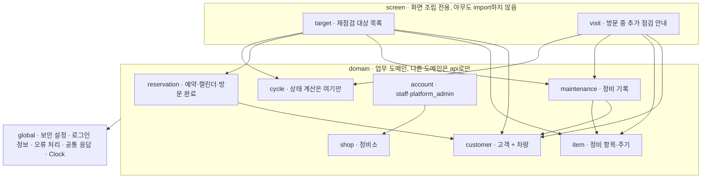

# 차곡 레포 구조 · 협업 규칙 · AI 스킬 안내

> 레포를 처음 보는 팀원을 위한 요약 안내서

상태: 레포 v11 기준 (2026-11-22 · @하다)

## 이 문서는

차곡을 어떤 레포 구조로 만들었고, 각 파일이 무슨 일을 하며, 우리가 어떤 규칙과 AI 스킬로 일할지를 정리한 안내서입니다. 규칙을 지키는 수고를 사람 대신 자동 검사와 스킬이 최대한 맡도록 설계했습니다.

규칙의 원본은 `chagok-docs`의 `CONVENTIONS.md`(코드 구조)·`CONTRIBUTING.md`(협업)와 `.claude/rules/`(AI용)입니다. 이 문서는 그것을 처음 보는 사람을 위한 요약입니다. **이 문서와 레포 파일이 다르면 레포 파일이 기준입니다.** 💡 표시는 형상관리 제안값이라 팀 회의에서 바뀔 수 있습니다.

v10 기준 핵심:

- **레포가 3개가 됐습니다.** GitHub Organization `OneMonthproJect` 안에 공개 레포로 `chagok-docs`·`chagok-backend`·`chagok-frontend`. 기획 문서·협업 규칙·코드 규칙·공용 AI 설정의 원본은 `chagok-docs`에만 있습니다.
- **MVP = P0 + P1.** 관문에 **MVP 점검**(`v0.8-mvp`)이 생겼고, P2는 MVP 점검을 통과한 뒤 `결정` 이슈로 하나씩 더합니다.
- **DB는 Flyway 기준**입니다. `schema.sql`·`data.sql` 대신 `db/migration/V*.sql`과 `db/seed/`.
- 코드 PR은 명세가 바뀌면 `chagok-docs` 문서 PR 링크를 답니다. pr-check가 검사합니다.

## 팀원이 쓰는 법

스킬 = 절차서, 메인 대화에서 함께 진행 · 에이전트 = 스킬을 싣고 별도 맥락 · 최소 권한으로 맡아서 결과만 돌려줌 (Claude Code 전용)

| 언제 | 누가 | 어느 레포에서 | 이렇게 말하기 | 스킬 | 에이전트 (Claude Code) |
|---|---|---|---|---|---|
| 새 아이디어 · 범위 추가 · P2 착수 | PM | docs | "이거 추가해도 돼? …" | `chagok-scope-guard` | `chagok-scope-keeper` |
| 이슈 만들기 | PM · 형상관리 | docs | "F-CUS 이슈 만들어줘" | `chagok-issue-writer` | — |
| 이슈 구현 (PR 본문 초안까지) | 구현 담당 | backend · frontend | "#12 구현해줘" | `chagok-issue-coder` | — 메인 대화에서 |
| 버그 | 구현 담당 | backend · frontend | "#20 버그 고쳐줘: 현상 …" | `chagok-bug-fix` | — 메인 대화에서 |
| PR 올리기 직전 자가 점검 | 작성자 | 해당 레포 | "@chagok-pr-reviewer 이 브랜치 봐줘" | `chagok-pr-review` | `chagok-pr-reviewer` |
| PR 리뷰 | 확인하는 팀원 | 해당 레포 | "#15 PR 리뷰해줘" | `chagok-pr-review` | `chagok-pr-reviewer` |
| 명세 바꾸기 전 | 누구나 | 어디서나 | "이거 바꾸려는데 어디 고쳐야 해?" | `chagok-spec-sync` 모드 A | — |
| 프론트 · 백 연결, 기능 묶음 끝 | 도메인관리 · 구현 담당 | backend · frontend | "API 계약 점검해줘" | `chagok-spec-sync` 모드 C | `chagok-contract-checker` |
| 시연 준비 | DB관리 | backend | "시연 데이터 만들어줘" | `chagok-seed-data` | `chagok-seed-builder` |
| 릴리스 전 | 형상관리자 | 작업 폴더 (세 레포) | "MVP 점검 릴리스 점검해줘" | `chagok-release-check` | — |

Claude Code에서는 에이전트가 있는 일이면 Claude가 알아서 맡기고, "@에이전트이름"으로 직접 불러도 됩니다. claude.ai에서는 스킬만 씁니다. 결과는 모두 제안이고, 커밋 · 승인 · 머지는 사람이 합니다. 쓴 스킬 · 에이전트 이름은 PR 템플릿 「AI 사용」과 `chagok-docs/docs/etc/AI_USAGE`에 남깁니다.

## 한눈에 보는 작업 흐름

팀원은 모두 각 레포의 `develop`에 PR로 올리고, `main`에는 형상관리자만 정해진 네 번(중간 점검 · MVP 점검 · 관문 2 · 발표) 세 레포를 함께 올립니다.

1. 이슈를 만든다 — 기능·버그는 코드 레포, 문서·결정은 `chagok-docs`
2. 그 레포의 최신 `develop`에서 `feature/#이슈번호-이름` 브랜치를 만든다
3. 작업하고 커밋한다: `feat: 무엇을 했는지 (#이슈번호)`
4. 명세(07·08·09)가 바뀌면 `chagok-docs`에 문서 PR을 먼저 올린다
5. `develop`으로 PR을 연다. 제목 `[#이슈번호] 제목`, 본문 첫 줄 `Closes #이슈번호`, 「문서 PR」 칸에 링크
6. 자동 검사가 돌고(❌면 머지하지 않음), 팀원 1명이 다른 코드 레포와 함께 띄워 확인한다(승인 인원 강제 없음)
7. Squash merge → 이슈가 자동으로 닫히고 브랜치가 자동으로 지워진다
8. (형상관리자) 관문마다 세 레포 `develop → main` 릴리스 PR → (코드 레포) CodeRabbit 점검 → 같은 태그

지금은 기획 · 설계 단계라 `chagok-docs` 작업이 중심입니다. 코드는 관문 1(주기표 · ERD · API 확정)을 통과한 뒤 `기반` 이슈로 시작합니다.

## 레포 3개와 각 파일의 역할

### 왜 문서를 따로 뺐나

백엔드와 프론트를 나누면, 둘이 함께 기준으로 삼는 것(API 명세, ERD, 화면 명세, 협업 규칙, AI 규칙)을 어디에 둘지가 문제가 됩니다. 한쪽 레포에 두면 다른 쪽 담당은 남의 레포에서 계약서를 고쳐야 하고, 양쪽에 복사하면 스펙 동기화 스킬이 한쪽만 고치는 순간부터 둘이 갈라집니다. 그래서 공용인 것은 어느 코드 레포에도 속하지 않는 세 번째 레포에 둡니다. 원칙은 하나입니다: **원본은 한 곳에만 두고, 나머지는 가리키기만 한다.**

| 무엇 | 원본 위치 | 코드 레포에서는 |
|---|---|---|
| 기획 문서 00~13 | `chagok-docs/docs/` | 읽기만 (`../chagok-docs/docs/`) |
| 협업 규칙 · 코드 구조 규칙 | `chagok-docs/CONTRIBUTING.md` · `CONVENTIONS.md` | 읽기만 |
| AI 공용 규칙 · 스킬 · 에이전트 | `chagok-docs/.claude/rules·skills·agents` | `sync-claude.sh`로 **복사, 커밋 안 함** |
| AI 권한 설정 | 레포마다 `.claude/settings.json` | 레포마다 다름 (gradle·npm 등) |
| AI 안내 | 레포마다 `CLAUDE.md` | 레포마다 다름 (그 레포에만 해당하는 것만) |
| CI · pr-check · CODEOWNERS · CodeRabbit | 레포마다 `.github/` | 레포마다 다름 (경로가 다르므로) |

레포마다 다른 것은 달라야 정상입니다. 문제는 같아야 할 것이 달라지는 경우라서, 같아야 할 것은 원본을 하나만 둡니다.

### 작업 폴더

세 레포는 한 폴더 안에 나란히 clone합니다. 코드 레포의 설정과 스크립트가 `../chagok-docs`를 기준으로 동작합니다.

```text
chagok/                      ← 내 PC의 작업 폴더 (레포 아님)
├── chagok-docs/
├── chagok-backend/
└── chagok-frontend/
```

### chagok-docs

```text
chagok-docs/
├── docs/                 기획·설계 문서 00~13 + etc/ (이 안내서 포함)
├── .github/              문서·결정 이슈 템플릿, PR 템플릿, pr-check, 라벨, CODEOWNERS
├── .claude/
│   ├── settings.json     이 레포용 AI 권한 설정
│   ├── rules/            ai-rules.md · source-of-truth.md   ← 세 레포 공용 원본
│   ├── skills/           스킬 8개                            ← 세 레포 공용 원본
│   └── agents/           에이전트 4개                         ← 세 레포 공용 원본
├── scripts/              setup-workspace.sh · sync-claude.sh · setup-labels.sh
├── README.md             프로젝트 소개, 레포 3개, 관문 표, 팀 역할
├── CONTRIBUTING.md       협업 규칙 (세 레포 공통)
├── CONVENTIONS.md        코드 구조 규칙 (백엔드·프론트)
└── CLAUDE.md             이 레포에서 AI로 작업할 때
```

### chagok-backend · chagok-frontend

```text
chagok-backend/                          chagok-frontend/
├── src/ (기반 이슈에서 생성)            ├── src/ (기반 이슈에서 생성)
│   └── main/resources/db/               │   ├── app/ shared/
│       ├── migration/  V*.sql           │   └── features/ pages/
│       └── (없음)                       │
├── .github/  기능·버그 템플릿, PR 템플릿, backend-ci / frontend-ci, pr-check, 라벨, CODEOWNERS
├── .claude/settings.json   (rules·skills·agents는 복사본, .gitignore)
├── .coderabbit.yaml
├── CLAUDE.md · README.md
└── .gitignore · .gitattributes · .editorconfig
```

| 위치 | 역할 | 누가 주로 보나 |
|---|---|---|
| `chagok-docs/CONVENTIONS.md` | 코드 구조 규칙의 유일한 원본: 7개 규칙, 패키지 구조, 의존 방향, 한 곳에만 둘 규칙, DB(Flyway), 변경 검증표, ArchUnit 초안 | 구현 담당 전원 |
| `chagok-docs/CONTRIBUTING.md` | 협업 규칙: 레포 3개, 브랜치 · 이슈 · 커밋 · PR · 릴리스 · 문서 동기화 · 패키지 주인 · 초기 설정 체크리스트 | 전원 |
| `docs/00·04·07·08` | 기준 문서: 범위, 기능 ID, ERD, API. 모든 ID의 출처 | 전원 |
| `docs/11_architecture` | 구조를 "왜" 그렇게 정했는지 (규칙 자체는 CONVENTIONS) | 전원 |
| `docs/12_backlog` | 기능 ID ↔ 백엔드·프론트 이슈 번호 ↔ 담당 표. 진행 상태 원본은 Organization Projects 보드 | PM, 형상관리 |
| `docs/13_changelog` | 기획이 왜 바뀌었는지 + 그 결정이 깨지는 상황. 문서끼리 어긋날 때 가장 먼저 보는 결정 기록 | 전원 |
| `docs/etc/` | AI 활용 기록, CodeRabbit 리뷰 기록, 트러블슈팅, 테스트 명세, 이 안내서 | 전원 |
| `scripts/setup-workspace.sh` | 작업 폴더 준비: 두 코드 레포 clone, develop 전환, AI 설정 복사 (처음 한 번) | 전원 |
| `scripts/sync-claude.sh` | `chagok-docs`의 공용 AI 설정을 코드 레포 `.claude/`로 복사 | Claude 쓰는 팀원 |
| `scripts/setup-labels.sh` | 세 레포 라벨 한 번에 생성 | 형상관리 |
| 레포마다 `.github/CODEOWNERS` | 패키지 주인. PR이 그 경로를 건드리면 주인에게 자동 리뷰 요청 (결정 14 후 기입) | 형상관리 |
| 레포마다 `.github/ISSUE_TEMPLATE/` | docs: 문서 · 결정(P2 착수 칸 포함) / 코드 레포: 기능(짝 이슈 칸 포함) · 버그 | 전원 |
| 레포마다 `.github/PULL_REQUEST_TEMPLATE.md` | `Closes #`, 「문서 PR」 칸, 완료 정의, 구조 체크, AI 사용 | 전원 |
| `.gitattributes` | 줄바꿈을 LF로 통일. Windows에서 생기는 가짜 변경 방지 | 자동 |

## 코드 구조: 고치기 쉬운 구조 💡

코드 규칙의 원본은 `chagok-docs`의 `CONVENTIONS.md`이고(백엔드는 1~6·8·9장, 프론트는 7장), 사람이 기억할 것은 아래 7개뿐입니다. 나머지는 ArchUnit 테스트 · ESLint · CodeRabbit · pr-check가 지킵니다.

백엔드(`chagok-backend`)는 세 층으로 나눕니다.

| 층 | 하는 일 | 패키지 |
|---|---|---|
| `global/` | 모든 도메인이 쓰는 기반 | 보안 설정, 로그인 정보, 오류, 공통 응답, Clock |
| `domain/` | 업무 도메인. 표를 가짐 | shop · account · customer(+vehicle) · item · maintenance · reservation · cycle(계산만) |
| `screen/` | 화면 조립 전용. 표 없음 | target(재점검 대상 목록) · visit(방문 중 안내) · booking(예약 상세 패널 💡) |

도메인 하나의 안쪽은 `api` · `controller` · `dto` · `service` · `entity` · `repository`입니다. 다른 패키지가 import할 수 있는 건 `api`(interface · record · enum)뿐이라, 도메인 안쪽을 바꿔도 밖은 무너지지 않습니다.

프론트(`chagok-frontend`)도 같은 생각입니다. `shared`(공통) ← `features`(도메인별) ← `pages`(화면 조립)이고, feature끼리는 import하지 않으며 ESLint가 막습니다. 상태는 서버가 준 값을 그대로 보여 주고 프론트에서 다시 계산하지 않습니다.

| # | 규칙 | 놀이방에서 일어난 일 |
|---|---|---|
| 1 | 다른 도메인은 그 도메인의 `api` 패키지로만 부른다 | 13개 도메인 중 9개가 Service 직접 주입으로 얽힘 |
| 2 | 의존 방향은 한쪽으로만 (외래키 방향 = 코드 방향) | 서로 import하는 순환 → 어느 쪽도 혼자 못 고침 |
| 3 | 같은 규칙은 한 곳에 (상태는 cycle, 소속 확인은 getOwned, 상태 전이는 Entity) | 같은 규칙 사본 5~6곳, 이미 어긋나 있었음 |
| 4 | 여러 도메인을 읽는 화면은 `screen`에서 조립, 아무도 screen을 import 안 함 | 마이페이지 · 관리자 화면이 순환을 만듦 |
| 5 | 오류는 ErrorCode로 던지고 전역 처리기 한 곳에서 | Controller 38개 중 13개가 각자 처리 |
| 6 | 상태(미확인/여유/임박/도래)는 저장하지 않고 조회 때 계산 | 규칙을 바꿀 때 데이터 수정이 필요 없게 |
| 7 | DB 구조는 Flyway 버전 파일이 기준, 이미 공유된 버전 파일은 고치지 않고 새 번호로 | 테스트 172개가 스키마 차이로 실패 |

### 의존 방향

화살표 = import해도 되는 방향(외래키 방향과 같음). 그 밖의 방향은 ArchUnit이 빌드에서 막습니다.



화살표가 없는 방향(예: customer가 maintenance를 부르기, reservation이 maintenance를 부르기)은 금지입니다. 아래쪽 도메인은 위쪽을 모르기 때문에, 안쪽을 고쳐도 `api`가 그대로면 위쪽은 영향이 없고, 새 기능은 위에 패키지를 더하는 식으로 붙습니다. "방문 완료 → 정비 기록 등록"은 코드 호출이 아니라 프론트의 화면 이동입니다.

### 바꾸거나 더할 때 건드리는 곳

이 구조가 맞는지는 "자주 생길 변경이 몇 곳을 건드리나"로 확인합니다. 표보다 많이 건드리게 되면 구조가 새고 있다는 신호이고, pr-check가 도메인 3개 이상을 건드린 PR에 경고를 띄웁니다.

| 변경 | 건드리는 곳 | 기존 코드 수정 |
|---|---|---|
| 정비 항목 주기값 변경 | 시드(`db/seed/`), 07 시드표 | 없음 |
| 임박 기준 변경 (1개월 → 2주) | cycle 상수 1개 + 테스트 기대값 | cycle만 |
| 상태 표시 문구 · 색 | 프론트 `StatusBadge` | 1파일 |
| API 응답에 필드 추가 | 그 도메인 dto + 08 + 프론트 types | 그 도메인만 |
| P0-나머지 외부 정비 · 거절 입력 | maintenance 입력 화면 · 검증 (enum과 cycle 처리는 이미 있음) | maintenance만 |
| P1 월평균 주행거리 추정 | cycle + maintenance.api 메서드 추가 + screen/target | 3곳, 추가 위주 |
| P1 연락 결과 기록 | 새 domain/contact(새 마이그레이션) + screen/target 표시 한 줄 | 새 패키지 + 1줄 |
| P1 신규 · 재방문 집계 | 새 screen/stats | 새 패키지 |
| P1 정비소 개설 · 정지 | shop 내부 + shop.api + 보안 설정 1줄 | shop + 1줄 |
| P1 정비소별 항목 설정 화면 | item 내부 + 화면 1개 | item만 |

P1(MVP)과 MVP 점검 뒤의 P2를 더할 때도 대부분 "새 패키지를 만들고 기존 코드에는 한 줄"로 끝나도록 설계했습니다. 놀이방에서 기능을 더하려면 너무 많은 곳을 건드려야 했던 문제를 이 표로 미리 확인합니다.

## 브랜치 · 이슈 · 커밋 · PR 규칙 💡

규칙은 다섯 줄로 요약됩니다: **이슈 먼저, 해당 레포의 `develop`에서 브랜치, `develop`으로 PR, 본문에 `Closes #`, 명세가 바뀌면 문서 PR 링크.**

| 브랜치 | 용도 | 머지 |
|---|---|---|
| `main` | 중간 점검 · MVP 점검 · 관문 2 · 발표 시점의 안정 버전 | 형상관리자만, Merge commit |
| `develop` | 기본 브랜치이자 통합 브랜치 | 팀원 확인 후 Squash (승인 인원 강제 없음) |
| `feature/#번호-이름` | 기능 | → develop |
| `fix/#번호-이름` | 버그 수정 | → develop |
| `docs/#번호-이름` | 문서만 | → develop |
| `chore/#번호-이름` | 설정 · 빌드 · CI · AI 설정 | → develop |

- 세 레포 모두 같은 브랜치 규칙입니다. 번호는 **그 레포의** 이슈 번호입니다.
- 브랜치 이름은 영문 소문자 · 숫자 · 하이픈. 예: `feature/#12-cycle-calc`
- 이슈 하나 = 브랜치 하나 = PR 하나. 하루 안에 머지할 크기로 쪼갭니다.
- 기능 하나가 API와 화면을 모두 가지면 **백엔드 이슈와 프론트 이슈로 나누고** 「짝 이슈」 칸으로 서로 링크합니다. 백엔드 이슈는 도메인 패키지 하나, 프론트 이슈는 화면 하나가 본체입니다.
- 다른 레포의 이슈 · PR은 `OneMonthproJect/chagok-docs#12`처럼 레포 이름을 붙여 적습니다.
- `main` · `develop`에 직접 push하지 않습니다. GitHub Free 기준이라 설정이 막아 주지 않으므로 팀원이 지키는 규칙입니다(CONTRIBUTING 5장 「GitHub Free 운영」).
- 이슈 제목은 `[F-기능ID] 무엇을`, 단계 라벨(`P0-핵심` / `P0-나머지` / `P1` / `P2` / `기반`) 필수.
- 단계 순서를 지킵니다: P1 이슈는 중간 점검 통과 전에 열지 않고, P2 이슈는 MVP 점검 통과 + `결정` 이슈 합의 전에 열지 않으며 한 번에 하나씩입니다. Non-goal 기능은 이슈도 만들지 않습니다.
- 개발 시작 후 범위 추가는 `결정` 이슈 + 전원 합의가 먼저입니다. 합의 전에 브랜치를 열지 않습니다.
- 범위를 줄이면 기능을 통째로 빼고, 같은 날 `chagok-docs`에서 00 · 04 · 08에 "보류"로 표시합니다.
- 커밋: `타입: 내용 (#번호)`. 타입은 `feat` `fix` `docs` `test` `refactor` `chore`.
- PR: 제목 `[#번호] 제목`, 본문 첫 줄 `Closes #번호`. push 전 `git pull origin develop`, 충돌은 올린 사람이 해결.
- 확인하는 사람은 브랜치를 받아 **다른 코드 레포의 develop과 함께 띄워** 실제로 실행해 봅니다. 남의 패키지를 건드렸다면 그 패키지 주인에게 확인을 받습니다(CODEOWNERS가 자동으로 요청).

머지된 브랜치는 GitHub에서 자동으로 지워집니다. Squash merge 뒤 같은 브랜치에서 이어 작업하면 충돌이 나기 때문에, 항상 새 브랜치에서 시작하도록 만든 장치입니다. 내 PC의 로컬 브랜치는 직접 정리합니다.

```bash
git switch develop
git pull --prune
git branch -D feature/#12-cycle-calc
```

## 자동으로 일어나는 일

PR을 열면 형식·비밀값·DB 규칙·빌드를 GitHub Actions가 자동으로 검사하고 PR에 ✅/❌를 표시합니다. GitHub Free 운영이라 ❌가 머지 버튼을 막지는 않습니다. **❌인 PR은 머지하지 않고**, 형상관리자가 확인합니다.

| 무엇 | 레포 | 결과 |
|---|---|---|
| 브랜치 이름 · PR 제목 · `Closes #` 검사 (다른 레포 이슈 `OneMonthproJect/<레포>#n`도 인정) | 세 레포 | 틀리면 머지 차단 |
| 커밋 · PR 본문에 AI 공동 작성자 표기 (`Co-authored-by: Claude` 등) | 세 레포 | 머지 차단 (PR 본문과 모든 커밋을 검사) |
| 관문 2 이후 `feature/` 브랜치 PR (`FEATURE_FREEZE=true`) | 세 레포 | 머지 차단 |
| 이미 develop에 있는 Flyway 버전 파일을 고치거나 지움 | backend | 머지 차단 |
| 마이그레이션이 바뀌었는데 「문서 PR」에 `chagok-docs` 링크 없음 | backend | 머지 차단 |
| Controller · DTO · ErrorCode가 바뀌었는데 문서 PR 링크 없음 | backend | 경고 |
| cycle 코드가 바뀌었는데 테스트 변경 없음 | backend | 경고 |
| 한 PR이 도메인 3개 이상을 건드림 | backend | 경고 (쪼갤 수 있는지, api 대신 내부를 고치지 않았는지) |
| `features/*/api · types`가 바뀌었는데 문서 PR 링크 없음, 새 페이지, feature 3개 이상 | frontend | 경고 |
| 기준 문서(00 · 04 · 07 · 08)가 바뀌었는데 13 changelog 없음 | docs | 경고 |
| 공용 AI 설정 · 세 레포 공통 규칙이 바뀜 | docs | 경고 (머지 후 팀 공지 안내) |
| 비밀값·민감 파일, DB·Flyway 규칙(공유된 마이그레이션 수정, 이름 규칙, `schema.sql`, classpath 안 시드, `ddl-auto`) | backend (비밀값은 세 레포) | 모든 PR. ❌ |
| Wrapper 검증 → 빌드 + DB 없는 테스트(ArchitectureTest) → DB 테스트(빈 MySQL, Flyway, 앱 기동). 통과·실패·건너뜀(검증 안 됨) 요약 | backend | 모든 PR, develop·main push. ❌ |
| `npm ci` · lint(ESLint 경계 규칙) · 빌드(타입 검사) | frontend | 모든 PR, develop·main push. ❌ |
| 패키지 주인에게 리뷰 요청 | 세 레포 | CODEOWNERS 기준 자동 |
| 영역 라벨 `backend` `frontend` `db` `docs` `ci`, 유형 라벨 `feature` `fix` | 세 레포 | 자동 부착 |
| `review-me` 라벨 | backend: cycle · global · 마이그레이션 / frontend: `src/app` · `src/shared/api` | 자동 부착(표시용). 필요하면 `@coderabbitai review` |
| 이슈 자동 클로즈 · 브랜치 삭제 · 보드 이동 | 세 레포 | develop 머지 때 |

이슈 자동 클로즈는 기본 브랜치에 머지될 때만 동작합니다. 그래서 세 레포 모두 기본 브랜치를 `develop`으로 둡니다. 브랜치 보호·필수 검사는 선택입니다. 켜면 ❌가 머지를 막지만, 켜지 않아도 운영 규칙은 같습니다.

## 릴리스와 CodeRabbit 점검

CodeRabbit은 코드 레포에만 설치하고, 모든 PR이 아니라 릴리스 PR과 위험한 PR에만 돌립니다.

| 언제 | CodeRabbit | 이유 |
|---|---|---|
| 일반 PR → develop | 돌지 않음 | 팀원 확인으로 충분 |
| 중요·복잡한 PR → develop | 필요할 때 `@coderabbitai review` (수동) | 반복 AI 리뷰를 만들지 않음 |
| 코드 레포 릴리스 PR develop → main | 자동 리뷰 1회 (`release` 라벨). 추가 push에는 자동 리뷰 없음 | main 직전 전체 점검 |
| `chagok-docs` PR | 돌지 않음 | 문서는 사람이 ID 일치로 봄 |

릴리스는 네 번입니다. **세 레포에 같은 날 같은 태그**를 달아, 태그 하나로 그 시점의 문서 · 백엔드 · 프론트를 맞춰 받을 수 있게 합니다.

| 시점 | 태그 | 리뷰 범위 |
|---|---|---|
| 중간 점검 | `v0.5-midcheck` | P0-핵심 |
| MVP 점검 | `v0.8-mvp` | P0 전체 + P1. 통과해야 P2 착수 |
| 관문 2 (기능 동결) | `v0.9-freeze` | MVP 점검 이후 변경분 (P2 포함 시 그 기능) |
| 발표 | `v1.0-demo` | 동결 이후 수정분 |

관문 2 이후에는 `FEATURE_FREEZE`를 `true`로 바꿉니다(Organization 변수 하나, 안 되면 레포마다). 그때부터 `feature/` 브랜치 PR은 pr-check가 ❌로 표시하고, 형상관리자는 `fix/` · `docs/`만 머지되게 확인합니다.

### PR 종류별로 일어나는 일

| | 팀원 PR (`feature/…` → develop) | 릴리스 PR (develop → main) |
|---|---|---|
| 누가 머지 | 확인한 팀원 | 형상관리자만 |
| CodeRabbit | 필요할 때 수동 요청 | 코드 레포는 자동 1회 (`release` 라벨) |
| 머지 방식 | Squash | Merge commit |
| 브랜치 삭제 | 자동 삭제 | 안 됨 (develop은 기본 브랜치) |
| 이슈 close | `Closes #`의 이슈 자동 close | 없음 (develop 머지 때 이미 닫힘) |

### CodeRabbit 지적 처리 흐름

CodeRabbit 리뷰는 머지 차단 조건이 아닙니다. 모든 제안을 고쳐야 하는 것도 아닙니다. 형상관리자가 지적마다 아래처럼 분류해 답글을 남기고 최종 판단합니다. 실제 오류 · 보안 · 데이터 손상 · 정비소 격리 위반을 먼저 고칩니다.

| 분류 | 기준 | 처리 |
|---|---|---|
| 수정 | 정비소 격리(shop_id) 누락, cycle 규칙 위반, 실행 오류, 보안, 08 명세와 불일치 | `fix/#번호-…`로 해당 레포 develop에 고친 뒤 릴리스 PR에 반영 |
| 미룸 | 이름 짓기, 리팩터링, 작은 성능 개선 등 시연에 영향 없는 것 | "관문 2 이후 검토" 답글 후 해결 처리 |
| 반영 안 함 | 기획 결정과 충돌 (예: 차량번호 중복 차단, 쓰지 않는 기능 추가) | 근거 문서를 답글로 남기고 해결 처리 |

- 판단: 형상관리자가 1차 분류, 주기 계산은 도메인관리, 마이그레이션 · 시드는 DB관리. 수정은 그 코드를 쓴 담당자.
- 기록: `chagok-docs/docs/etc/DEV_REVIEW_CodeRabbit.md`에 `| 레포 | 릴리스 | 파일 | 지적 요약 | 분류 | 사유 | 수정 PR |` 한 줄씩.
- 시간: 릴리스 당일 오전 리뷰 → 점심 전 분류 → 오후 수정 · 머지.

### 릴리스 날 순서

1. `chagok-release-check` 스킬로 세 레포를 함께 점검 (완료 정의, 짝 이슈가 둘 다 머지됐는지, 열린 P0 · P1 이슈, 범위 위반, 문서 · 코드, 구조 테스트. 발표 때는 "시연에서 하지 말 것" 메모까지)
2. `chagok-docs` 릴리스 PR → 형상관리자 확인 후 머지
3. `chagok-backend` · `chagok-frontend` 릴리스 PR → `release` 라벨 자동 → CodeRabbit 리뷰 (안 돌면 `@coderabbitai full review` 댓글)
4. 지적 분류 → 수정할 것은 `fix/` PR로 develop에 머지 → 모든 지적 해결 처리
5. 세 레포 main을 함께 받아 빈 DB에서 시나리오 A · B와 격리 시연 확인 → Merge commit
6. 세 레포에 같은 태그를 달고 GitHub Release의 "Generate release notes"로 변경 목록 자동 작성

## 문서와 코드 맞추기

기획 문서가 기준이고, 기획 문서는 `chagok-docs`에만 있습니다. 코드와 문서가 다르면 코드에 맞춰 문서를 슬쩍 고치지 않고, 어느 쪽이 맞는지 팀이 정합니다.

관문 1 이후 명세를 바꾸는 순서:

1. `chagok-docs`에 `결정` 이슈: 무엇을 왜 바꾸는지
2. `chagok-docs`에 문서 PR: 문서 수정 + `13_changelog`에 한 줄
3. 코드 레포에 코드 PR: 「문서 PR」 칸에 2의 링크
4. **문서 PR을 먼저(또는 같은 날) 머지**합니다. 코드가 문서보다 앞서 develop에 들어가지 않게.

| 문서 (chagok-docs) | 맞춰야 할 코드 | 지키는 방법 |
|---|---|---|
| 07 ERD | backend `src/main/resources/db/migration/V*.sql`, `db/seed/demo_seed.sql`, Entity | 마이그레이션이 바뀌면 문서 PR 링크 필수(pr-check ❌). 이미 있는 버전 파일은 고치지 않고 새 번호로 |
| 08 API | backend Controller · DTO · ErrorCode, frontend `features/*/api.ts` · `types.ts` | 바뀌면 08의 표와 JSON 예시를 함께 수정하는 문서 PR, 반대쪽 담당에게 링크 공유. 자동 검사가 경고 |
| 04 주기 규칙 | backend `domain/cycle`, 테스트 T1~T17(04) | 규칙을 바꾸면 테스트 기대값부터. 도메인관리 리뷰 필수 |
| 격리 규칙 | backend 모든 정비소 데이터 조회 | 테스트 X1~X10. 실패하면 머지 금지 |
| 09 화면 | frontend `src/pages` | 화면 ID와 페이지 파일 1:1 |
| 00 범위 | 존재하는 기능 전체 | 차례가 오지 않은 단계(MVP 점검 전 P2 등) · Non-goal 기능은 빈 화면 · 버튼 · API · 테이블로도 만들지 않음 |

08은 API마다 JSON 예시 블록을 둡니다. 요청 본문이 있으면 요청 예시, 모든 API는 공통 응답으로 감싼 성공 응답 예시를 넣습니다. 값은 시드에서 가져오고, 필드 이름 · enum · 날짜 형식은 표와 글자까지 같게 씁니다. 프론트 `types.ts`와 백엔드 연결 전 목업은 이 JSON을 기준으로 만듭니다. 예시는 08 안에만 두고 코드 레포에 복사하지 않습니다.

### 문서끼리 어긋날 때

원본은 `chagok-docs/.claude/rules/source-of-truth.md`이고, Claude Code가 세션마다 자동으로 읽습니다(코드 레포에서는 복사본). 사람도 같은 순서로 판단합니다.

1. **결정 기록**: `13_changelog`와 닫힌 `결정` 이슈의 「결정 결과」. 날짜가 늦은 것이 우선입니다.
2. **기준 문서** 00 · 04 · 07 · 08: 문서마다 자기 영역의 원본입니다. 00은 범위 · 단계(MVP = P0 + P1), 04는 기능 ID · 규칙 · T-xx, 07은 테이블 · 제약 · 시드표, 08은 API · 응답 · 에러 코드 · JSON 예시.
3. **나머지 문서**(01 · 02 · 03 · 05 · 06 · 09 · 10 · 11 · 12 · `etc/`): 위에 맞춰 고치는 대상입니다.

기준 문서끼리 다르면 어느 쪽도 고르지 않고 `결정` 이슈로 올립니다. 단, 00에서 P2(MVP 점검 전) · Non-goal인 기능이 다른 문서에 구현 대상으로 들어와 있으면 00이 맞습니다.

## 팀 공용 Claude 설정

누가 어느 레포에서 AI를 쓰든 같은 규칙으로 결과가 나오도록, 공용 규칙 · 스킬 · 에이전트는 `chagok-docs` 한 곳에 두고, 레포마다 다른 것(권한 설정, 그 레포만의 안내)은 레포마다 둡니다.

**`.claude/rules/ai-rules.md`** (공용): AI가 세 레포에서 항상 지키는 규칙입니다. 작업 폴더와 경로 읽는 법, 도메인 3개 이상이면 멈추고 쪼개자고 제안하기, 문서에 없는 ID를 지어내지 않기, 문서는 `chagok-docs`에서만 고치기, 차례가 오지 않은 단계의 기능을 미리 만들지 않기, 사람 확인 없이 커밋 · push · 머지 · 이슈 생성하지 않기, 비밀 파일 읽지 않기, AI 사용 기록 남기기, AI를 공동 작성자로 올리지 않기. 스킬 · 에이전트 표도 여기 있습니다.

**`.claude/rules/source-of-truth.md`** (공용): 문서끼리 어긋날 때의 판단 순서(위 절).

**`CLAUDE.md`** (레포마다): 그 레포에만 해당하는 것만 적습니다. 코드 레포는 원본 문서 위치, Flyway · 시드 규칙(백엔드), types · pages 규칙(프론트), 빌드 명령, 그리고 "`.claude/rules`가 비어 있으면 동기화부터"를 적어 둡니다.

**`.claude/settings.json`** (레포마다): 어기면 되돌리기 어려운 것을 설정으로 강제합니다.

- `.env` · `secrets/` · 키 파일은 AI가 읽을 수 없습니다.
- force push와 `main` · `develop` 직접 push는 AI가 실행할 수 없게 막습니다(사람의 push는 팀 규칙으로 지킴).
- 커밋 · push · PR 생성 · 머지 · 이슈 생성 · 태그 · 릴리스는 실행 전에 확인을 묻습니다.
- 옆 레포를 읽을 수 있게 `additionalDirectories`에 `../chagok-docs` 등을 넣어 둡니다.
- 코드 레포에서는 복사본인 `.claude/rules · skills · agents`를 AI가 고치지 못하게 막습니다(고칠 일은 `chagok-docs`에서).
- 개인 설정은 `.claude/settings.local.json`에 둡니다(커밋되지 않음).

**AI는 도구다**: 커밋 메시지 · PR 본문에 `Co-authored-by: Claude`, `noreply@anthropic.com`, "Generated with Claude Code"를 넣지 않습니다. pr-check가 세 레포에서 PR 본문과 모든 커밋을 검사해 있으면 ❌로 표시합니다. AI 계정을 Collaborator · Reviewer · CODEOWNERS로 지정하지 않고, AI 사용 사실은 PR 템플릿 「AI 사용」과 `chagok-docs/docs/etc/AI_USAGE`에 사람이 적습니다.

### 스킬 8개

| 스킬 | 누가 | 언제 | 결과물 |
|---|---|---|---|
| `chagok-scope-guard` | PM | 새 기능 · 범위 추가 의견, P2 착수 의견 | 진행 / 쪼개기 / 결정 이슈 / 보류 / 거절 판정과 근거(00 범위, 지금 단계, 열린 P0 · P1 이슈). P2는 MVP 점검 후에도 결정 이슈로. 결정 이슈 초안까지 |
| `chagok-issue-writer` | PM · 형상관리 | 기능 ID로 이슈를 만들 때 | 백엔드(도메인 패키지 하나) · 프론트(화면 하나) 이슈로 나누고 짝 이슈로 연결. 레포 · 라벨 · 마일스톤 · 담당. 기반 이슈 3개 세트도 |
| `chagok-issue-coder` | 구현 담당 | 이슈를 구현할 때 | 계획 보고 → 코드 · 테스트 → CONVENTIONS 7개 자체 점검 → 문서 PR 필요 여부 → 브랜치 · 커밋 · PR 본문, AI 사용 기록 한 줄 |
| `chagok-bug-fix` | 구현 담당 | 명세와 다른 동작을 고칠 때 (동결 후에도) | 04 · 05 · 08 근거 → 재현 테스트(T-xx · X-xx) → 원인 한 곳 최소 수정, 같은 패턴이 남은 곳 목록, `fix/` 브랜치 · PR 본문 |
| `chagok-pr-review` | 확인하는 팀원 | develop 대상 PR을 리뷰할 때 | 이슈 완료 조건 · 범위 · 격리 · cycle · 08 일치 · 구조 · 문서 PR 링크 · AI 표기 지적, 두 코드 레포를 함께 띄우는 확인 순서, 리뷰 코멘트 초안 |
| `chagok-spec-sync` | 누구나 | 명세를 바꾸기 전(모드 A), 문서 · 코드 대조(B), API 계약 점검(C) | A: 세 레포에 걸친 영향 범위, 문서 PR → 코드 PR 순서, 13 changelog 초안. B: 어긋난 곳 표. C: 08 ↔ backend ↔ frontend 대조표 |
| `chagok-seed-data` | DB관리 | 시연 시드를 만들거나 고칠 때 | 07 시드표 기준 `db/seed/demo_seed.sql`(시연 전용 DB, 실행기로만), 오늘 기준 상대 날짜, 삭제·구조 변경 문장 없음, 시연 계정 1234 해시, 기대 상태표와 시연 순서 |
| `chagok-release-check` | 형상관리자 | 세 레포 develop → main 릴리스 전 | 머지 가능 / 조건부 / 보류 판정, 한쪽만 머지된 기능, 구조 테스트 · API 계약 · 시드 확인, CodeRabbit 미해결 지적 분류, 빈 DB 시연 순서, 세 레포 태그 명령 |

스킬은 이어서 쓰도록 만들었습니다. 범위 추가 의견은 scope-guard가 먼저 거르고, issue-writer가 만든 이슈를 issue-coder(버그는 bug-fix)가 받아 **분석 → 계획 보고 → 개발자 승인 → 구현 → 검증 → 결과 보고** 순서로 구현하고(`ai-rules.md`), pr-review로 승인자가 확인합니다. 프론트 · 백이 연결되면 spec-sync 모드 C로 08과 맞추고, 시연 전에는 seed-data로 시드를 맞추고, 릴리스 때 release-check가 세 레포를 함께 점검합니다.

### 배포

**Claude Code**

- 원본은 `chagok-docs/.claude/`입니다. `chagok-docs`에서 Claude Code를 실행하면 바로 쓰입니다.
- 코드 레포에서는 복사본을 씁니다. 처음 한 번과 `chagok-docs`를 pull한 뒤 코드 레포 루트에서 `bash ../chagok-docs/scripts/sync-claude.sh`를 실행합니다(Git Bash). 작업 폴더에서 `bash chagok-docs/scripts/sync-claude.sh chagok-backend chagok-frontend`로 두 레포를 한 번에 해도 됩니다.
- 왜 복사인가: Claude Code는 다른 폴더의 에이전트를 불러오지 않고, 스킬도 `--add-dir`로 연 폴더에서만 불러옵니다. 복사본은 `.gitignore`로 커밋되지 않으므로 원본은 여전히 하나입니다. 어느 버전을 복사했는지는 `.claude/.synced-from`에 남습니다.
- 코드 레포 루트에서 `claude`를 실행하고, 처음 뜨는 작업 공간 신뢰 확인을 수락합니다. 입력창에 `/chagok`을 치면 스킬 8개가 보여야 합니다.
- 개인 폴더(`~/.claude/skills/`)에 예전에 복사해 둔 `chagok-*`가 있으면 지웁니다. 같은 이름이면 개인 폴더가 레포보다 우선해서 옛 버전이 쓰입니다.

**claude.ai**

- 형상관리자가 배포하는 `chagok-*.skill` 8개(`chagok-docs/.claude/skills/`와 같은 v10)를 각자 스킬로 추가합니다. 스킬이 바뀌면 다시 받아 같은 이름으로 덮어씁니다.
- claude.ai는 레포 파일을 직접 읽지 못하므로, 필요한 문서(08 일부, `source-of-truth.md` 등)를 대화에 붙여 넣습니다. 에이전트는 claude.ai에 없습니다.

**스킬 · 규칙을 고칠 때**

- `chagok-docs`에서 `chore/#번호-update-skills` 브랜치와 PR로 합니다(`.claude/`는 형상관리 소유). 코드 레포의 복사본은 고치지 않습니다.
- 머지 후 팀에 "chagok-docs pull → sync-claude.sh 다시 실행"을 공지하고 `.skill` 파일도 다시 배포합니다(pr-check가 이 공지를 경고로 알려 줍니다).

## 스킬과 에이전트

스킬 위에 Claude Code 에이전트(서브에이전트) 4개를 둡니다. 스킬은 "어떻게 하는가"를 적은 절차의 원본이고, 에이전트는 그 스킬을 미리 싣고 별도 맥락 · 최소 권한으로 일을 맡아 결과만 돌려주는 담당자입니다.

| 에이전트 | 맡는 일 | 싣는 스킬 | 쓰기 권한 | 언제 맡기나 |
|---|---|---|---|---|
| `chagok-contract-checker` | 08 표 · JSON 예시 ↔ backend Controller · DTO ↔ frontend `api.ts` · `types.ts` 대조표 | `chagok-spec-sync` (모드 C) | 없음 | Controller · DTO · `types.ts`를 바꾼 뒤, 프론트 · 백 연결 직후, 릴리스 전 |
| `chagok-pr-reviewer` | PR 1차 리뷰: 심각도별 지적, 직접 실행 순서, 코멘트 초안 | `chagok-pr-review` | 없음 (승인 · 코멘트 게시 금지) | PR 올리기 직전 작성자 자가 점검, 승인자 리뷰 |
| `chagok-scope-keeper` | 범위 판정과 결정 이슈 초안 | `chagok-scope-guard` | 없음 | 새 기능 · 범위 추가 · P2 착수 의견, 이슈를 새로 만들기 전 |
| `chagok-seed-builder` | 시연 시드와 기대 상태표 | `chagok-seed-data` | `db/seed/demo_seed.sql`만 | 시드를 만들거나 고칠 때, 중간 점검 · MVP 점검 · 발표 전 |

### 에이전트로 뺀 기준

- 읽을 파일이 많아 메인 대화의 맥락을 아껴야 하는 일: API 계약 점검(세 레포를 읽음), PR 리뷰
- 작성자와 떨어진 새 눈으로 봐야 하는 일: PR 리뷰, 범위 판정
- 권한을 좁게 묶을 수 있는 일: 넷 중 셋은 읽기 전용, 시드 담당은 시드 파일만 고침

구현(`chagok-issue-coder`)과 버그 수정은 에이전트로 만들지 않았습니다. 사람과 주고받으며 고쳐야 하고, 계획 · 구현 · 테스트가 한 맥락을 공유해야 해서 메인 대화가 맞습니다.

### 적절하게 쓰기 위한 장치

- 에이전트 결과는 제안입니다. 고칠지, 커밋 · 머지할지는 사람이 정합니다.
- 리뷰 에이전트는 `gh pr review` · `gh pr comment` · `gh pr merge`를 실행하지 않도록 지시하고, `settings.json`도 실행 전에 확인을 묻습니다.
- 에이전트도 같은 `ai-rules.md` · `settings.json` · pr-check를 받습니다.
- 에이전트를 쓴 작업은 `AI_USAGE`의 「스킬 · 에이전트」 칸과 PR 템플릿 「AI 사용」에 이름을 남깁니다. 발표 때 AI를 어디에 어떻게 썼는지 보여 줄 근거가 됩니다.

### 한 번 도는 흐름

1. 구현 담당이 코드 레포에서 `chagok-issue-coder`로 이슈를 구현한다 (메인 대화)
2. 명세가 바뀌어야 하면 `chagok-docs`에 문서 PR을 먼저 올린다
3. API를 건드렸으면 `chagok-contract-checker`가 08과 대조한다
4. `chagok-pr-reviewer`가 1차 리뷰를 돌려준다 → 사람이 고칠 것을 고르고 PR을 올린다
5. 확인하는 팀원도 `chagok-pr-reviewer` 결과를 보고, 두 코드 레포를 함께 띄워 직접 실행해 본 뒤 머지한다(✅ 확인)

에이전트를 더 늘리지는 않습니다. 늘릴수록 관리할 설정과 예상 밖 동작이 함께 늘어납니다. 개발 중에 같은 요청을 매번 반복하는 일이 생기면 그때 그 작업만 추가로 검토합니다.

## 팀 회의에서 정할 것

- 이 문서의 💡 규칙(브랜치 이름, 커밋 형식, Squash merge)을 그대로 쓸지
- `CONVENTIONS.md` 패키지 구조와 의존 방향(결정 20)을 확정할지, 특히 다른 도메인 계약을 `api` 패키지에 두는 방식
- 시연 DB 이름(💡 `chagok_demo`) — DB관리
- 구현 담당 방식: 한 도메인의 백엔드 · 프론트 짝 이슈를 같은 사람이 맡을지 나눠 맡을지. 어느 쪽이든 패키지 하나 = 주인 1명으로 CODEOWNERS에 기입
- 같은 차량 · 같은 시각 중복 예약을 DB 유일 제약으로 막을지 (결정 이슈로 따로)
- 관문 1 · 중간 점검 · MVP 점검 · 관문 2 · 발표 날짜 (릴리스 태그 날짜와 같음)
- Claude Code를 쓰는 팀원이 누구인지 (동기화 · 배포 공지 대상)
- AI 공동 작성자 표기 금지와 AI 사용 기록 방식이 과정의 AI 사용 기준과 맞는지 (강사님께 확인)

## 팀원이 처음 할 일

1. GitHub Organization 초대 메일 수락
2. 작업 폴더를 만들고 세 레포 준비 (Git Bash):
   ```bash
   mkdir chagok && cd chagok
   git clone https://github.com/OneMonthproJect/chagok-docs.git
   bash chagok-docs/scripts/setup-workspace.sh OneMonthproJect
   ```
3. `chagok-docs/CONTRIBUTING.md` 읽기 (협업 규칙, 0장 레포 3개부터)
4. `chagok-docs/CONVENTIONS.md` 읽기: 백엔드는 1~6장, 프론트는 7장. 내가 주인인 패키지의 위치 확인
5. Claude를 쓴다면 내 코드 레포의 `CLAUDE.md`와 `.claude/rules/ai-rules.md` 읽기. 코드 레포 루트에서 `claude` 실행 → 신뢰 확인 수락 → `/chagok`으로 스킬 8개 확인. claude.ai는 `chagok-*.skill` 8개 추가
6. 개발 환경: JDK 21, Node 22 LTS, MySQL 8, `git config --global user.name` · `user.email`을 GitHub 계정과 같게
7. 첫 작업: 내 담당 문서나 결정 이슈 하나를 골라 `chagok-docs`에서 `docs/#번호-이름` 브랜치로 PR 올려 보기

## 이 안내서 변경 이력

| 날짜 | 레포 | 바뀐 것 |
|---|---|---|
| 2026-11-20 | v5 | 첫 판 |
| 2026-11-20 | v6 | `.claude/rules/source-of-truth.md` 추가 반영 |
| 2026-11-20 | v7 | 스킬 8개 v7 반영, 배포를 `git pull` 기준으로, claude.ai용 `.skill` 배포 |
| 2026-11-22 | v11 | GitHub Free 운영(승인·브랜치 보호 강제 없음, ❌ PR 머지 금지), CodeRabbit 릴리스 중심, 차단·경고 기준, 비밀값·DB 규칙 검사, 시연 시드 분리(`db/seed/`), Gradle Wrapper·CI 3단계, ArchitectureTest, AI 개발 6단계 |
| 2026-11-22 | v10 | 기획안 v10과 버전을 맞춤. Organization `OneMonthproJect`·공개 레포, 예약 상세 패널용 `screen/booking`(💡), 점검 결과·예약 목적·홈·도면 결정 반영(CONVENTIONS·13 changelog·시드 스킬) |
| 2026-11-22 | v8 | 레포 3개(`chagok-docs` · `chagok-backend` · `chagok-frontend`)로 전면 개편: 원본 위치 표, 작업 폴더, `sync-claude.sh` 배포, 레포별 자동 검사 · 문서 PR 링크. MVP = P0 + P1, MVP 점검 · `v0.8-mvp`, P2 규칙. Flyway 기준. 프로젝트 기간 표기 삭제 |
