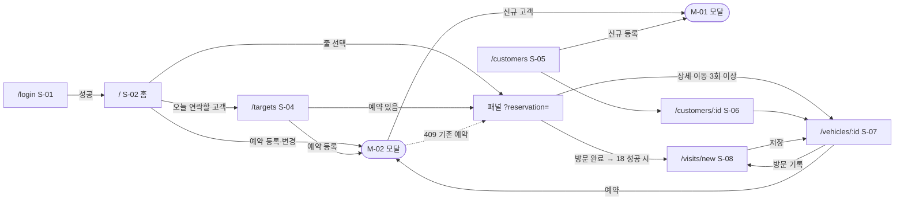

# 07 프론트 화면 구조·라우팅·컴포넌트 설계 (추천안)

> 기준 시각: 2026-11-24, docs develop `cf9ef3f`, frontend develop `bf2ab08`. **이 문서는 추천안이다.** 09 화면 명세(화면 구성·이동 경로), 08 API 번호, CONVENTIONS 7장(프론트 구조·Mock)에 맞추고, 그 문서에 **없던 것**(URL, 페이지별 컴포넌트 트리, 반복 컴포넌트 구분 기준)만 채운다. 09와 다르면 09가 맞다.
> 범위는 **P0-핵심만**이다. P0-나머지·P1은 "확장 자리"로만 적고 지금 만들지 않는다(00 3장, 09 0장 「빈 화면 금지」).
> 💡 = 팀 확인 필요. 확정되면 URL 표는 09 2장에, 컴포넌트 구분 기준은 CONVENTIONS 7장에 넣는 docs PR을 낸다(D-19 세부 확정 후속: 프론트 구현 담당·도메인관리, 화면 이슈 착수 전).
> 이 설계의 구현 이슈는 [02](02_P0_개발이슈_생성계획.md)의 **3-1 앱 골격**(라우트·`AppLayout`·머리·메뉴)과 **3-2 공통 UI**다. 어느 이슈가 어느 파일을 만들고 고치는지(충돌 방지)는 [08](08_구현_파일_소유_충돌방지.md).

## 1. 페이지는 어떻게 연결되는가

### 1.1 URL (추천)

| URL | 화면 | 접근 | 쿼리·메모 |
|---|---|---|---|
| `/login` | S-01 로그인 | 공개 | 이미 토큰이 있으면 `/`로. 이동 경로의 `state.from`·`reason` 계약은 FU-3 결정 전 |
| `/` | S-02 홈 (오늘 예약 목록 + 예약 상세 패널) | 로그인 | `?date=YYYY-MM-DD` 없으면 오늘, `?reservation=<id>` 있으면 패널 열림 |
| `/targets` | S-04 재점검 대상 | 로그인 | — |
| `/customers` | S-05 고객·차량 목록 | 로그인 | `?q=` 검색어(쪽은 `?page=`) |
| `/customers/:customerId` | S-06 고객 상세 | 로그인 | 차량 추가는 같은 화면 안(인라인) |
| `/vehicles/:vehicleId` | S-07 차량 상세 | 로그인 | 정비 이력 더 보기는 화면 안 |
| `/visits/new` | S-08 방문·정비 기록 | 로그인 | `?vehicleId=`(없으면 화면에서 검색), `?reservationId=`(예약에서 왔을 때) |
| 그 밖 | → `/login` 이동 | | 이미 `App.jsx`의 `*` 처리 |

- **M-01(고객·차량 등록)·M-02(예약 등록·변경)는 URL이 없는 모달**이다. 여는 화면의 상태로만 연다.
- **예약 상세 패널은 S-02에만 있다.** 다른 화면(S-04·S-07)에서 "기존 예약 열기"가 필요하면 `/?date=…&reservation=<id>`로 이동한다(09 M-02의 409 처리, S-04의 "예약 있음" 💡). 패널 닫기·뒤로 가기는 `reservation` 쿼리를 지우는 것이다(09 S-02: 좁은 화면 뒤로 가기).
- 모든 URL 상수는 `src/app/paths.js`의 `PATHS`에 둔다(현재 `LOGIN`뿐). 화면 이슈가 자기 경로를 더하고, 컴포넌트는 문자열 경로를 직접 쓰지 않는다.
- 메뉴(09 0장 💡): 홈 `/` · 재점검 대상 `/targets` · 고객·차량 `/customers`. 항목은 각 화면의 `pages/Sxx/route.jsx`가 `menu: { label, order }`로 선언하고 `AppMenu`가 읽는다(라우트가 있는 항목만 보이므로 빈 메뉴가 없고, 화면 이슈가 `App.jsx`·`AppMenu`를 고치지 않는다 — [08](08_구현_파일_소유_충돌방지.md)).

### 1.2 이동 경로 (09 2장의 P0-핵심 부분 + URL)



방문 완료(18)가 실패(409 등)하면 S-08로 이동하지 않고 패널을 다시 조회한다(09 S-02).

## 2. 공통 화면은 어떻게 묶이는가

```
<BrowserRouter>
  /login                → pages/S01          (AppLayout 밖)
  RequireAuth           → 토큰 없으면 /login (401 처리는 shared/api/client.ts)
    └ AppLayout          ← 공통 화면 묶음 (머리 + 메뉴 + 본문 자리)
        ├ /               pages/S02
        ├ /targets        pages/S04
        ├ /customers      pages/S05
        ├ /customers/:id  pages/S06
        ├ /vehicles/:id   pages/S07
        └ /visits/new     pages/S08
```

| 공통 묶음 | 하는 일 | 쓰이는 곳 | 위치 | 호출 API |
|---|---|---|---|---|
| `AppLayout` | `shared/ui/Layout`에 머리·메뉴를 끼운 앱 골격, 본문은 `<Outlet/>` | S-02·04·05·06·07·08 (S-01 제외) | `app/` | — |
| `AppHeader` | 정비소명·로그인한 이름·역할·로그아웃 (로그아웃 = 토큰 삭제 후 `/login`) | `AppLayout` | `app/` | 03 `GET /api/me` (한 번 읽어 공유) |
| `AppMenu` | 홈 · 재점검 대상 · 고객·차량. 넓은 화면은 왼쪽, 좁은 화면(1024px 미만 💡)은 위쪽 탭 | `AppLayout` | `app/` | — |
| `RequireAuth`·`UnauthorizedRedirect` | 로그인 가드, 401이면 토큰 삭제 후 로그인 | 전체 | `app/` (있음) | — |
| `client.ts` | 공통 응답·오류(400 필드·401·403·404·409·500·네트워크), Mock 전환 판정 | 모든 `api.ts` | `shared/api/` (있음) | — |
| `StatusBadge` | 미확인/여유/임박/도래 글자+색 | 4곳(아래 3.2) | `shared/ui/` (있음) | — |
| `Button` | 요청 중 비활성(`submitGuard`) | 모든 저장·등록 | `shared/ui/` (있음) | — |

`AppHeader`·`AppMenu`는 `features/auth`를 쓰므로 `shared`가 아니라 `app/`에 둔다(`shared`는 아무것도 import하지 않음). 이 위치는 3-1 구현 때 CONVENTIONS 7장과 함께 확인한다 💡.

## 3. 페이지별 골격 (컴포넌트·API)

경로의 `features/…`는 그 도메인의 `components/`다. 컴포넌트 이름은 추천이고, 구현 이슈에서 바꿀 수 있다. 데이터 호출은 `features/<도메인>/api.ts`를 거치고 `pages`는 `mocks/`를 import하지 않는다(CONVENTIONS 7장).

### 3.1 페이지 ↔ 컴포넌트 ↔ API

| 화면 | 페이지 구성 (위 → 아래) | 호출 API (08) | 이슈 |
|---|---|---|---|
| **S-01** `/login` | `LoginForm`(아이디·비밀번호·버튼, 실패 문구 하나) ← `features/auth` | 01 `POST /api/auth/login` | 3 |
| **S-02** `/` | `SummaryCards`(오늘 예약 N건 · 오늘 연락할 고객 N명 → `/targets`) → `DateNavigator`(앞뒤·오늘로) → `ReservationList`(`ReservationRow`×N, 빈 상태 문구+[예약 등록]) → `ReservationPanel`(오른쪽, 좁은 화면은 전체) → `ReservationFormModal`(M-02) | 04 `GET /api/home`(요약), 15 `GET /api/reservations?from=&to=`(목록), 17 패널, 18 방문 완료, 16·19 등록·변경 | 14-1·14-2·15·17 |
| **S-04** `/targets` | 머리(기준일·대상 수) → `TargetList`(`TargetRow`: 고객·연락처·차량번호·`ItemStatusList`(대상 항목)·"예약 있음" 꼬리표·[예약 등록]) → `ReservationFormModal`(차량 채움) | 14 `GET /api/targets`, 16 `POST /api/reservations` | 16 |
| **S-05** `/customers` | `CustomerSearchBox` → `CustomerResultList`(`CustomerRow`) → [신규 등록] → `CustomerVehicleFormModal`(M-01) | 05 `GET /api/customers`, 06 `POST /api/customers` | 5 |
| **S-06** `/customers/:id` | `CustomerInfoCard` → `CustomerVehicleList`(`VehicleRow`: 차종·연식·최근 주행거리·도래 n·임박 n → S-07) → `AddVehicleInline`(차종 필수) | 07 `GET /api/customers/{id}`, 08 `POST …/vehicles` | 6·6-1 |
| **S-07** `/vehicles/:id` | `VehicleCustomerHeader`(고객명 → S-06) → `ItemStatusList`(표: 항목·상태·기준 기록·다음 정비일·다음 km) → `VisitHistory`(방문 단위 최신순, 더 보기) → 버튼[방문 기록 → S-08]·[예약 → M-02] | 09 `GET /api/vehicles/{id}`, 10 `…/item-status`, 11 `…/visits` | 9 |
| **S-08** `/visits/new` | `VehiclePickerOrSummary`(차량번호·고객명) → `VisitInfoForm`(방문일·주행거리, 비었으면 연식·주행거리 안내) → `ItemStatusList`(미리보기, "저장 전 미리보기 — 기록되지 않음") → `ItemRecordRows`(6개 항목: 기록 안 함/교체/점검 + 메모) → [저장] → S-07 | 09(차량), 10 미리보기(입력 멈춘 뒤 0.5초 💡), 13 `GET /api/items`, 12 `POST …/visits` | 10 |
| M-01 모달 | `CustomerVehicleFormModal`: 위에 기존 고객 검색 결과 → 입력(고객명·연락처·동의 기본 미체크·차량번호·**차종**·연식·주행거리) | 05(검색), 06 | 5 |
| M-02 모달 | `ReservationFormModal`: 차량 선택(`vehiclePicker` 자리) → 날짜·시각(30분) → 예약 목적(항목 체크·기타·메모) → 변경 모드는 `version` 전송 | 05(차량 검색), 13(항목), 16, 19 | 14-2 |

`AppLayout`에서 03이 한 번 호출된다(2장). 페이지별 API를 모으면 S-02는 04·15·16·17·18·19, S-04는 14·16, S-05는 05·06, S-06은 07·08, S-07은 09·10·11, S-08은 09·10·12·13이다.

### 3.2 반복되는 컴포넌트와 구분 기준

| 반복 요소 | 쓰이는 곳 | 구분 | 위치 |
|---|---|---|---|
| `StatusBadge` | 패널·S-04·S-07·S-08 | 원자 컴포넌트. 상태 글자+색 한 곳 | `shared/ui` (있음) |
| `ItemStatusList` | 패널(배지만), S-04(배지+다음 정비일), S-07(표), S-08(미리보기+근거) | **모양만 `variant`로**(`summary`·`target`·`table`·`preview`). 상태는 서버 값 그대로, 프론트 재계산 금지 | 💡 4곳이라 `shared/ui`로 올린다. 필요한 데이터는 props로만 받는다(API 타입을 모름). **3-2가 `shared/ui`에 먼저 만든다**(08. 나중에 옮기면 다른 사람 파일을 고치게 되어 충돌한다) |
| `ReservationRow` | S-02 오늘 목록(P0-나머지: 월 목록 패널·주 카드가 같은 패널 컴포넌트 재사용) | 같은 예약 줄. 목록·패널·카드가 같은 컴포넌트를 쓴다는 09 S-02 규칙 | `features/reservation/components` |
| `ReservationPanel` | S-02에서만 | 다른 화면은 URL로 이동 | `features/reservation/components` |
| `ReservationFormModal` | S-02·S-04·S-07 | 열리는 곳이 다를 뿐 같은 모달. 열 때 `vehicle`·`defaults`만 다르게 넘긴다 | `features/reservation/components` |
| `CustomerVehicleFormModal` | S-05·M-02(신규) | 저장 뒤 `onCreated(customer, vehicle)` 콜백으로 M-02에 차량을 채운다 | `features/customer/components` |
| 빈 상태 문구+버튼 | S-02·S-04·S-05·S-06·S-07 | 09 5장 표의 문구를 받는 작은 컴포넌트 `EmptyState` | `shared/ui` (3-2) |
| 칸 아래 오류(400 `fieldErrors`) | M-01·M-02·S-06 인라인·S-08·S-01 | `FormField`(라벨+입력+오류) | `shared/ui` (3-2) |
| 공통 오류 안내(500·네트워크·403) | 모든 화면 | `client.ts`의 오류를 보여 주는 `ErrorNotice` | `shared/ui` (3-2) |
| 모달 틀 | M-01·M-02 | 닫기·초점·배경 | `Modal` — `shared/ui` (3-2) |

**구분 기준(어디에 둘지)**
1. 도메인 용어·API 타입을 모르면 → `shared/ui`.
2. 한 도메인의 데이터 모양을 알면 → `features/<도메인>/components`.
3. 두 feature를 합쳐야 하면 → `pages`(예: M-02의 차량 검색은 customer, 예약은 reservation).
4. 한 화면에서만 쓰면 → 그 `pages/Sxx/` 안.
5. `shared`로 올리는 것은 **두 번째 사용이 생겼을 때**가 원칙이다. 한 번만 쓰는 공통 컴포넌트를 미리 만들지 않는다(CONVENTIONS 11장 3번과 같은 생각). **예외: 처음부터 둘 이상 쓰이는 것이 확실한 5개**(`Modal`·`FormField`·`EmptyState`·`ErrorNotice`·`ItemStatusList`)는 3-2가 먼저 만든다. 나중에 옮기면 다른 사람의 파일을 고치게 되어 충돌하기 때문이다([08](08_구현_파일_소유_충돌방지.md)).

**feature끼리 import하지 않는 규칙 때문에 생기는 조합**(`pages`에서 해결)
- M-02는 차량 검색(customer)과 항목 목록(13)이 필요하다. `ReservationFormModal`은 `vehiclePicker`(차량 선택 자리)를 props로 받고, S-02·S-04·S-07 `pages`가 `features/customer`의 `VehiclePicker`를 끼워 넣는다.
- 항목 목록(13)은 M-02(예약 목적)와 S-08(정비 기록)이 함께 쓴다. API 13을 `features/maintenance`에 두고(CONVENTIONS에 `item` feature가 없음), M-02를 여는 `pages`가 읽어 `items`를 props로 넘긴다 💡.
- S-04의 "예약 등록"은 `features/target`의 `TargetRow`가 `onReserve(vehicle)`만 알리고, `pages/S04`가 `ReservationFormModal`을 연다.
- S-02의 요약·목록·패널은 모두 reservation·target 데이터를 쓰므로 `pages/S02`에서 조립한다(04 요약은 `features/home`(`SummaryCards`, API 04)에 두고 `pages/S02`가 조립한다. 16 `features/target`과 17이 같은 feature 파일을 나눠 쓰지 않게 하려는 것이며 새 feature라 확인이 필요하다 💡, [08](08_구현_파일_소유_충돌방지.md)).

## 4. 폴더 골격 (추천)

```
src/
├── app/
│   ├── App.jsx            RequireAuth → AppLayout → routes (3-1 이후 화면 이슈는 고치지 않음)
│   ├── routes.js          pages/*/route.jsx를 import.meta.glob으로 수집 (3-1)
│   ├── AppLayout.jsx      머리·메뉴·Outlet   (3-1)
│   ├── AppHeader.jsx      03 /api/me, 로그아웃 (3-1)
│   ├── AppMenu.jsx        메뉴 항목 목록 (3-1, 항목은 화면 이슈가 등록)
│   ├── RequireAuth.jsx · UnauthorizedRedirect.jsx   (있음)
│   └── paths.js           PATHS 상수 (화면 이슈가 더함)
├── shared/
│   ├── api/client.ts      (있음)
│   ├── ui/                Button · Layout · StatusBadge (있음) + 3-2: ItemStatusList·EmptyState·FormField·ErrorNotice·Modal
│   └── lib/               tokenStore · submitGuard (있음) + 날짜 표시
├── features/
│   ├── auth/              LoginForm
│   ├── customer/          CustomerSearchBox·CustomerRow·CustomerInfoCard·VehicleRow·AddVehicleInline·CustomerVehicleFormModal·VehiclePicker
│   ├── maintenance/       VisitHistory·VisitInfoForm·ItemRecordRows·(items API 13)
│   ├── reservation/       ReservationRow·ReservationList·ReservationPanel·ReservationFormModal·DateNavigator
│   ├── home/              SummaryCards (API 04, 💡 새 feature)
│   └── target/            TargetRow·TargetList
│       (각 feature: api.ts · types.ts(08 그대로) · components/ · mocks/)
└── pages/                 S01 · S02 · S04 · S05 · S06 · S07 · S08  (09 화면 ID와 1:1)
```

## 5. 이슈와의 연결

| 이슈 | 이 문서에서 하는 일 |
|---|---|
| 3 | S-01: `LoginForm`, 01, `PATHS.LOGIN` (있음) |
| **3-1 (앱 골격)** | 라우트 표(1.1)의 구조(`RequireAuth` → `AppLayout` → `Outlet`), `AppHeader`·`AppMenu`·로그아웃(03), `PATHS` 정리. 아직 없는 화면은 라우트·메뉴 항목을 만들지 않는다 |
| 5 | S-05·M-01, 메뉴 "고객·차량" 등록, `/customers` |
| 6·6-1 | S-06, 차량 추가 인라인, `/customers/:customerId` |
| 3-2 | `shared/ui`에 `Modal`·`FormField`·`EmptyState`·`ErrorNotice`·`ItemStatusList`(껍데기·variant) |
| 9 | S-07, `ItemStatusList`(표) 사용, `/vehicles/:vehicleId` |
| 10 | S-08, `ItemStatusList`(미리보기) 사용, `/visits/new` |
| 14-1 | S-02 목록, `DateNavigator`, `/` 쿼리 `date`, 메뉴 "홈" 등록 |
| 14-2 | M-02, `vehiclePicker` 자리, 항목 목록 |
| 15 | `ReservationPanel`, `?reservation=`, 방문 완료 → `/visits/new` |
| 16 | S-04, 메뉴 "재점검 대상" 등록, `/targets` |
| 17 | `features/home`(`SummaryCards`, API 04) |

## 6. 확인이 필요한 것 (💡·❓)

1. **URL 표(1.1)**: 09에 URL이 없어 추천으로 정했다. 특히 `/visits/new?vehicleId=&reservationId=`와 S-02 쿼리(`date`·`reservation`)를 팀이 확인한다.
2. **`ItemStatusList`를 `shared/ui`로 올릴지**: 4곳에서 쓰지만 모양이 variant로 갈리는 것이 과한 추상화인지 3-1·9번 담당이 판단한다.
3. **항목 목록(API 13)의 위치**: `features/maintenance`에 두는 안. `item` feature를 따로 두면 CONVENTIONS 7장을 바꿔야 한다.
4. **모달 상태**: M-01·M-02를 URL 없이 두는 안. 새로 고치면 닫힌다(09에 모달 복원 규칙은 없음).
5. **좁은 화면 기준 1024px와 메뉴 모양**: 09 0장의 💡 그대로(D-19).
6. FU-3(토큰 저장 위치, 401 이동의 `from`·`reason` 계약)은 이 문서에서 정하지 않는다.
